# 🛡️ PSF Guard

[](https://github.com/theatrus/psf-guard/releases/latest)
[](https://github.com/theatrus/psf-guard/actions/workflows/ci.yml)
[](https://github.com/theatrus/psf-guard/releases/latest)
[](https://opensource.org/licenses/Apache-2.0)

**Catalog, review, plan, calibrate, and stack your astrophotography images.**

Import folders of FITS or XISF files, review image quality, plan captures,
and build calibrated stacks. Use the desktop app on Windows, macOS, or
Linux, or run PSF Guard on a server or NAS and open it in a browser.

PSF Guard catalogs images in place. You can use files from any capture
software; N.I.N.A. and Target Scheduler are optional. If you use N.I.N.A.,
the **PSF Guard Sync** plugin can upload captures and exchange Target
Scheduler plans and reviewed grades.

**[Download](https://github.com/theatrus/psf-guard/releases/latest)**
· **[Getting started](https://psf-guard.com/docs/)**
· **[Repository guides](docs/README.md)**
· **[Report an issue](https://github.com/theatrus/psf-guard/issues)**

> This README describes the source prepared for 0.12. Read the
> [0.12 changes and upgrade notes](docs/releases/v0.12.0.md), including the
> Target Scheduler deprecation, and check the
> [published releases](https://github.com/theatrus/psf-guard/releases) for the
> version you install.

## 🧭 Choose a workflow

| Where you work | Start here |
|---|---|
| **On your computer** | [Install the desktop app](#desktop-app-windows--macos--linux), then import your image folders. |
| **On a server or NAS** | [Run PSF Guard with Docker](#docker-linux-servers--nas) beside your image storage and review it from a browser. |
| **With N.I.N.A.** | [Connect the Sync plugin](#connect-nina) to upload captures and exchange plans and grades with Target Scheduler. |
| **With an existing Target Scheduler database** | [Import the database](#existing-database) or connect with PSF Guard Sync. |
| **Planning a target or mosaic** | [Set framing and exposure goals](#planning) for one or more rigs, then preview activation. |
| **Checking calibration** | [Review frames and masters](#calibration), compare flat groups, and inspect the calibration each light uses. |
| **Processing a stack** | [Stack and process channels](#stack-processing), combine color, or send the project to WBPP. |
| **From scripts or an agent** | Use the [CLI](#cli-reference), [REST API](#rest-api), or [MCP server](#agents). |

## ✨ What PSF Guard does

- **Review images.** Browse by project, target, observing night, filter, or
  grade. Compare frames with synchronized zoom, grade selections, and undo
  grading changes.
- **Find quality problems.** Inspect star measurements, cloud and obstruction
  evidence, pointing errors, tracking loss, and pixel-aligned satellite trails.
  Review recommendations before changing grades.
- **[Check calibration](#calibration).** Browse bias, dark, dark-flat, and flat
  frames and their masters. Inspect grades and matching decisions, compare flat
  groups across nights and rotator angles, and choose which frames to use.
- **[Build and process stacks](#stack-processing).** Calibrate and integrate
  channels, combine RGB, LRGB, or narrowband color, and adjust background,
  stretch, and deconvolution. Inspect source frames and download linear or
  processed FITS results.
- **[Plan captures across rigs](#planning).** Frame targets and mosaic panels,
  assign filters and accepted exposure goals, check visibility, and set site
  and scheduling limits. Preview activation into each rig's Target Scheduler
  project.
- **View sky coverage.** Explore every catalog on one sky map, inspect solved
  image overlays, and replay coverage by observing night.
- **Export and sync.** Export lights with matching calibration frames, run
  PixInsight WBPP, create AstroBin acquisition CSVs, and exchange plans and
  grades with N.I.N.A.
- **Manage the catalog.** Schedule [backups](#backups), review imports, and
  remove rejected frames with a preview and a recovery period. Follow running,
  queued, and waiting work in [background jobs](#background-jobs).
- **[Coordinate contributions](#collaboration) (early beta).** Review Starfront
  assignments, report accepted work, and deliver raw lights with calibration
  frames or completed stacks. The Director plugin adds live rig status and
  capture automation as a separate early beta.

The N.I.N.A. Director plugin and collaboration are in early beta. Target
Scheduler with PSF Guard Sync is the supported capture workflow described
here. See [Director and collaboration](docs/DIRECTOR.md) for their current
scope.

## 🚀 Start your catalog

### Import your images

1. [Install the desktop app](#desktop-app-windows--macos--linux), or
   [set up a server](#docker-linux-servers--nas).
2. Open **Settings → Databases → New Database from Images**.
3. Add your image folders and choose **Create & Import**. In a browser, use
   paths on the server.
4. Choose a project in the **Library**, then open **Images** or **Sequence**.

The first import reads headers. Leave **Queue background quality analysis**
off for a quick import, then run quality analysis when you need it. Enable
**Automatic import** to check for new frames on a schedule; review unknown
targets before importing them. See [Importing images](docs/IMPORTING.md).

Image folders can remain read-only for review and grading. The catalog must
be writable to save grades and plans. Uploads, exports, and file-removal
operations need writable destination folders.

<a id="connect-nina"></a>
### Connect N.I.N.A. with PSF Guard Sync

For N.I.N.A. and Target Scheduler, use **PSF Guard Sync** to exchange data
with PSF Guard. Target Scheduler runs the imaging session; Sync transfers
capture records, plans, and reviewed grades. Direct uploads of lights and
calibration frames also work without Target Scheduler.

1. In N.I.N.A., open **Options → General → Plugin Repositories** and add
   `https://nina-plugins.psf-guard.com/`. Install **PSF Guard Sync** from
   **Plugins → Available**, then restart N.I.N.A.
2. In PSF Guard, open **Settings → Databases → Import from Target Scheduler**,
   choose **Use the PSF Guard Sync plugin**, add a shared or empty image folder,
   and click **Create catalog for plugin**. No local TS file is required.
   To use an existing catalog, click its **Edit** button instead.
3. Choose **Generate pairing code** in the catalog's pairing controls. In the
   N.I.N.A. plugin, enter the server URL and code, then click **Pair** and
   **Test connection**.
4. Choose what to sync. To transfer image files, also enable
   **Accept remote image uploads** and set a **Receive directory** in
   PSF Guard.

Use HTTPS for a remote server; HTTP works for loopback connections. Pairing
codes work once and expire after an hour. Pairing enables catalog sync, but
image uploads and capture automation require their own settings.

Follow the [N.I.N.A. Sync setup guide](https://psf-guard.com/docs/sync-plugin.html)
for prerequisites, pairing, and sequencer instructions. The Director beta is
not required for this workflow.

<a id="existing-database"></a>
### Import a Target Scheduler database

Open **Settings → Databases → Import from Target Scheduler**. Choose **Use the
PSF Guard Sync plugin** for a network connection, or **Import a local TS file**
to select the SQLite file, add its image folders, and click **Import from Target
Scheduler**. On Windows, the default source is
`%LOCALAPPDATA%\NINA\SchedulerPlugin\schedulerdb.sqlite`.

When you import a local file, PSF Guard creates its own working copy and keeps
the source connected for sync. Automatic file sync imports new captures and
writes local grade changes back to TS.
It runs when the app or server starts, when files change, and every five minutes
by default. Change these options under the imported catalog in Settings.
Conflicting TS grades remain unchanged and are reported for review. Planning
transfers still require Preview and Apply in **Settings → Sync**. Director
activation sends reviewed planning through the saved TS connection; failed
TS deliveries stay pending for retry. To import a standalone copy, turn off
**Keep the source connected for Target Scheduler sync**. **Catalog storage**
also offers a custom destination path. See
[Target Scheduler imports](docs/IMPORTING.md#import-from-target-scheduler).

Existing direct-open TS registrations keep working through 0.12, which does
not convert them. A later release will automatically migrate these
registrations to PSF Guard-owned catalogs with Target Scheduler sync. Direct
access is deprecated; removal is planned for 0.13 or later.

Separate catalogs give each product control of its own data and help us support
both PSF Guard and Target Scheduler as they develop.

### Plan captures across rigs

Start with **New plan** in the Library, or open an existing project's
**Planning** button. Set **Framing**, add participating **Rigs**, and choose
accepted exposure goals under **Exposures**. Save the draft, then review
**Activate…** before writing each rig's Target Scheduler project.

The [planning tour](#planning) covers mosaics, templates, visibility, and
activation. Ordinary planning with Target Scheduler does not need the
Director beta plugin.

## 📷 See it in practice

These examples use real acquisitions. PSF Guard helps you review frames,
check calibration, and inspect a stack before further processing.

### Review and grade a night quickly

| Library | Images | Sequence |
|:--:|:--:|:--:|
| 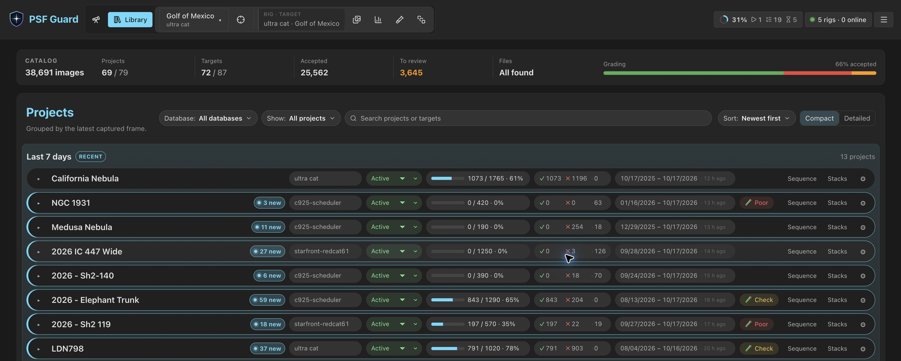 | 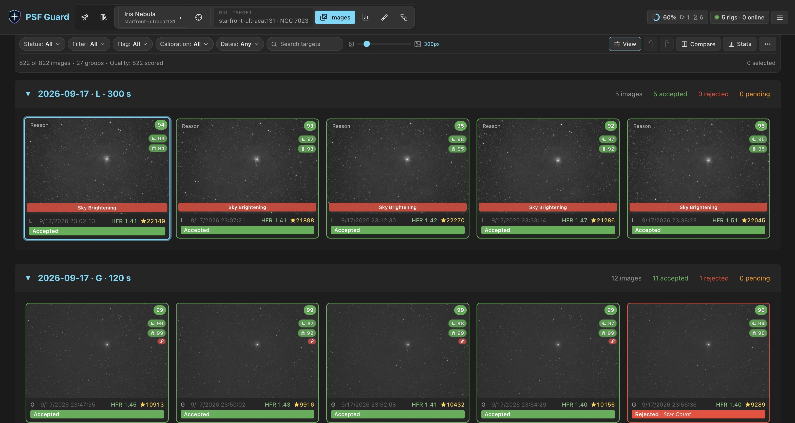 | 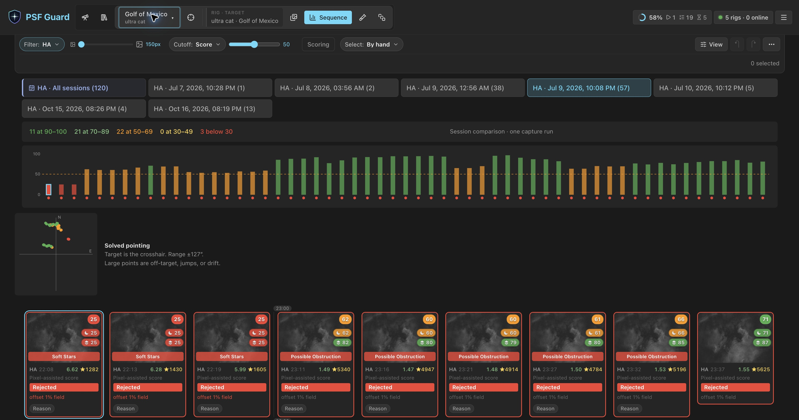 |
| Project progress and grades | Filters and batch grading | Scores and findings across a night |

Use arrow keys to move between frames and `Space` to select them. Preview
loads and refreshes preserve your position. **View → Sort** controls the
order; a dot marks frames captured since your last visit from the Library.
See [image order and new frames](docs/SCREENING.md#order-and-new-frames).
Open **Compare** to inspect selected frames with synchronized zoom.

<details>
<summary>Responsive grid layout</summary>

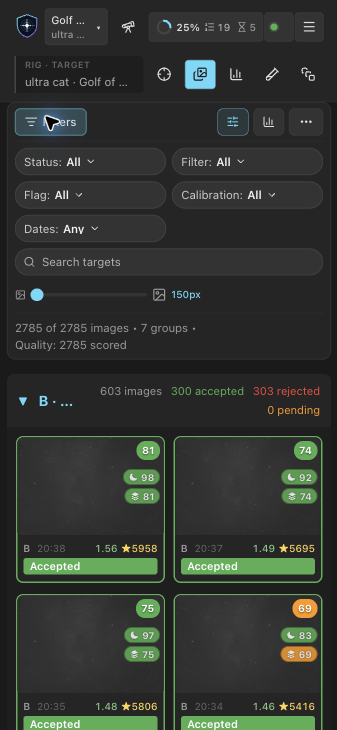

</details>

### Build an image catalog from image folders

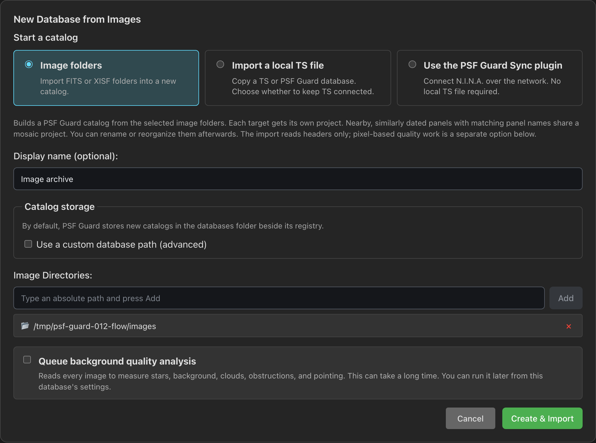

PSF Guard reads `.fits`, `.fit`, `.fts`, and `.xisf` files. It groups lights
into projects and targets and derives exposure plans from their headers.
Calibration frames go into a separate library in the same catalog.

Import progress remains available after you close Settings or reload the page.
Use **Analyze Missing Quality** to fill missing measurements, or **Rescan All
Quality** to repeat the analysis. See [importing and planning](docs/IMPORTING.md)
for grouping rules, scan settings, and database edits.

### See the evidence behind a quality decision

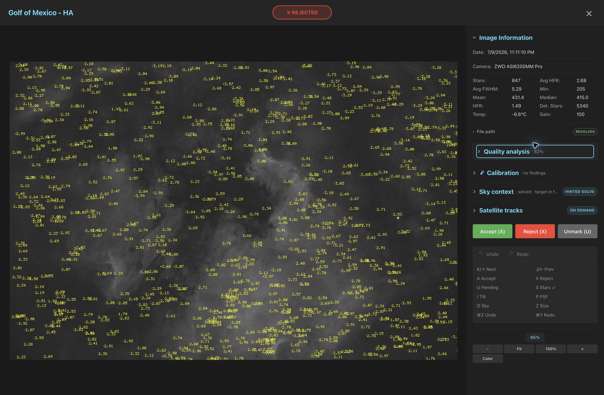

Sequence combines image statistics, spatial and photometric measurements,
fresh plate solves, and cached satellite evidence. Review the findings before
applying a grade. Missing optional evidence does not count as a failure.
Star overlays show measurements from the pixels; imported capture statistics
can differ. Open the PSF view to inspect Gaussian and Moffat fits.

### Preview a stack without leaving the grader

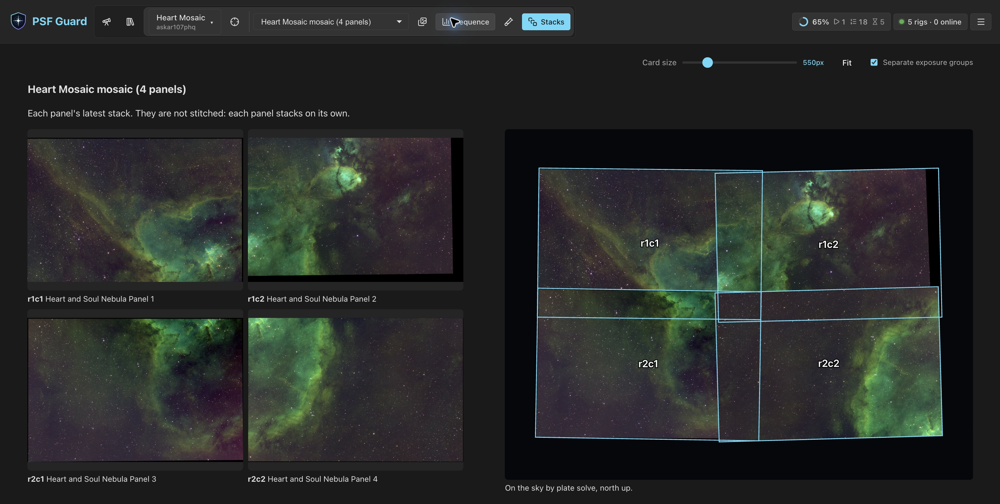

Each Heart Mosaic panel has its own stack; the sky view places the panels by
their solves without stitching them. Inspect a stack at full size, or review
the saved quality exclusions, registration matches and residuals.

### Combine real narrowband channel stacks

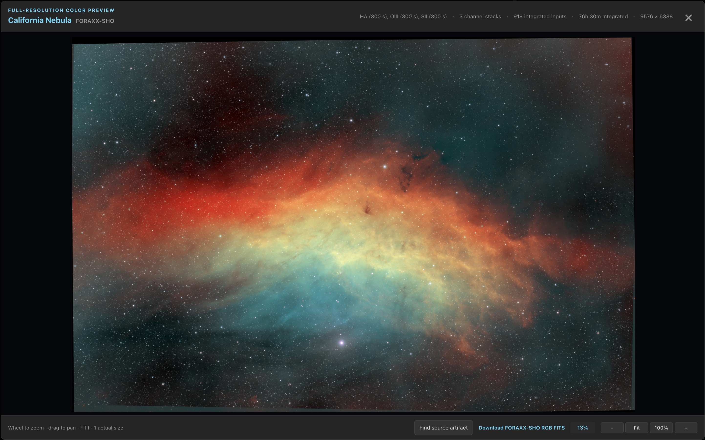

This cached California Nebula preview combines H-alpha, OIII and SII channel
stacks, with 918 inputs and 76 h 30 m of integration. It includes saved
processing with optional RC-Astro tools. Recombine the same channel stacks as
SHO, Foraxx SHO, or another compatible palette without repeating integration.

Inspect background fits, adjust each channel's processing, and download a
processed RGB FITS file. See [stack previews](docs/STACKING_PREVIEWS.md) for
processing controls and saved results.

## 📦 Installation

### Desktop app (Windows / macOS / Linux)

Download the installer for your platform from the
[latest release](https://github.com/theatrus/psf-guard/releases/latest).

| Platform | Asset |
|---|---|
| Windows x64 | `PSF.Guard_<version>_x64_en-US.msi` or the `-setup.exe` installer |
| macOS (Apple Silicon) | `PSF.Guard_<version>_aarch64.dmg` |
| Linux x64 | `PSF.Guard_<version>_amd64.deb` or `.AppImage` |

Install and launch the app, then import your images or open an existing
catalog. The Windows NSIS installer (`-setup.exe`) also installs
`psf-guard-cli.exe` and adds it to your user `PATH`.

**Settings → Open logs** opens the daily log folder. Logs include stack
exclusions and their reasons; the app keeps seven days.

| Platform | Log folder |
|---|---|
| Windows | `%LOCALAPPDATA%\com.theatrus.psf-guard\logs` |
| macOS | `~/Library/Logs/com.theatrus.psf-guard` |
| Linux | `~/.local/share/com.theatrus.psf-guard/logs` |

Use **Settings → Server → Fixed port** if a browser, API client, or MCP
client needs a stable localhost address. Save the port and restart the
server from that panel. **Automatic**, the default, chooses a free port at
startup. A fixed-port conflict opens the Server controls so you can choose
another port. Standalone servers use `--port` or `[server].port` instead.

#### Resize the desktop UI

Open the hamburger menu and choose **Zoom in**, **Zoom out** or **Reset to 100%**.
Use Cmd on macOS or Ctrl on Windows and Linux with +, − or 0 for the same actions,
including while Settings is open. The desktop app changes the whole UI in 10%
steps from 50% to 200% and saves the scale on this device. Image zoom has separate
controls. In a browser, use the browser's zoom controls.

### Docker (Linux servers / NAS)

Create a persistent data volume and the first editor account before starting
a server with database management enabled:

```bash
docker volume create psf-guard-data
docker run --rm -it \
  -v psf-guard-data:/data \
  ghcr.io/theatrus/psf-guard:latest \
  users add admin --role read-write

docker run -d --name psf-guard -p 3000:3000 \
  -v psf-guard-data:/data \
  -v /path/to/images:/images:ro \
  ghcr.io/theatrus/psf-guard:latest \
  server --allow-database-management
```

Open `http://localhost:3000/` on the host, or the server's address from
another computer, and sign in. Create a catalog under **Settings →
Databases**, using `/images` as the image folder. The management option
allows signed-in editors to configure paths and catalogs on the server.

The `/data` volume stores settings, accounts, catalogs created in the UI,
previews, stacks, calibration masters, and downloaded Seiza catalogs. Keep
it when replacing the container. A host folder also works if user 1000 can
write it. Mount image folders writable only when you need uploads or file
moves. For remote N.I.N.A. pairing, provide an HTTPS address through your
reverse proxy.

To open an existing database instead, mount its file writable and pass its
container path to `server`. The supplied
[`docker-compose.yml`](docker-compose.yml) shows that setup; it starts
without database management enabled.

The `latest` tag follows releases; `edge` follows unreleased work on `main`.
Use a version tag to pin a release. For configuration files, authentication,
and API access, see [Configuration](#configuration) and
[server authentication](docs/AUTHENTICATION.md).

### Standalone CLI binaries

These links download the latest release:

| Platform | Download |
|---|---|
| Linux x64 | [`psf-guard-linux-x64`](https://github.com/theatrus/psf-guard/releases/latest/download/psf-guard-linux-x64) |
| macOS (Apple Silicon) | [`psf-guard-macos-arm64`](https://github.com/theatrus/psf-guard/releases/latest/download/psf-guard-macos-arm64) |
| Windows x64 | [`psf-guard-windows-x64.exe`](https://github.com/theatrus/psf-guard/releases/latest/download/psf-guard-windows-x64.exe) |

For a local browser session, start with an empty registry or the catalogs
already registered on that machine:

```bash
# Linux; use the macOS binary name on macOS.
chmod +x psf-guard-linux-x64
./psf-guard-linux-x64 server --host 127.0.0.1 --allow-database-management
```

```bat
:: Windows
psf-guard-windows-x64.exe server --host 127.0.0.1 --allow-database-management
```

Open `http://localhost:3000/` and add a catalog in Settings. To serve other
computers, create an account with `psf-guard users add admin --role read-write`
before starting on a network address. See [server authentication](docs/AUTHENTICATION.md).

PSF Guard checks release notices without sending catalog or image data.
Desktop builds can install signed updates. See [app and server updates](docs/UPDATES.md).

### Fedora RPM

Download the Fedora RPM from the
[releases page](https://github.com/theatrus/psf-guard/releases/latest). Install
the package built for your Fedora version; for example:

```bash
sudo dnf install ./psf-guard-*.fc44.x86_64.rpm
```

The package installs the CLI/server plus a `psf-guard.service` systemd unit
for running the PSF Guard server as a daemon.

Native RPMs build with standard tooling (`rpmbuild`, `mock`, COPR) and need no
network access after the sources have been prepared:

```bash
sudo dnf install -y rpm-build rpmdevtools cargo rust nodejs npm git
rpmdev-setuptree
./scripts/make-rpm-sources.sh                  # builds frontend + vendors crates
rpmbuild -ba packaging/rpm/psf-guard.spec      # writes RPMs to ~/rpmbuild/RPMS/
```

See [`packaging/rpm/README.md`](packaging/rpm/README.md) for mock builds and
release steps.

### Build from source

```bash
git clone https://github.com/theatrus/psf-guard.git
cd psf-guard
cargo build --release
./target/release/psf-guard server --host 127.0.0.1 --allow-database-management
```

Install the Rust toolchain pinned in `rust-toolchain.toml` and Node.js
24.15 or later in the 24 series (or Node.js 26+) with npm. The build embeds
the React frontend. Image processing uses the pure-Rust
[`seiza-imgproc`](https://github.com/theatrus/seiza) crate, so no native
computer-vision libraries are required.

## 🖼️ The grader UI

The desktop app and web server provide the same review tools. Start in the
**Library**, choose a project, and open **Images**, **Sequence**, or **Stacks**.

- **Images:** filter and group frames, compare selections, and accept, reject,
  or unmark them. Shift+Click selects a range; Ctrl/Cmd+Click toggles one frame.
- **Sequence:** review scores and evidence across an observing session. Select
  frames by score, HFR, star count, or a quality finding before grading them.
- **Stacks:** build a calibrated preview for a target and channel, or send a
  selection from Images with **Stack selected**. Inspect exclusions and
  registration results, then combine channels in color. WBPP master lights
  also appear here.
- **Image details:** inspect measurements and the file path. Copy the path or
  choose **Show in folder** in the desktop app. Inspect sensor tilt and field
  curvature with 1:1 corner crops and star measurements across a 3×3 grid.

On phones, the header hides as you scroll down and returns when you scroll
up. Image details have a bottom bar for grading and navigation. Open the
Images or Sequence toolbar menu for Undo and Redo, or **Options** in Stacks
for build settings. Side-by-side comparison is hidden from the phone toolbar.

Previews load in the background and preserve your scroll position. Grading
supports undo and redo. These shortcuts apply where the corresponding tool
is available:

| Key | Action | Key | Action |
|---|---|---|---|
| K / → | Next image | A | Accept |
| J / ← | Previous image | X | Reject |
| ↑ / ↓ | Nearest grid row | Space | Toggle selection |
| Enter | Open image | C | Compare in Images |
| Esc | Clear selection / close | U | Unmark |
| S | Stars overlay | O | Solve / sky overlay |
| T | Predict / satellite tracks | P | PSF view |
| + / − | Zoom | Ctrl+Z | Undo |
| Ctrl+Y | Redo | | |

Grades update the active catalog. When that catalog belongs to Target
Scheduler, or you sync grades back to it, the scheduler can update accepted
counts and replace rejected exposures. See [quality screening](docs/SCREENING.md)
and [stack previews](docs/STACKING_PREVIEWS.md).

<a id="planning"></a>
## Planning and mosaics

Plans live in the **Library** alongside their captured projects. **New plan**
starts a target before any frames exist; **Planning** opens an existing
project's workspace. One plan can use several rigs and sites, with a shared
framing or a separate framing for each rig.

### Frame targets and mosaic panels

Search for a target or enter coordinates in **Framing**. Place the camera's
field over a survey image, adjust its angle, and check tonight's visibility
against the rig's site and horizon. Rig setup includes optics, sensor size,
pixel scale, camera angle, and a planning site. Sites can use N.I.N.A. `.hrz`
horizon files.

Add, move, rotate, or remove individual mosaic panels. Check neighboring
panels against the minimum overlap, use snapping, and undo framing edits.
Panels with captured frames start locked at their recorded fields. Unlock a
panel only when you intend to change it. Assign different panels to different
rigs, such as a wide-field rig for the whole target and a longer telescope
for selected regions.

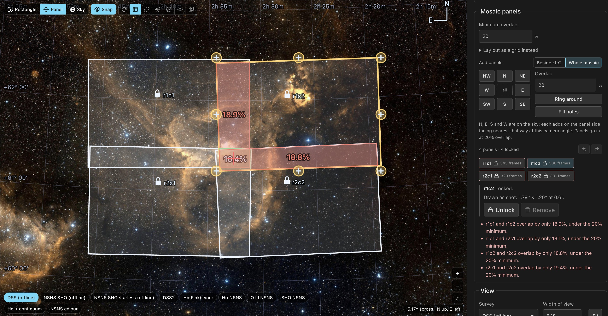

This Heart Mosaic capture keeps all four panels locked. Measured overlaps
range from 18.1% to 19.4%, below the saved 20% minimum; the warning list shows
which joins need review.

### Set exposure goals and scheduling limits

Under **Exposures**, add objectives by bandpass and purpose: faint detail or
unsaturated stars. Set a goal in accepted hours or accepted frames. Each rig
can use its own exposure length, template, goal, and panel selection. The
coverage check identifies a band or panel that no rig covers.

Choose templates from the rig's Target Scheduler database or the shared
**Settings → Exposure templates** library. Templates keep filter, gain,
offset, binning, and readout settings together. Set site and rig details under
**Settings → Rigs**. In the workspace, **Rigs** shows scheduling limits and
where each inherited value comes from; **Priority and defaults** sets project
order and defaults. Limits include altitude, horizon, meridian window,
filter switching, and dithering. Exposure templates can also set Moon rules.

### Review and activate

Saving a plan keeps a draft. **Activate…** previews what each rig's Target
Scheduler project will run, turn off, or restore. Activation enables the
plan's exposure rows and disables other exposure plans in that project;
existing frames and acquisition counts stay intact. Use **Take Target
Scheduler's values** before activation if you want to keep extra exposure
plans made in N.I.N.A.

For an imported TS catalog, the preview shows the saved TS destination.
Activation writes the owned catalog, then delivers the reviewed planning to
TS. A failed delivery stays pending and can retry through the saved sync
settings. Rigs at another PSF Guard site can receive planning through a Sync
peer. Activation updates planning; Target Scheduler runs the imaging session.

See [framing](docs/DIRECTOR.md#framing-view),
[mosaic panels](docs/DIRECTOR.md#mosaic-panels),
[exposure goals](docs/DIRECTOR.md#acquisition-plan), and
[activation](docs/DIRECTOR.md#activation) for the full rules.

<a id="calibration"></a>
## Calibration frames, flat groups, and masters

Open **Calibration** from a project's review view to see the calibration it
uses, or open it from the Library to browse the rig's whole library.
**Frames** groups bias, dark, dark-flat, and flat frames by session or flat
group. **Masters** shows generated masters, their source frames, and the
projects that use them.

Frame grades report measurements such as clipping, noise, uneven illumination,
stray light, and dust changes. Poor frames stay out of masters by default.
Use **Keep out** to exclude a frame through later regrades, **Use anyway** to
override its grade, or **Clear** to return to automatic grading. These choices
change which frames masters and exports use; they do not alter the raw files.

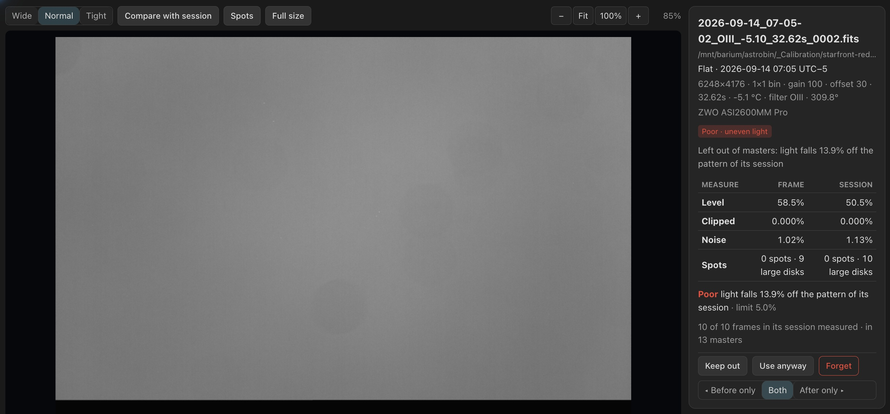

This flat has no clipped pixels, but its illumination differs from its
session by 13.9%, above the 5% limit. PSF Guard excludes it from masters.

Flat groups compare measured illumination and dust patterns across nights
and rotator angles. Compare groups to inspect a change, split or join a group,
or choose which side of a change supplies a light's flats. A recorded angle
alone does not prove that two sets of flats match.

A light's **Calibration** panel explains the matched inputs and any gaps.
Project coverage reports show affected lights before you build or export.
PSF Guard tracks master inputs and rebuilds dependent results when those
inputs change. Duplicate checks can merge duplicate records without deleting
source files.

See [calibration libraries](docs/CALIBRATION_LIBRARY.md),
[flat groups](docs/CALIBRATION_LIBRARY.md#flat-groups), and
[frame grades](docs/CALIBRATION_LIBRARY.md#frame-grades).

<a id="stack-processing"></a>
## Stack and process images

Open **Stacks** for a target and channel, or use **Stack selected** in Images.
PSF Guard matches calibration masters, registers frames, and integrates
eligible inputs. By default, Accepted and usable Pending frames can join a
stack; **Accepted only** leaves Pending frames out. Inspect admission
decisions, rejected regions, and source frames when you find an artifact. The SNR curve shows how the result changes
as more exposures join the stack.

Combine channels as RGB, LRGB, or narrowband color, including SHO and Foraxx
SHO. Adjust background extraction and channel processing, then download a
linear or processed FITS result. OSC files with a recognized `BAYERPAT`
header also support color previews.

**View processing** offers display stretches and optional Seiza deconvolution.
**Median anchor** and **Layered** join Auto MTF, which stays the default.
Install the optional **Gaia colors** package under **Settings → Catalogs** to
calibrate RGB, LRGB, and OSC stack colors against stars. The result shows the
calibration's star count and gains, or why calibration could not run.

With a licensed standalone RC-Astro CLI on the server, processing also offers
BlurXTerminator, NoiseXTerminator, and StarXTerminator. Star removal keeps
both the stars and starless results. Processing runs show queue position and
progress, support Stop, and can resume after a restart. Saved processing
choices remain available when a stack rebuilds.

See [stack methods, processing, and downloads](docs/STACKING_PREVIEWS.md) or
[run PixInsight WBPP](#wbpp) with the same calibration
choices.

<a id="background-jobs"></a>
## Follow background work

Open the header's jobs chip to see running, queued, waiting, and
needs-attention work. The list separates **Started by you** from **Automatic**
and shows progress and queue positions. A waiting job explains what it is
waiting for. Stack builds, quality scans, flat measuring, catalog installs,
backups, transfers, and WBPP copies report here.

Work you start takes priority over automatic analysis and preview generation.
Use Stop, queue controls, or transfer Pause and Retry where the job offers
them. **Move to top** makes a queued stack, processing or WBPP task run next
after the current task finishes. A task waiting for review stays visible until
you address it. Configure
processor shares under **Settings → Performance**. See the
[background job guide](docs/design/background-jobs.md) for priority and
restart behavior.

## 🗺️ Sky coverage map

Open **Sky** to see targets from all registered catalogs on a flat sky map
or a globe. Fields use plate solves when available and image headers
otherwise. Color shows the filter mix; brightness shows exposure time.

Hover over a field for hours, filters, and nights, or click it to open the
target in Images. Zoom in to see stack previews. Use the timeline to filter
observing nights and replay how your coverage grew.

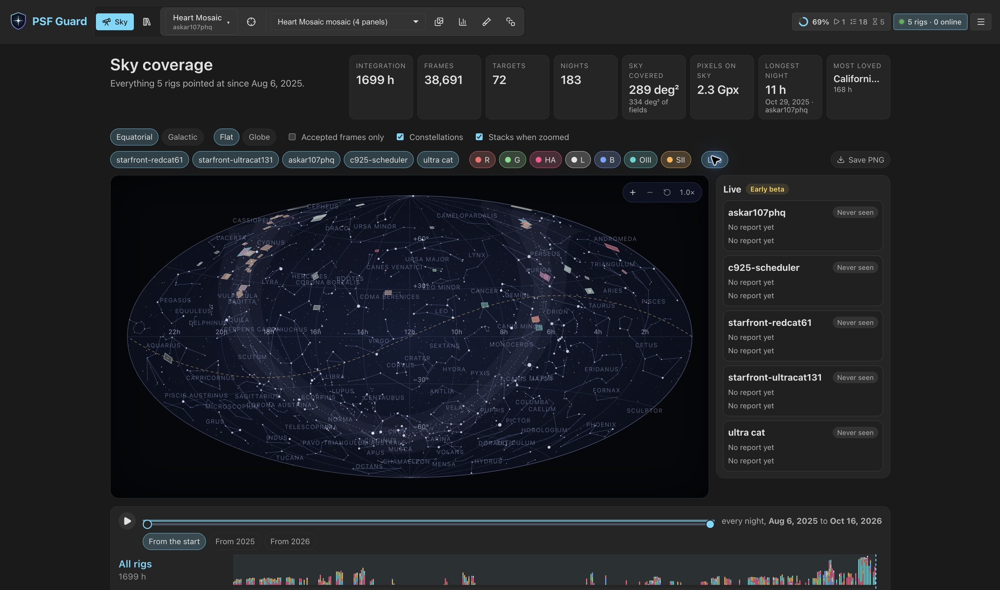

See [sky coverage](docs/SKY_COVERAGE.md) for field placement, observing-night
rules, and the totals shown on the map.

<a id="sky-context-plate-solving-and-overlays"></a>
## 🌌 Sky context, plate solving, and overlays

The **Sky context** panel shows the image's header coordinates and catalog
target. With `objects.bin` installed, it lists objects expected nearby.
Those coordinates do not prove what the pixels contain.

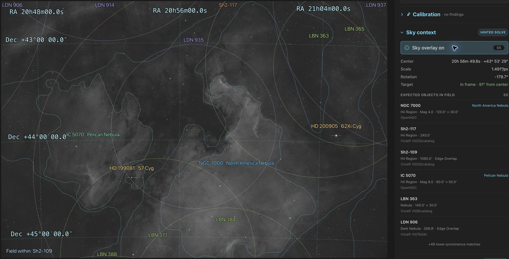

A supported TAN WCS in the file enables an overlay immediately. To solve the
pixels, choose **Solve field** or press `O`. PSF Guard tries the pointing
hint and pixel scale first, then a blind solve if the required index is
installed. A successful solve reports the center, scale, and target offset.
Press `O` again to toggle the overlay.

### Install the Seiza catalogs

PSF Guard includes the Seiza solver, but its star catalogs require a separate
download. Open **Settings → Catalogs** to install, update, or validate them.
Choose **Blind solving** for the usual setup. Browser access to these
controls requires an editor and `--allow-database-management`.

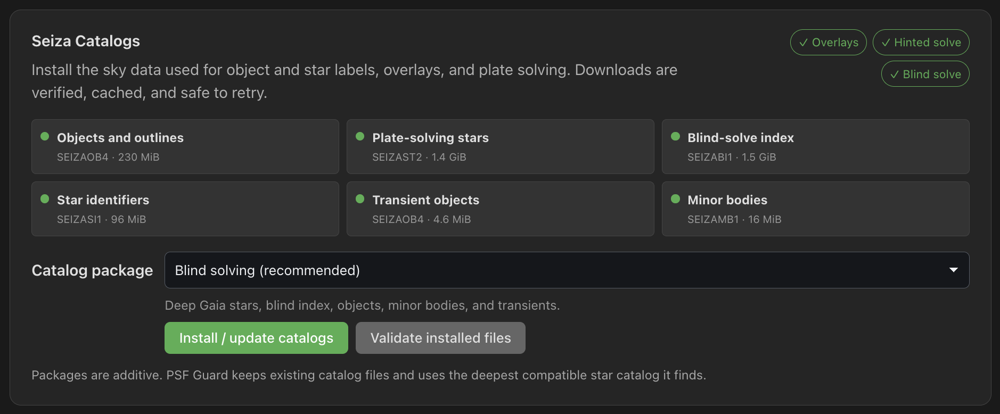

For a headless installation, use the Seiza CLI from the
[Seiza releases](https://github.com/theatrus/seiza/releases):

```bash
# Choose a bundle and install it in Seiza's standard catalog directory.
seiza setup

# Or choose the destination explicitly.
seiza download-data prebuilt --output /path/to/seiza-data
```

PSF Guard finds Seiza's standard catalog directory automatically. To use
another location, set `SEIZA_CATALOG_DIR` or the `astrometry.data_dir` field
in the [database registry](#databases-the-registry), then restart PSF Guard.
Downloads are versioned and verified with SHA-256.

In Docker, Settings installs catalogs under `/data/seiza` on the persistent
data volume. To use an existing download, add these options to `docker run`:

```bash
-e SEIZA_CATALOG_DIR=/catalogs \
-v /path/to/seiza-data:/catalogs:ro
```

| File | Purpose |
|---|---|
| `objects.bin` | Object matches from coordinates, plus solved labels and outlines |
| `stars-lite-tycho2.bin`, `stars-gaia.bin`, or `stars-deep-gaia17.bin` | Hinted solving; Seiza uses the deepest installed catalog |
| `blind-gaia16.idx` | Blind solving when pointing hints are missing or wrong |

The blind index normally sits beside the star catalog. Override its path
with `astrometry.blind_index` or `SEIZA_BLIND_INDEX` when needed.

Check catalog discovery and validate installed files through the API:

```bash
curl http://localhost:3000/api/astrometry/capabilities
curl -X POST http://localhost:3000/api/astrometry/catalogs/validate
```

For a server with accounts, include an API token as described under
[REST API](#rest-api). Validation reads each catalog file and can take time.
Solves are cached per database and invalidated when the source image,
relevant catalogs, or solver version changes. See
[astrometry quality](docs/ASTROMETRY_QUALITY.md).

### Satellite track identifiers and bright-trail risk

Open **Satellite tracks** and choose **Identify satellite tracks**, or press
`T`. PSF Guard solves the image if needed, predicts crossings during the
exposure, and checks the pixels for trails near those paths.

Dashed paths show orbital predictions; solid green paths show detected
trails. A satellite name is a candidate identification. A prediction alone
does not lower a score or recommend rejection. A pixel-aligned trail can
trigger a warning or rejection recommendation for review.

Prediction needs an exposure time and observing site in the header.
User-triggered predictions and quality scans can fetch satellite elements.
Opening Sequence or running `screen-fits --regrade-db` uses cached elements
and does not download them. Bright-trail risk describes geometry and
illumination, not apparent magnitude.

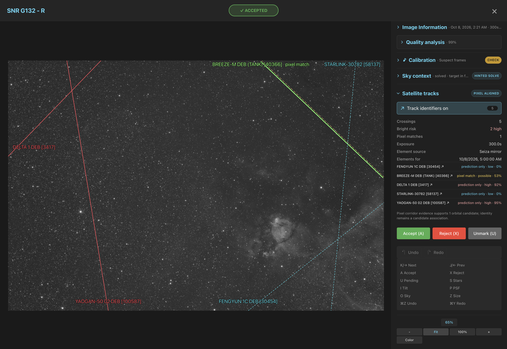

This SNR G132 frame has one pixel match among five predicted crossings. The
orbital identity remains a candidate; the frame's stored grade is Accepted.

See [satellite prediction](docs/SATELLITES.md) for header requirements, data
sources, score limits, and cache behavior.

## 🔍 Quality screening

PSF Guard checks for clouds, obstruction, stray light, pointing errors, and
tracking loss. Star count and HFR alone can miss these faults.

Choose a target and run **Analyze Quality** from Images or Sequence. Review
scores and the evidence for each finding, then select frames to grade. The
rejection review shows proposed changes before applying them.

Session scores compare frames within a capture run. Stack comparisons also
compare matching frames across nights and require at least three frames
across two sessions. The UI identifies frames without enough matches. A low
relative score alone does not diagnose damage or recommend rejection, and
stable framing offsets remain advisory.

Use **Analyze Missing Quality** or **Rescan All Quality** in database
settings for a background scan of the whole catalog. These jobs fill star,
spatial, photometric, and pointing measurements and report progress after
you close Settings. Star count and HFR use the N.I.N.A. Fast detector to
stay comparable with Target Scheduler measurements.

From the CLI, screen folders without a database or add `--regrade-db` to
check against catalog targets and preview grade changes:

```bash
psf-guard screen-fits "/path/to/LIGHT"
psf-guard screen-fits "/path/to/LIGHT" --annotate /tmp/diagnostics
psf-guard screen-fits "/path/to/LIGHT" --regrade-db my-db --dry-run
# After reviewing the preview, apply supported [Auto] rejections:
psf-guard screen-fits "/path/to/LIGHT" --regrade-db my-db
```

See [quality screening](docs/SCREENING.md) for measurements and tuning, and
[astrometry grading](docs/ASTROMETRY_QUALITY.md) for the evidence required
to recommend rejection.

## 📤 Export accepted frames for stacking

Choose **Export** on a Library project or target to export lights with
matched calibration frames. Use **Include ungraded lights** to control
whether pending frames are included. Rejected frames are excluded.

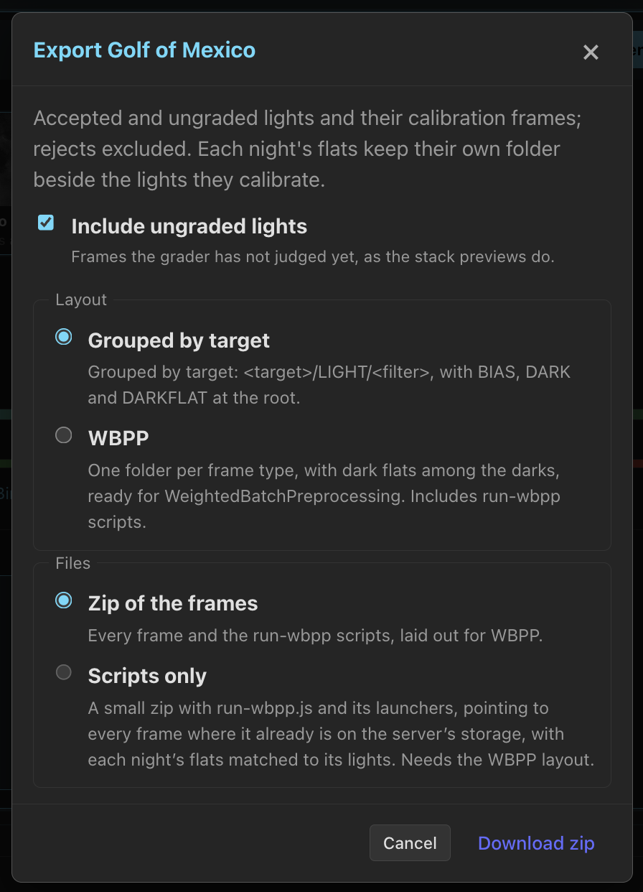

The desktop app can write to a chosen folder; a browser can download a ZIP.
Set a database's **Server export directory** to write exports on the server
as a background job. PSF Guard clones files when the filesystem supports it
and copies them otherwise.

Exports can group frames by target or use PixInsight WBPP's folder layout
with runner scripts. Matched calibration inputs include bias, dark,
dark-flat, and flat frames when suitable matches exist.

```bash
psf-guard export my-db --dest ./stacking --dry-run
psf-guard export my-db --dest ./stacking
```

See [calibration libraries](docs/CALIBRATION_LIBRARY.md) for matching rules
and [WBPP](docs/WBPP.md) for runner options.

## ☆ Acquisition list for AstroBin

Choose **AstroBin** on a project or target to export a CSV with one row per
night, filter, and exposure length. **Essentials** includes the four required
columns. **Full** adds capture settings, temperatures, and matched calibration
frame counts.

Preview the rows, assign any missing AstroBin filter IDs, then download or
copy the CSV. Each catalog saves its filter map. Use date ranges when a rig
used different physical filters under the same filter name.

```bash
psf-guard astrobin-csv my-db --target-id 12 --detail full -o ngc7023.csv
```

See [AstroBin acquisition export](docs/ASTROBIN_EXPORT.md) for row grouping
and filter mapping.

<a id="wbpp"></a>
## ⚗ Stack in WBPP from the Library

Set the PixInsight path under **Settings → Setups → PixInsight**, then
choose **Stack in WBPP** on a Library project. PSF Guard runs
WeightedBatchPreprocessing on the server using the source files and matched
calibration frames. On a server without a display, it uses `xvfb-run`.

Choose a quality preset, Fast Integration, drizzle, autocrop, and light
rejection settings. Fast Integration is off by default; WBPP otherwise uses
it automatically for groups of 150 or more frames. WBPP exports include
runner scripts with the same options.

The run dialog shows the log and progress. Download completed masters or
use the master lights in a PSF Guard color composition. See
[WBPP runs](docs/WBPP.md) and [calibration libraries](docs/CALIBRATION_LIBRARY.md).

With a licensed standalone `rc-astro` CLI on the server, you can also apply
BlurXTerminator, NoiseXTerminator, and StarXTerminator to stacks. Star removal
saves separate starless and stars results, each with its own stretch and FITS
download. See [stack processing](docs/STACKING_PREVIEWS.md#reversible-view-processing).

## 🗂️ Managing rejected files

To remove rejected frames from a catalog, open **Settings → Databases →
Purge Rejects**. Preview the selection before applying it. PSF Guard moves
files to `.psf-guard-trash` and saves the records needed to restore them.
**Restore** recovers a removal batch while its files remain in the trash;
**Empty trash** deletes files after their retention period.

The CLI offers the same removal workflow:

```bash
psf-guard remove-rejects --db my-db --cache-dir ./cache            # preview
psf-guard remove-rejects --db my-db --cache-dir ./cache --apply    # remove
psf-guard list-removed --db my-db
psf-guard restore-removed --db my-db --batch <batch-id>
psf-guard empty-reject-trash --db my-db
psf-guard purge-removed --db my-db
```

Use the server's cache root for `--cache-dir`. By default, removal requires
a rejection at least seven days old, and trash retention is 14 days.
Frames in a collaboration report remain in the catalog. Imports, sync, and
uploads do not restore removed frames. See
[reject removal](docs/design/reject-removal.md) for retention and recovery.

To move rejected files out of a stacking folder while keeping their catalog
records, use the separate archive commands:

```bash
psf-guard move-rejects --db my-db --dry-run
psf-guard move-rejects --db my-db
# After changing a frame's grade, restore it from the archive:
psf-guard restore-rejects --db my-db
# Or restore every archived frame:
psf-guard restore-rejects --db my-db --all
```

Archive moves include sidecars and record each source path. Restore never
overwrites an existing file. See [reject archives](docs/design/reject-archive.md).

<a id="syncing-between-machines"></a>
## 🔄 Syncing between machines

For a N.I.N.A. rig, start with [PSF Guard Sync](#connect-nina). Use the
workflows below when transferring between database files or PSF Guard
servers. No sync is needed when both tools open the same database.

### Transfer between database files

Open **Settings → Sync**, choose the source and destination, then preview a
merge, planning update, or grade transfer before **Apply**. The preview
survives a page reload and refuses to apply if the destination changed.
Pending grades are excluded from the UI grade push by default.

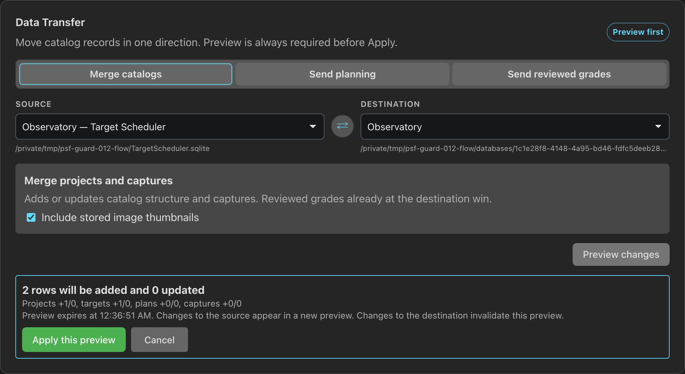

The CLI accepts registered database slugs or SQLite paths. Back up both
catalogs before the first transfer:

```bash
# Pull projects and captures from the telescope; preserve local grading.
psf-guard sync pull --from telescope.sqlite --to my-db --dry-run

# Push planning fields without changing telescope captures or grades.
psf-guard sync planning --from my-db --to telescope.sqlite --dry-run

# Push grades; the source grade wins.
psf-guard sync grades --from my-db --to telescope.sqlite --dry-run
```

Remove `--dry-run` to apply. Records match by GUID and need Target Scheduler
schema 22 or later. Each command opens the source read-only and applies
changes in one transaction. Use `--project` to limit scope; grade transfers
also support `--target` and `--status`.

### Transfer between PSF Guard servers

Under **Settings → Sync → Remote PSF Guard**, add the peer URL and its
manual API key, test the connection, then preview and apply a transfer.
In the receiving catalog's editor, generate a **Remote API key** and enable
**Accept remote scheduler sync**. Enable
**Accept remote image uploads** separately if the client will send files.

```bash
psf-guard sync remote --direction pull \
  --local review --peer https://telescope.example:3000 --token-file key.txt
```

Directions are `pull`, `push-planning`, and `push-grades`. All preview before
applying; add `--dry-run` to stop at the preview. Supply the key through
`--token-file` or `PSF_GUARD_SYNC_TOKEN`. The `--token` argument is also
supported, but command arguments may be visible to other processes.

For a deployment configured from the command line, set the grants in TOML:

```toml
[[remote_sync]]
database = "telescope"
token_file = "/run/secrets/psf-guard-key"

[[remote_upload]]
database = "telescope"
image_dir = "/data/incoming"
placement = "target_tree"  # optional; default is "flat"
token_file = "/run/secrets/psf-guard-key"
```

These grants apply at startup to an already registered catalog. They do not
require `--allow-database-management`. Each catalog has one manual key;
paired N.I.N.A. clients have separate credentials. The server records remote
sync actions in `remote-sync-audit.jsonl` under the cache directory.

See the [data-transfer protocol](docs/design/data-transfer.md) for snapshots,
previews, uploads, and identity checks, and the
[N.I.N.A. Sync guide](https://psf-guard.com/docs/sync-plugin.html) for plugin setup.

<a id="collaboration"></a>
## Collaboration and live rigs (early beta)

Under **Settings → Rigs → Setup → Collaboration**, connect a Starfront server,
browse compatible projects, and review assigned work before importing a draft.
A collaboration assignment becomes an ordinary plan that you can inspect and
activate. Joining a project does not start capture.

From **Reports**, report accepted work and upload accepted raw lights with
matched calibration, or an existing PSF Guard or WBPP stack. File delivery and
contribution reports are separate actions. Transfers show progress, Pause,
Resume, Retry, and Cancel, and retain completed-file receipts across restarts.
Automatic assignment pulls and file uploads require their own opt-in settings.

The separate N.I.N.A. Director plugin can report live rig status and run
approved capture programs. The header's **Live** chip opens rig status on the
Sky. Director pairing and capture automation remain early beta; pairing alone
does not authorize acquisition. Planning with Target Scheduler and PSF Guard
Sync remains available without Director. See
[Director and collaboration](docs/DIRECTOR.md) for setup and current limits.

<a id="agents"></a>
## Work through an agent

The desktop app and server expose MCP at `/api/mcp`. An agent can inspect
catalogs, quality evidence, calibration matches, plans, and background jobs.
With write access it can grade frames, start scans and WBPP, manage flat-group
choices, or create backups.

Use **Settings → Agents** on a local instance, or **Settings → Users → API
tokens → Connect an agent** on a server with accounts. Read-only tokens can
inspect results; write tools use the same account permissions and database
management checks as the UI. See [MCP setup and tools](docs/MCP.md) for Codex,
Claude Code, and other MCP clients.

<a id="cli-reference"></a>
## ⌨️ CLI reference

Run `psf-guard --help` for the command list and `psf-guard <command> --help`
for options. Square brackets below indicate optional arguments; replace
angle-bracketed placeholders before running a command.

Common commands:

```bash
# Serve the grader UI (registers the DB in the shared registry on first run)
psf-guard server <database> <image-dirs...> [--port 3000]
psf-guard server --config psf-guard.toml            # server configuration
psf-guard server --registry /tmp/scratch.json <db> <dirs...>  # separate registry
psf-guard server --host 127.0.0.1 <db> <dirs...>    # localhost only (default binds 0.0.0.0)

# Quality screening; --regrade-db also enables astrometry quality analysis
psf-guard screen-fits ./lights --annotate ./diagnostics
psf-guard screen-fits ./lights --regrade-db my-db --dry-run
psf-guard screen-fits ./lights --format json         # or table, csv

# Create and register a catalog from FITS or XISF image folders
psf-guard create-db new.sqlite ./lights1 ./lights2 [--name "My Rig"] [--dry-run]
# Add frames to matching targets by name or coordinates. Only unmatched
# frames create projects. Preview with --dry-run first.
psf-guard import <slug-or-path> ./more-lights [--dry-run] [--no-attach]
psf-guard remove-imported <slug-or-path> [--dry-run]  # undo an import's projects

# Export accepted lights and matched calibration frames.
# Add --layout wbpp for WBPP folders and runner scripts.
psf-guard export <slug-or-path> --dest ./stacking [--include-pending]
psf-guard export my-db --dest ./stacking --target "M 31" --link  # hardlinks

# Reject archival
psf-guard move-rejects --db <slug> [--dry-run] [--project NAME] [--target NAME]
psf-guard restore-rejects --db <slug> [--all] [--image-id N] [--dry-run]
psf-guard remove-rejects --db <slug> [--days 7] [--project-id N] [--target-id N] [--apply]
psf-guard restore-removed --db <slug> (--batch ID | --guid GUID...)
psf-guard list-removed --db <slug>
psf-guard empty-reject-trash --db <slug>
psf-guard purge-removed --db <slug> [--batch ID]

# Two-database sync (see "Syncing between machines" above)
psf-guard sync pull --from telescope.sqlite --to my-db
psf-guard sync planning --from my-db --to telescope.sqlite
psf-guard sync grades --from my-db --to telescope.sqlite

# Star detection & PSF analysis
psf-guard analyze-fits image.fits [--detector nina|hocusfocus] [--compare-all]
psf-guard annotate-stars image.fits [--max-stars 50]
psf-guard visualize-psf image.fits [--star-index N]  # single-star fit residuals
psf-guard visualize-psf-multi image.fits [--num-stars 25]
psf-guard benchmark-psf image.fits                   # PSF fitting performance

# FITS utilities
psf-guard stretch-to-png image.fits -o output.png   # MTF auto-stretch
psf-guard read-fits image.fits                      # header/metadata dump

# Database queries & manual grading
psf-guard -d database.sqlite list-projects
psf-guard -d database.sqlite list-targets "Project Name"
psf-guard -d database.sqlite dump-grading [--project NAME]
psf-guard -d database.sqlite show-images <IDS>
psf-guard -d database.sqlite update-grade <ID> rejected
psf-guard regrade database.sqlite [--dry-run]        # statistical re-grading
psf-guard -d database.sqlite fill-guids [--dry-run]  # GUIDs Target Scheduler's upgrade skipped
```

Batch commands also support statistical outlier detection
(`--enable-statistical`): per-target/filter HFR and star-count distribution
analysis plus sequence-based cloud detection. Details in
[docs/STATISTICAL_GRADING.md](docs/STATISTICAL_GRADING.md).

<a id="configuration"></a>
## ⚙️ Configuration

Most desktop users can manage databases in Settings and do not need to edit
the registry or server TOML. The settings below are for server and API setups.

### Databases: the registry

PSF Guard stores its list of image catalogs in a JSON registry. Each
catalog uses the Target Scheduler database structure. The registry is
separate from the server TOML:

| Platform | Registry path |
|----------|---------------|
| Windows | `%APPDATA%\psf-guard\config.json` |
| macOS | `~/Library/Application Support/psf-guard/config.json` |
| Linux | `~/.config/psf-guard/config.json` |

`psf-guard server <db> <dirs...>` **registers** that database on first run and
reuses it afterwards. Manage the list in **Settings → Databases** or through
`/api/databases`; a standalone server needs `--allow-database-management`
for those controls. Pass `--registry /tmp/scratch.json` to use a separate
registry for testing.

The default N.I.N.A. scheduler database on Windows lives at
`%LOCALAPPDATA%\NINA\SchedulerPlugin\schedulerdb.sqlite`.

### Seiza catalogs and plate solving

See [Sky context, plate solving, and overlays](#sky-context-plate-solving-and-overlays)
for installation, Docker setup, resource roles, and UI usage. PSF Guard uses
Seiza's standard catalog discovery; a complete catalog bundle can also be
selected explicitly with the top-level `astrometry.data_dir` in the JSON
registry:

```json
{
  "schema_version": 2,
  "databases": [],
  "astrometry": { "data_dir": "/var/lib/psf-guard/catalog" }
}
```

`objects.bin` enables coordinate-only object association. A star tile catalog
enables hinted solving; the blind pattern index adds fallback solving when the
pointing hint is absent or stale. Successful pixel-derived solutions live at
`<cache>/<db-slug>/astrometry/<image-id>.json` and are invalidated when the
source image or relevant catalog changes.

<a id="server-knobs-the-toml"></a>
### Server settings: the TOML

```bash
cp psf-guard.toml.example psf-guard.toml
psf-guard server --config psf-guard.toml
```

```toml
[server]
port = 3000
host = "0.0.0.0"
# Optional: fraction of CPU cores available to each class of work.
# Interactive jobs (occlusion scans, on-demand previews, stack builds you
# start) get scan_worker_ratio; background work (pre-generation, automatic
# stack refreshes) gets background_worker_ratio, and pre-generation pauses
# while an interactive job runs. Settings → Performance → Processor use can
# override both without a restart.
#scan_worker_ratio = 0.5
#background_worker_ratio = 0.25

# Optional browser session policy. Users live in auth.json; see
# docs/AUTHENTICATION.md.
[server.auth]
session_hours = 168
# Omit to follow a same-origin browser's HTTP or HTTPS scheme.
# secure_cookie = true
allow_read_only_compute = false

# Optional plain-text notice shown below the application header.
[server.banner]
title = "Demo site"
message = "This public demo uses sample data. Changes may be reset."
link_text = "Learn about PSF Guard"
link_url = "https://psf-guard.com/"

[cache]
directory = "./cache"  # overrides the cache directory selected in Settings
# stack_directory = "/mnt/nas/psf-guard/stacks"            # default: the cache
# calibration_directory = "/mnt/nas/psf-guard/masters"     # default: the cache
file_ttl = "5m"        # 30s, 5m, 1h, 2h30m, 1d ...
directory_ttl = "5m"

[pregeneration]        # optional background preview generation
enabled = true
screen = true          # 1200px previews
large = false          # 2000px previews
```

Omit `[server.banner]` to hide the notice. The title and message are plain
text. Set both link fields or omit both; links must use `http://` or
`https://`.

Add users without putting passwords in the TOML:

```bash
psf-guard users add viewer --role read-only --email viewer@example.com
psf-guard users add editor --role read-write --email editor@example.com
psf-guard users list
```

Adding an account enables browser sign-in. Viewers can browse images and
cached results; editors can also change grades and plans and start analysis.
Set `allow_read_only_compute = true` to let viewers start stacks, solves,
and satellite predictions.

Without accounts, a loopback server allows local access. A network server
returns 401 until an account exists; with database management enabled, it
refuses to start without one. `--allow-anonymous-access` grants access
without sign-in. Remote sync and uploads use their own catalog-scoped
credentials. The desktop app uses a local server without browser sign-in.
See [server authentication](docs/AUTHENTICATION.md).

Signed-in editors can manage every account from the separate **Users** tab in
Settings. Each account can include an optional email address. Changes made
there take effect at once.

Scripts and MCP clients use personal API tokens. Create one
under **Settings → Users → API tokens** or with
`psf-guard users token create <user> --label "..."`, and send it as
`Authorization: Bearer psfg_…`. The server is an MCP server at `/api/mcp`;
see [MCP server for agents](docs/MCP.md).

Command-line arguments override the TOML file. The server ignores legacy
`[database]` and `[images]` sections; use the registry for catalogs and paths.

<a id="rest-api"></a>
## 🔌 REST API

Use `GET /api/databases` to list catalog IDs. Per-database endpoints use
`/api/db/{db_id}/`. On a server with accounts, add
`-H "Authorization: Bearer $PSF_GUARD_API_TOKEN"` to each request, with a
personal API token stored in that environment variable. Mutating requests
need an editor token. The examples below use a local server and catalog
ID `my-db`.

```bash
# List images with filters
curl "localhost:3000/api/db/my-db/images?project_id=2&status=pending"

# Update a grade
curl -X PUT localhost:3000/api/db/my-db/images/123/grade \
  -H "Content-Type: application/json" \
  -d '{"status": "accepted"}'

# Fetch processed images
curl "localhost:3000/api/db/my-db/images/123/preview?size=large" -o preview.png
curl "localhost:3000/api/db/my-db/images/123/annotated" -o stars.png

# Read header/catalog context, then plate-solve pixels on demand
curl "localhost:3000/api/db/my-db/images/123/astrometry"
curl -X POST "localhost:3000/api/db/my-db/images/123/astrometry"

# Read a cached satellite prediction, or explicitly refresh/predict on demand
curl "localhost:3000/api/db/my-db/images/123/satellites"
curl -X POST "localhost:3000/api/db/my-db/images/123/satellites"

# Preview a full telescope → local sync. Use dry_run=false to apply it.
curl -X POST "localhost:3000/api/databases/my-db/sync" \
  -H "Content-Type: application/json" \
  -d '{"peer_db_id":"telescope","kind":"pull","dry_run":true}'

# Preview a local → telescope planning-settings sync.
curl -X POST "localhost:3000/api/databases/my-db/sync" \
  -H "Content-Type: application/json" \
  -d '{"peer_db_id":"telescope","kind":"push_planning","dry_run":true}'

# Create a server-owned preview of reviewed grade changes.
curl -X POST "localhost:3000/api/databases/my-db/sync/preview" \
  -H "Content-Type: application/json" \
  -d '{"peer_db_id":"telescope","kind":"push_grades"}'

# Apply only the preview you reviewed (use preview_id from the prior response).
curl -X POST \
  "localhost:3000/api/databases/my-db/sync/previews/<preview_id>/apply"
```

## One-shot-color frames

PSF Guard debayers raw OSC images with a recognized `BAYERPAT` header.
Color display is on by default. Use the **Color** control, or `C` in the
image viewer, to switch to luminance. The choice is shared across views.
OSC stacks integrate all three channels and produce RGB previews and FITS
files.

Grading always measures luminance from the debayered image. Changing the
display to color does not change quality scores. PSF Guard measures the
stretch on luminance and applies it equally to red, green, and blue to
preserve their ratios.

Mono frames without a Bayer pattern display in grayscale.

## Preview cache format

Previews and annotated images use lossless PNG by default. To save disk
space, configure JPEG in the server TOML:

```toml
[server]
preview_format = "jpeg"      # "png" (default) or "jpeg"
preview_jpeg_quality = 88    # 50–100, ignored for PNG
preview_color = true        # color by default for OSC frames
keep_failed_uploads = false # retain rejected upload files for debugging
```

JPEG uses less space but can smooth noise, hot pixels, and faint stars.
It can also add halos around annotation lines. Quality measurements always
use the source image, so preview compression does not change grades.

Changing formats creates new previews on demand and leaves the old cache
files in place. Switching back can reuse those files. The server reports
space used by the other format at startup; it does not delete that set
automatically.

`preview_color` controls the default display and the previews generated in
the background. Other display choices generate on demand.

`keep_failed_uploads` retains a rejected upload's staging file and logs its
path for diagnosis. Accepted uploads move into place only after checksum,
header, and destination checks. They use the receive directory's normal
permissions.

<a id="backups"></a>
## Back up catalogs and settings

Use **Settings → Backups** for a manual or scheduled archive of settings and
catalogs. SQLite's online backup supports catalogs that N.I.N.A. is still
writing. The desktop app suggests `~/Documents/psf-guard/backups` and includes
secrets by default for manual backups and new schedules. Existing schedules
keep their saved choice. Browser and CLI backups exclude secrets by default;
archives with secrets cannot be downloaded. Restoration is manual; follow
the archive's instructions. The last backup result remains visible after a
restart.

Image files and generated previews, stacks, and masters are not included.
Back up original FITS and XISF files separately. See [Backups](docs/BACKUPS.md)
for permissions, schedules, archive contents, and restoration.

<a id="️-known-limitations"></a>
<a id="known-limitations"></a>
## ⚠️ Requirements and beta features

[Image-folder imports](docs/IMPORTING.md) scan subfolders and read frame
headers. They do not require a N.I.N.A. folder layout.

- **Plate solving:** solving image pixels requires Seiza star catalogs; blind
  solving also needs the blind index. Install them under **Settings → Catalogs**.
- **Satellite prediction:** requires a solved frame, UTC exposure timing,
  observing-site coordinates and orbital elements. Missing inputs make the
  check unavailable; they do not count as an image fault. See
  [satellite prediction](docs/SATELLITES.md#required-fits-metadata).
- **Beta integrations:** N.I.N.A. Director plugin pairing and collaboration
  remain early beta. Planning itself is not beta and does not require the
  Director plugin. Use Target Scheduler with PSF Guard Sync for capture. See
  [Director and collaboration](docs/DIRECTOR.md).

## 🛠️ Development

Read the [contributor and writing guide](CLAUDE.md) before changing code or
prose. Use the pinned Rust toolchain and Node.js 24.15 or later in the 24
series (or Node.js 26+).

```bash
# From the repository root:
cargo fmt --all -- --check
cargo clippy --workspace --all-targets --all-features -- -D warnings
cargo test --workspace

# Frontend checks:
(cd static && npm ci && npm run lint && npx vitest run && npm run build)

# Browser tests, after building the server and installing Playwright browsers:
scripts/e2e-local.mjs e2e/navigation.spec.ts
```

Run local browser tests through the guard script, one run at a time. See
[frontend development](static/README.md) for setup and
[running e2e locally](static/README.md#running-e2e-locally) for the test workflow.
Use a temporary registry for ad-hoc server work:

```bash
RUST_LOG=debug cargo run -- server --registry /tmp/psf-guard-test.json \
  --host 127.0.0.1 db.sqlite images/
```

The [documentation index](docs/README.md) links current user guides and
engineering records.

## 📄 License

Apache License 2.0 — see [LICENSE](LICENSE).
