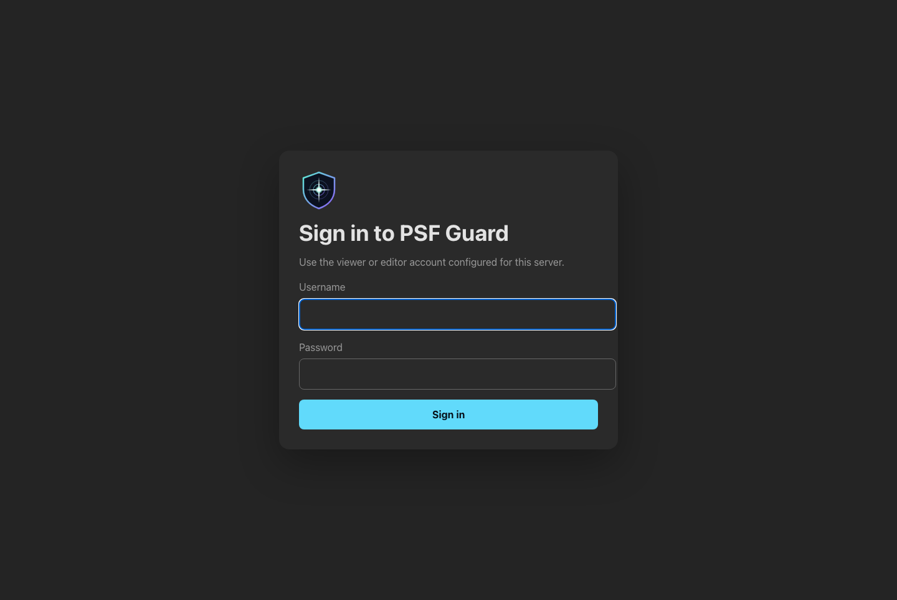
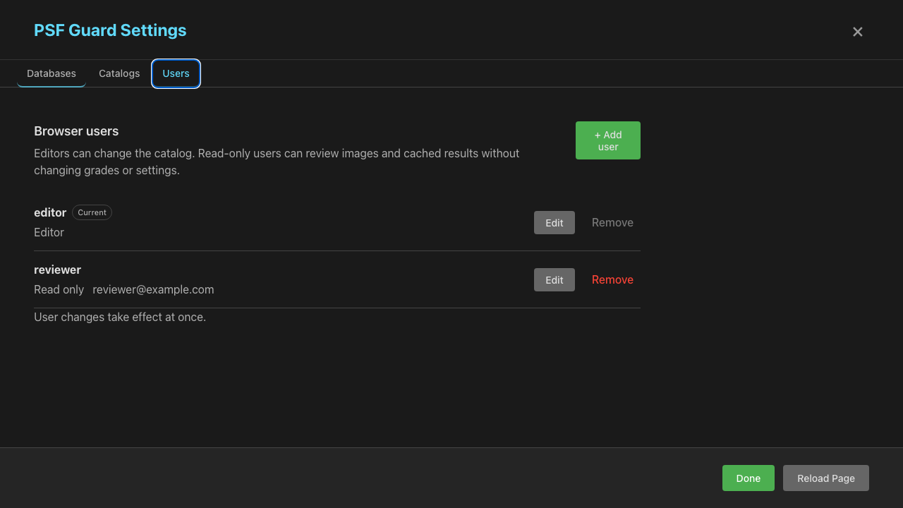

# Server authentication

PSF Guard can require a login when it runs as a web server. Authentication is
off by default. The Tauri desktop app does not use it: its server listens on
localhost and remains trusted by the desktop UI.



## What a server with no accounts serves

The bind address decides what an account-less server hands out. Reaching a
loopback server already means reaching the machine, so it stays open:

| Bind address | No accounts configured |
|---|---|
| `127.0.0.1`, `::1`, `localhost` | Full access, as before. The desktop app and local development use this. |
| Anything else, including the `0.0.0.0` default | Every API request answers 401, including reads. |

A network server therefore needs at least one account before it serves
anything. `psf-guard server --allow-database-management` goes further and
refuses to start on a network address until an account exists, because those
routes name paths the server then reads and writes. Only an editor can use
them once it does.

Remote sync and image upload are the exception. They carry their own
`Authorization: Bearer` keys, so those routes keep working on a server with no
browser accounts — that is how a headless intake box runs.

### Keeping a network server open

`--allow-anonymous-access` gives every caller on a network address what a
localhost server gives them, with no accounts and no login:

```bash
psf-guard server --host 0.0.0.0 --allow-anonymous-access
```

It exists for a server on a network you trust as much as the machine itself,
and for upgrading an older deployment without an outage. It hands full editor
access — grading, imports, and, with `--allow-database-management`, the
registry — to anyone who can reach the port. Add accounts and drop the flag.

## Manage users from the CLI

Add a viewer or editor. If `--password-file` is absent, the CLI prompts twice
without showing the password:

```bash
psf-guard users add viewer --role read-only --email viewer@example.com
psf-guard users add editor --role read-write --email editor@example.com \
  --password-file /run/secrets/editor
psf-guard users list
```

The CLI stores salted Argon2 password hashes in `auth.json`, beside the
database registry. It never stores the password. Email is optional account
metadata. With a custom database registry, pass the same path to both commands:

```bash
psf-guard users add editor --role read-write \
  --registry /srv/psf-guard/catalogs.json
psf-guard server --registry /srv/psf-guard/catalogs.json
```

This example writes the users to `/srv/psf-guard/catalogs.auth.json`. The
standard `config.json` registry uses `auth.json`. On Unix, PSF Guard writes the
auth registry with mode `0600`.

Use `--replace` with `users add` to change a user's password or role. Remove a
user with:

```bash
psf-guard users remove viewer
```

The CLI refuses to remove the final user unless you pass `--allow-empty`.
Removing that user turns browser authentication off after restart. Restart the
server after any CLI user change; active sessions stay valid until then.

## Manage users in Settings

An editor signed in to a web server gets a separate **Users** tab in Settings.
Editors can add users, record an optional email, change roles or passwords,
and remove users. Changes take effect at once. Changing access or a password,
or removing an account, signs out its existing sessions. Changing only an
email does not.



The UI refuses to remove the account used by the current session or leave the
server without an editor. Tauri does not show the tab because its localhost
server does not use browser authentication.

## Server settings

The optional TOML block sets session policy. It does not define a second user
list:

```toml
[server.auth]
session_hours = 168
allow_read_only_compute = false
```

Run `psf-guard server --config psf-guard.toml`. If `auth.json` contains users,
the browser will show a PSF Guard login page. A successful login creates an
HttpOnly, SameSite=Strict session cookie. Sessions live in server memory,
expire after `session_hours`, and end when the server restarts.

When `secure_cookie` is omitted, a same-origin browser login on a direct
connection follows the URL: HTTPS receives a Secure cookie and direct HTTP
receives a non-Secure cookie. A proxy must preserve Host for automatic mode.
Requests whose Origin does not match Host, and clients that send no Origin,
remain Secure by default. Set `secure_cookie = true` to require HTTPS, or set
it to `false` for a direct HTTP client that cannot send an Origin header or a
plain-HTTP proxy that rewrites Host.

Direct HTTP exposes both the password and session to anyone who can observe
the connection. Prefer HTTPS outside a trusted network. Each server port uses
a different cookie name, so two loopback instances no longer sign each other
out.

## Roles

The viewer can read catalogs, images, quality results, exports, and cached
analysis. By default, the viewer cannot start costly stack builds, plate
solves, satellite predictions, or view-processing jobs. Cached results remain
available.

Set `allow_read_only_compute = true` to let the viewer start those derived-data
jobs. This can suit a trusted private server. Leave it off for a public demo,
where repeated jobs could consume CPU, network data, and cache space.

The editor can also, with or without the database-management gate below:

- grade images and use undo or redo;
- update projects, targets, coordinates, and exposure plans, and move targets
  and exposures between projects;
- start quality scans, and imports from the database's own image folders;
- save, delete, and import named processing setups (viewers can list, apply,
  and export them);
- keep calibration frames out or use them anyway, mark their validity, forget
  them, clear generated masters, and invalidate Target Scheduler flat
  coverage;
- set a project's exposure grouping and a catalog's AstroBin filter map, and
  fill in missing Target Scheduler GUIDs (the catalog file is copied beside
  itself first);
- start, queue, cancel and publish WBPP runs in the runs folder the
  PixInsight settings define, take a run's masters in as stacks, and read a
  run's files;
- install Seiza catalogs into the configured catalog folder;
- add, check, change, or remove sync peers, sync with them, and pair or
  unpair remote clients;
- move rejected frames to their image folder's trash, restore them, and
  empty the trash;
- write server exports into the database's configured export folder, and
  apply database sync previews.

Server checks enforce the role even if a client calls the API directly. The UI
also leaves Settings out of a viewer's header menu and disables grading
controls. The menu says who is signed in and holds **Sign out**.

## The database-management gate

`--allow-database-management` (always on in the desktop app) guards what
lets a client name a path on the server: a folder the server should read,
write, list or run a program from. Without it, nobody can add a server path
through the API, so a server copy cannot be pointed at the rest of its disk.
It does not guard work inside the folders an operator already defined, nor
editing rows inside a catalog: that is the editor's work, above. With the
gate on, an editor can also:

- register, create, change, or remove databases, and set their image,
  export, process, and remote-upload folders;
- import from a folder outside the database's image folders, and write a
  local export to a path of their choosing;
- choose storage folders and limits;
- set the PixInsight program and WBPP runs folder, and give one run a folder
  outside that runs folder;
- change a database's new-frame scanning and calibrated-copy pairing.

A viewer never gets these, gate or not. Whatever the gate, only an editor
reads a WBPP run's files, and no route reads a calibration frame from
outside the database's image and calibration folders: a catalog that
records a frame elsewhere, as one synced from another machine may, shows it
as missing.

## API tokens

A personal API token lets a script or an MCP client act as a user without a
browser login. It is a bearer credential:

```bash
curl -H "Authorization: Bearer psfg_…" https://guard.example/api/databases
```

A token never grants more than its user has. A viewer's token reads; an
editor's token can also write, unless it was minted **read only**. A token
can expire on a date you pick, or never. A token cannot mint or revoke
tokens; that takes a signed-in session, so a leaked token cannot renew
itself.

Mint tokens under **Settings → Users → API tokens**. Everyone signed in sees
and manages their own; an editor sees every token and can mint one for
another user. The secret is shown once, on creation. Revoking a token cuts
it off at once, and removing a user removes their tokens.

The CLI does the same against `auth.json`. Restart the server after a CLI
change, as with users:

```bash
psf-guard users token create editor --label "claude on laptop" --read-only --expires-days 90
psf-guard users token list
psf-guard users token revoke <id>
```

The file keeps the SHA-256 of each token, its owner, label, and dates, never
the secret. The [MCP guide](MCP.md) covers what an agent can do with one.

Scripts that prefer the ordinary UI API can still log in with a cookie jar:

```bash
curl -c psf-guard.cookies \
  -H "Content-Type: application/json" \
  -d '{"username":"editor","password":"..."}' \
  https://guard.example/api/auth/login

curl -b psf-guard.cookies https://guard.example/api/databases
```

Remote image upload and scheduler sync use neither. Their
`Authorization: Bearer ...` keys remain scoped to the configured database and
continue to work when browser authentication is enabled.

## View preferences

A signed-in user's view choices follow them to any browser or device:

- Images and Sequence: the sort order, the grouping (one for a project, one
  for All projects), the thumbnail sizes, and the chips.
- Sequence scoring: the penalty and reject-limit defaults each view's
  Scoring control starts from.
- Library: compact or detailed rows.
- The project picker's grouping, and moving on after a grade.

**Saving.** The browser loads the user's document at sign-in and shows
it: its keys, and the default for any it leaves out. Each change is saved
a moment after changes stop, or as the page closes, as just the keys it
changed, so a tab left open all day never undoes a choice made since on
another device. Nothing is saved until the document has loaded: a failed
load is tried again after 1 s, then 2 s, 4 s and so on up to a minute, and
a change made in the meantime is applied over the document when it comes
and saved then. A change made in one tab is saved by that tab; the user's
other tabs in the same browser follow it without saving it again. A link
that names an order, a grouping or a scoring value still wins; the saved
choice fills in what a link leaves out. A viewer saves their own preferences too: they
change no catalog, so the role does not gate them. A viewer cannot open
Settings, so they save scoring defaults with the Scoring control's **Save
as default**.

**Scoring defaults** are personal, not a catalog setting. They change the
scores and reject recommendations this person sees, and what their own
actions use. Saving them changes nothing anyone else sees: others see only
what those actions produce, as with a grade. The one lasting product is a
stack: it records the scoring its build used, and the automatic refresh of
that project reuses the newest build's scoring for everyone, as it did
before. A project's first automatic build uses the built-in scoring.

**First sign-in.** If the user has no document yet, they start from the
defaults, with one exception: the first account to sign in on a browser
takes the choices that browser made before anyone signed in. No later
account gets them, and if the first account already has a document, its
document wins and the browser's choices are set aside. Each user's copy in
a browser is kept apart from the browser's own and from other users', so
signing in as someone else on the same browser does not hand one person's
choices to the next. An empty document also sets aside any copy the
browser kept under that name, so an account removed and made again under
the same name starts clean.

**The API.** All three name only whoever is signed in; no request can name
another user.

- `GET /api/me/preferences` returns the document.
- `PATCH /api/me/preferences` merges changes into it:
  `{"schema_version": 1, "preferences": {"imageOrder": "newest", "imageGrouping": null}}`
  sets the order and resets the grouping to its default, and keeps every
  key it does not name. For one key, the last change wins.
- `PUT /api/me/preferences` replaces the whole document. It stays for tabs
  still running an older build; current builds send `PATCH`.

A document holds only the keys PSF Guard knows, each checked for its type
and range (a scoring penalty from 0 to 2 in steps of 0.1, a Max HFR above 0
and up to 100, a Min stars a whole number from 1 to 1,000,000, a limit
`null` when off), and is limited to 4 KiB; only a `PATCH` may set a key to `null`.
Both writes drop keys they do not know and name them in `ignored`. A
request body is limited to 16 KiB, and the server stops reading a longer
one there and answers `413`.

**Storage.** The server keeps the documents in `user-preferences.json`
beside `auth.json` (`<stem>.user-preferences.json` beside a custom
registry). It replaces the file atomically on each save, sets mode `0600` on
Unix, and keeps a `schema_version`. Fields a newer build wrote survive a
save by an older one. Every change to the file holds a lock on
`user-preferences.json.lock` beside it, so the server and the CLI never lose
each other's write.

**Removing a user.** Removing a user in Settings ends their sessions and
removes their preferences. `psf-guard users remove` removes them too; if
the preferences file cannot be read or written it warns rather than fails,
since the account is already gone. A running server keeps a user removed
with the CLI until it restarts, so their open sessions can save again until
then. Each save, and each server start, drops the preferences of any user
the server no longer has.

**No accounts.** A server without accounts, and the desktop app, keep these
choices in the browser's own storage, as before.

**What stays out.** Exposure grouping is not a personal preference: it is a
project setting in the catalog, shared by everyone who opens the project.
The image detail's folded panels stay in each browser, since a phone and a
desk want different panels open.

## Deployment notes

- Put the public server behind HTTPS. Login passwords otherwise cross the
  network in clear text.
- Restrict `auth.json` permissions to the PSF Guard service account. PSF Guard
  sets mode `0600` on Unix.
- A deployment can seed a user from an existing secret with
  `psf-guard users add editor --role read-write --password-file PATH`. PSF Guard
  stores only the resulting hash in `auth.json`.
- Keep `--allow-database-management` off unless editors need to name server
  paths from the browser (see [the gate](#the-database-management-gate)). An
  editor login does not override that gate, and the gate does not override
  the login: on a network address the server needs both.
- Treat `--allow-anonymous-access` as a temporary measure. A public server
  running it has no access control at all.
- Signing out revokes the current in-memory session. Restarting the server
  revokes every browser session.
