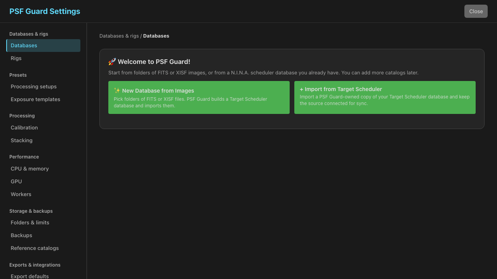
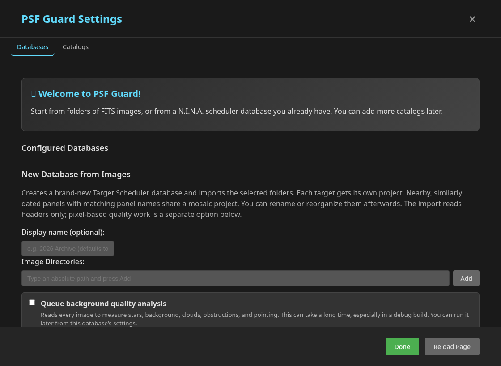
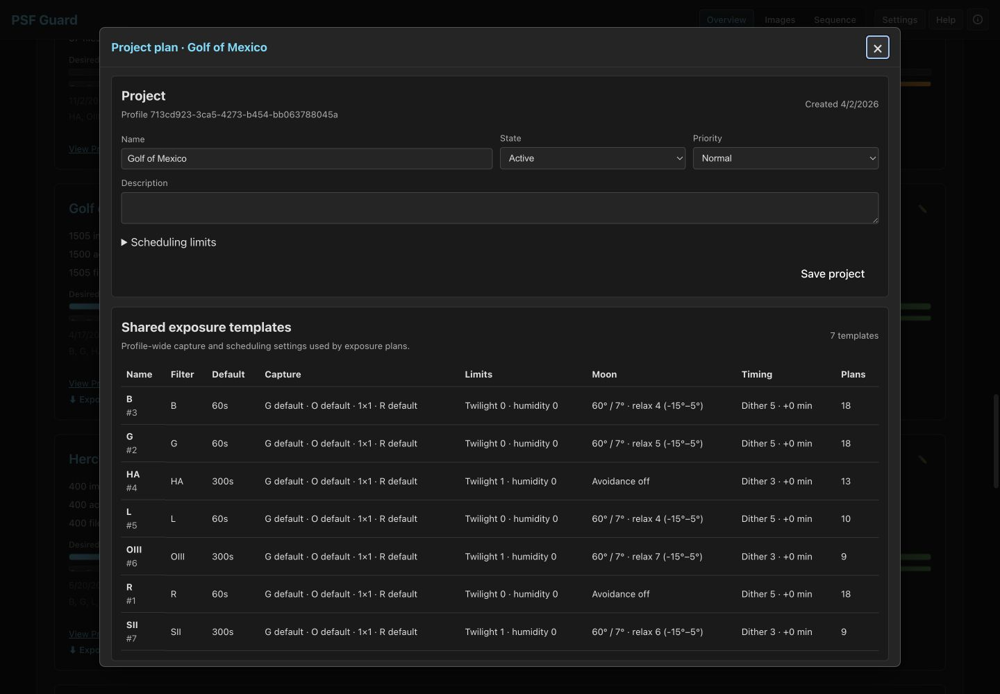
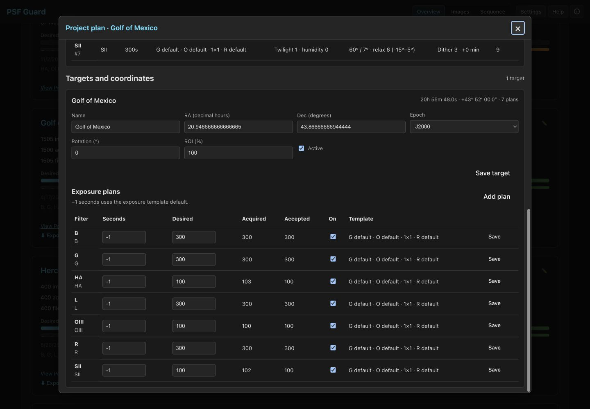
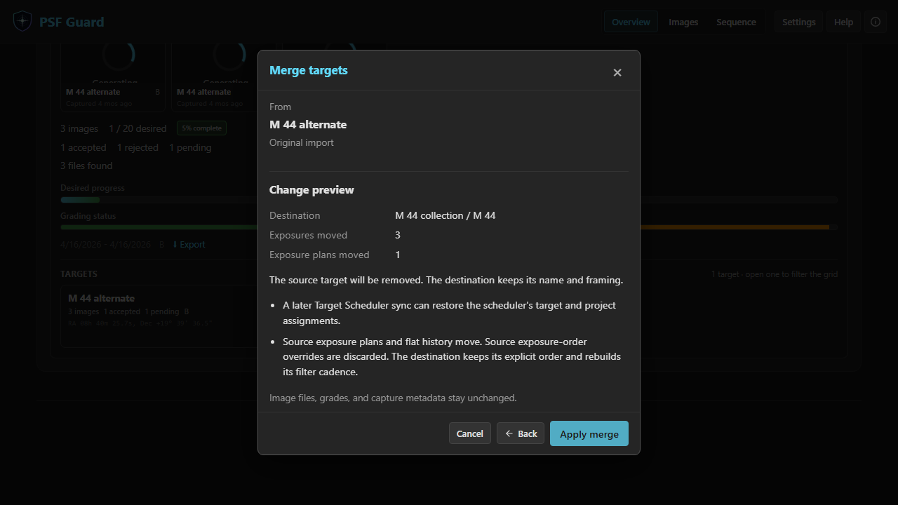
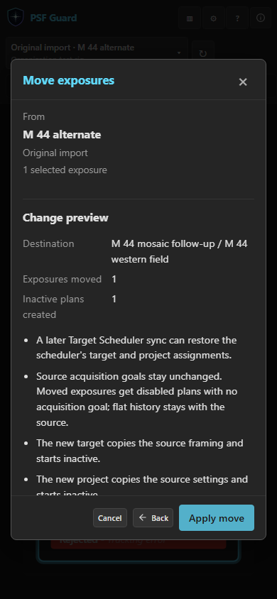
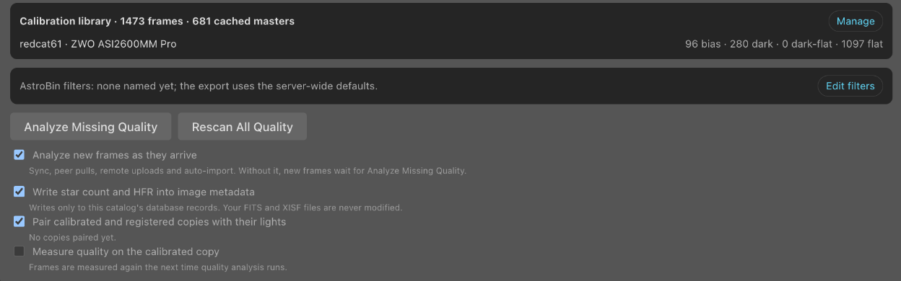
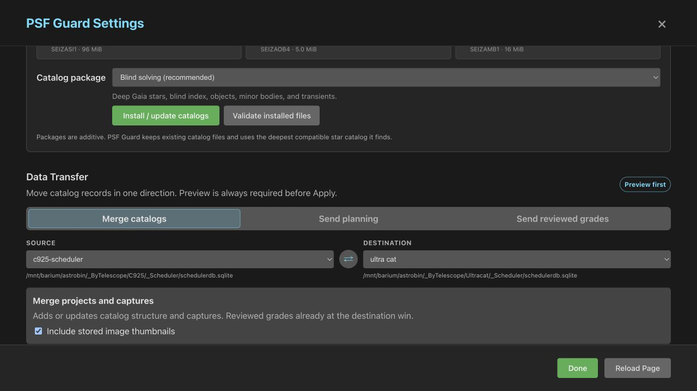

# Adding image folders

PSF Guard can import an existing N.I.N.A. Target Scheduler database or
build a compatible image catalog from folders of image frames. The first
import reads headers only. It does not decode every image or run quality
analysis, so a large library becomes usable without waiting for star
detection, photometry, or plate solving.

## Import from Target Scheduler

Open **Settings → Databases & rigs → Overview → Import from Target Scheduler**. The **Start a
catalog** choices keep image-folder import available alongside both TS options.
Choose **Image folders** to build a catalog from FITS or XISF folders; switching
choices keeps any folders you have already added. To connect TS, choose:

- **Import a local TS file**: select the source SQLite file, enter a display
  name, add the image folders, then click **Import from Target Scheduler**.
- **Use the PSF Guard Sync plugin**: add an empty image folder or a shared
  folder containing your images, then click **Create catalog for plugin**.
  PSF Guard opens the catalog's pairing controls. Install **PSF Guard Sync**
  in N.I.N.A., click **Generate pairing code**, and enter the server URL and
  code in the plugin. Click **Pair**, then **Test connection**. The plugin
  controls its sync schedule; a local TS file is not required. Enable
  **Accept remote image uploads** and choose a **Receive directory** if you
  also want the plugin to send image files. See
  [Connect N.I.N.A. with PSF Guard Sync](../README.md#connect-nina).

Database management must be enabled for a browser server, as described under
[Create a catalog in the UI](#create-a-catalog-in-the-ui).

### Import a catalog copy and choose storage

An import copies the complete SQLite catalog, including PSF Guard tables for
analysis, calibration, frame associations and per-catalog Director provenance.
PSF Guard keeps this embedded data for both import modes.

Leave **Keep the source connected for Target Scheduler sync** on to import
captures, exchange grades and deliver activated planning through the saved TS
connection. Turn it off and click **Import catalog copy** for a standalone
copy. The standalone import does not connect to or write back to the source,
and preserves embedded sync history without enabling it.
Connecting the source starts new grade-sync tracking for that connection;
existing image grades and the other catalog records remain unchanged.

The default destination is `databases/<uuid>.sqlite` beside the database
registry:

| Platform | Default catalog directory |
| --- | --- |
| macOS | `~/Library/Application Support/psf-guard/databases/` |
| Linux | `~/.config/psf-guard/databases/` |
| Windows | `%APPDATA%\psf-guard\databases\` |

A server started with `--registry /srv/psf-guard/config.json` uses
`/srv/psf-guard/databases/`. Under **Catalog storage**, select
**Use a custom database path (advanced)** and enter **Destination database path:**
to choose another location. This choice is available for image folders,
database-file imports and Sync plugin catalogs. Use an absolute path to a new
file on the machine running PSF Guard. A database-file import needs an existing
destination folder and never overwrites an existing file. The source and
destination must be different files. Turn the custom-path option off to use
managed storage.

A catalog copy is not a complete installation restore. The registry, image
folder settings, accounts, credentials and Director's global plans live
outside the catalog. Restore those from a [full backup](BACKUPS.md#restoring-by-hand).
Image files also remain in their original folders.

Servers can still register an explicit file through the positional database
argument or a registry entry. Existing direct TS access remains supported
through 0.12. A custom destination for an imported owned catalog does not
require direct TS access.

### Sync with a local TS file

PSF Guard reads a consistent SQLite snapshot and creates a working catalog
at the selected destination. The copy preserves existing IDs, GUIDs,
thumbnails, calibration records, and other PSF Guard tables. The import does
not write to the source. Image files remain in their existing folders.
The background jobs list shows import progress; reopening Settings recovers
that progress. If the import fails, correct the source path and try again.

The source remains connected for automatic sync, with grade writeback enabled.
The source needs the GUID columns provided by TS schema v22 or later. Under
**Sync → Target Scheduler sync** for the imported catalog, choose:

- **Sync when the desktop app or server starts** to import captures on startup.
- **Sync when new images or grades arrive** to check database changes. Changes
  are checked about every ten seconds; runs start no more than once per
  thirty seconds.
- **Sync interval (minutes; 0 disables the schedule)** for periodic sync. The
  default is five minutes. Zero leaves startup and change detection unchanged.
- **Automatically write grade changes back to Target Scheduler** to send edits made in
  PSF Guard automatically. When this is off, manual planning and grade
  transfers remain available through Preview and Apply.

Click **Save sync settings**. Automatic imports preserve reviewed local grades
and existing planning settings. They add missing parent records for new
captures and update acquisition progress. Automatic writeback updates TS grades,
reject reasons and accepted counts together. If both applications changed a
frame's grade, the job reports a conflict and leaves the TS grade unchanged.
Local pending changes survive restarts and can be retried safely.

For a reviewed merge, planning export or explicit grade overwrite, open
**Settings → Databases & rigs → Overview**, open the working catalog, then
choose **Sync**. Select its **Target Scheduler** connection as the other
endpoint, preview the changes, then apply the preview. The source file does
not need to be registered as a second catalog. If the source is unavailable,
the working catalog remains usable and the sync job reports the problem.

Director activation uses this same saved connection. Its preview shows the TS
file and planning transfer counts. **Activate** commits the working catalog,
then sends that project's planning to TS without changing captures, grades or
acquisition counts. The automatic grade-writeback switch does not disable this
explicit planning delivery. Failed deliveries remain pending and retry through
the configured startup, change detection and schedule settings, or with the
send button for the pending TS delivery. Grade conflicts do not block approved
planning deliveries. A change to the affected TS project or its referenced
templates, or an expired transfer, needs a new activation preview. Unrelated
projects can be delivered independently. Retry never exports unreviewed local
edits, and refreshing a preview in Settings does not approve an activation.

**PSF Guard is moving to its own catalogs.**

For new Target Scheduler databases, choose **Settings → Databases & rigs → Overview → Import
from Target Scheduler** to import the database and set up sync.

Your current Target Scheduler setup will keep working in 0.12. A later update
will create a PSF Guard catalog for you and keep captures, plans and grades in
sync with Target Scheduler.

Separate catalogs let us add features to PSF Guard and support new Target
Scheduler versions. We plan to remove direct database access in 0.13 or later.

Direct CLI/API access also keeps working in 0.12. The PSF Guard catalogs in
0.12 still use the TS schema; a native schema is a separate change.

## What counts as a frame

A scan picks up `.fits`, `.fit`, `.fts`, and `.xisf`, in any letter case.
Monolithic XISF files — what PixInsight writes — carry the same FITS keywords,
so they group, grade, preview, and stack exactly like FITS frames. Everything
else in the folder, including plate-solve `.json` and other sidecars, is left
alone.

PixInsight normalizes float images, writing samples between 0 and 1 where a
camera writes thousands of ADU. A frame that says so — `bounds="0:1"` — is put
on a 16-bit scale as PSF Guard reads it, so its background and star flux can be
compared against camera frames in the same sequence. A frame declaring any
other range is left exactly as stored, because writers disagree about what that
range means.

## Create a catalog in the UI

The desktop app always allows database management. For the web server, bind to
a trusted interface and opt in:

```bash
psf-guard server --host 127.0.0.1 --allow-database-management
```

On any other bind address the server refuses to start until a user account
exists, because database management picks paths the server then reads and
writes. Only an editor can use those routes. `--allow-anonymous-access` opens
them to everyone instead. See [server authentication](AUTHENTICATION.md).

Settings opens on **Databases & rigs → Overview**. Open a database to use
**Rig setup**, **Database & files**, or **Sync** for that database. The
breadcrumb returns to the parent list. Planning enables **Rig setup** and
**Presets → Exposure templates**. **Sync** requires an editor.
Install Seiza data packages under **Storage & backups → Reference catalogs**;
catalog installation also requires an editor. See [Settings navigation](SETTINGS.md).

On a first run PSF Guard opens the empty parent list and offers both import
starting points. The Library's empty state offers the same choices.



Choose **New Database from Images**.



1. Enter a display name. If you leave it blank, PSF Guard uses **Imported
   Images**.
2. Add one or more absolute paths. Each path must exist and must be a directory;
   an invalid path stays in the form, and the error says which path is missing.
3. Leave **Queue background quality analysis** off for a quick first import.
4. Choose **Create & Import**. The settings panel shows header-scan and import
   progress. If you close or reload the page, opening Settings finds the active
   server job and resumes the progress view.

An empty image folder is valid when preparing a catalog to receive N.I.N.A.
plugin syncs. Until images arrive, the overview shows zero image and grading
counts with no acquisition dates.

The UI stores the new catalog as a SQLite file under `databases/` beside the PSF Guard
registry. Its name comes from the display name, with `-2`, `-3`, and so on added
when needed. The database row in Settings shows the exact path. The CLI form
creates the database at the path you give it instead:

```bash
psf-guard create-db ./archive.sqlite /data/lights /data/more-lights \
  --name "Archive"
```

`create-db --dry-run` creates a temporary schema, previews the plan, and then
removes the new file. Add `--no-register` if you do not want the result added to
the shared registry.

## What the header import builds

PSF Guard writes a full Target Scheduler-compatible schema. This inherited
mapping lets it open an existing Scheduler database directly, but Target
Scheduler is not required. The import creates:

- one profile for the imported rig;
- projects and targets;
- shared exposure templates;
- exposure plans; and
- acquired-image rows, initially graded Pending.

Bias, dark, dark-flat, and flat frames go into PSF Guard-owned
`psf_guard_*` tables in the same SQLite file. They never become
`acquiredimage` rows or projects. Settings shows the frame count for each
detected rig. The raw files remain in place.

Calibration types take precedence over light-frame matching. In particular,
`IMAGETYP=TWILIGHT FLAT` is a flat, not a light despite the word "twilight".
Missing image-type headers still default to lights; check those headers before
importing a mixed archive.

The grouping rules stay conservative:

- FITS `OBJECT` names define targets. Frames from different telescope, camera,
  focal length, or binning signatures never share a project.
- Each target gets its own project by default, even when its frames span many
  nights.
- Panel-style targets share a mosaic project only when their names have the
  same panel root, their centers are within five degrees, and their capture
  dates are within 14 days by default.
- Target coordinates use the median FITS coordinates. Target Scheduler stores
  RA as decimal hours and Dec as degrees.
- Filter, gain, offset, binning, and numeric readout mode group the lights,
  and each group's exposure length becomes an exposure plan. The imported
  frame count seeds its desired and acquired counts.
- A new plan goes on an existing exposure template with the same filter,
  binning, and default exposure length, whose gain, offset, and readout mode
  each match the lights or are left at -1 (the camera's default); one that
  matches exactly comes first. Two groups that land on the same template,
  such as two gains on a camera-default template, share one plan.
- With no such template, PSF Guard makes one pinned to the lights' own
  gain, offset, and readout mode, with their exposure length as its default.
  Its name gives those settings and the length, for example
  `L G100 O30 1x1 300s`. A template
  whose default is another length never takes a new plan, even one for the
  same settings, so lights of two lengths get two templates. Lights with no
  exposure length go on the template for exactly their settings. You can
  move a plan to another template later; a sync carries the change.





The import does not plate-solve folders or verify the `OBJECT` name against the
pixels. Run quality analysis later to add fresh star measurements, spatial and
photometric evidence, and pixel-derived pointing checks. That keeps a bad or
missing solver catalog from blocking the initial catalog build.

## Add new frames later

Use the **Import** button on a configured database. PSF Guard first runs a dry
preview and lists frames that will attach to existing targets and frames that
will create new projects. It also says what the import changes in what Target
Scheduler will shoot: each existing target's line ends with, for example,
"adds 1 exposure plan" or "raises acquired on 2 plans", and a line gives any
new exposure templates. Confirm the preview to write it.

The preview runs at once. Previewing again, for example with other folders,
stops a preview still running and replaces it, and confirming the import
replaces it too. While an import writes, a preview is refused until the
import ends. The header's background jobs list shows the import with
**Stop**: stopping it before it has written anything leaves the catalog as
it was, and stopping it while it writes rolls its one transaction back.

The matching rules prevent common duplicates and splits:

- a basename already stored in the database is skipped;
- an `OBJECT` name match attaches to the existing target;
- otherwise, coordinates within 0.5 degrees attach to the existing target,
  unless the database's scan rules turn **Match targets by position** off; and
- unmatched frames create new project and target rows.

Lights that attach to an existing target join one of its exposure plans when
the plan's exposure length (its own, or its template's default when the plan
leaves it unset) equals theirs, and its template has the same filter and
binning, with gain, offset, and readout mode each equal to the lights' or left
at -1. A plan on a template that matches exactly comes first. When no plan
fits and the run may add one, the new plan's template is chosen as for a new
target, above. Automatic import, **Review**, remote uploads and the CLI follow
the same rules.

The same scan catalogs calibration frames and deduplicates them by canonical
path and file fingerprint. A dry run reports those changes but rolls back the
PSF Guard tables with the scheduler changes.

The preview also carries the run's scope controls:

- **Import**: lights and calibration (the default), lights only, or
  calibration only. Frames outside the scope are counted and left alone —
  a calibration-only run after a database reset rebuilds the library
  without touching the scheduler rows.
- **Folders**: the configured image roots and two levels of their
  subdirectories, each with a checkbox. Unchecking a root and checking one
  night's folder imports exactly that folder. A folder inside a configured
  root needs no extra grant; only a path outside every configured root
  requires database management.
- **Calibrated and registered copies** are paired, not catalogued. A copy
  that PixInsight's WBPP, Siril, ASTAP, DeepSkyStacker or another tool
  wrote is recorded with the light it came from, matched by capture time,
  exposure, filter, target and camera (see
  [calibrated subs](design/calibrated-subs.md) for how a copy is
  recognised). A calibrated copy with no raw light becomes the light, one
  per exposure, and a raw frame imported or synced later takes that row
  over, keeping its grade. A registered copy with no light is left out.
  The database's **Pair calibrated and registered copies** setting turns
  this off; the CLI takes `--no-pairing`.
- **Skip processed files** (opt-in): skip integration masters. When pairing
  is off, also skip calibrated and registered copies. Leave this off to
  catalog masters as well as raw images.
- **Include frames from other rigs** (opt-in): import lights from a telescope
  the catalog has not seen before. By default, PSF Guard learns telescope
  and camera names from the calibration frames and lights already in the
  catalog. It lists lights from an unknown telescope by rig, with an example
  file, without importing them. When telescope headers are missing, it checks
  the camera instead. This keeps another rig's images out of the catalog.
  A known telescope with a new camera, or a different driver spelling for the
  camera, still counts as the same rig. Turn this on when you change telescopes;
  PSF Guard records the new rig and accepts its frames in later imports.
  Remote uploads also refuse lights from an unknown rig.

Change any of them and choose **Update preview** to re-run the dry preview
before confirming.

The CLI exposes the same path:

```bash
psf-guard import archive ./new-lights --dry-run
psf-guard import archive ./new-lights
psf-guard import archive ./new-flats --calibration-only
psf-guard import archive ./processing-tree --skip-processed
psf-guard import archive ./new-camera --accept-other-rigs
```

Use `--no-attach` when every new frame should create imported structure instead
of attaching to an existing name or coordinate match. `--lights-only` and
`--calibration-only` scope the run to one frame kind. `--exclude PATTERN`
leaves files and folders out, as an exclude scan rule does; repeat it for more
patterns, and `create-db` takes it too. When `import` targets a registered
database, that database's scan rules apply as well. `remove-imported` can
remove projects created by an import; always preview it first.

## Scan rules

Image folders often hold more than lights: autofocus frames, plate-solve
tests, flats, pier-camera timelapses, processing output. Scan rules leave
those out of every import from a database's folders, so you do not have to
move your files to suit PSF Guard. Open the database under **Settings → Databases & rigs → Overview**, then
choose **Database & files → Edit → Scan rules**:

- **Exclude**: one pattern per line. A file or folder that matches is left
  out, and a folder that matches is never entered, so nothing below it is
  read. `**/Hocus Focus/**` keeps Hocus Focus's autofocus frames out;
  `**/PierCam/**` and `**/Automation/**` work the same way.
- **Include only**: when set, only files matching one of these patterns, or
  inside a folder matching one, are read. `LIGHT` keeps every file in
  N.I.N.A.'s `LIGHT` folders; `*.xisf` keeps XISF files wherever they are.
  The walk still enters every folder that is not excluded.
- **Require LIGHT in the image-type header**: exclude frames without
  `IMAGETYP` or `FRAME`. By default, PSF Guard treats them as lights.
- **Lights need a target name**: a light with no `OBJECT` is left out,
  instead of being filed under a new "Unknown Target" project. Autofocus
  and test frames usually have no `OBJECT`.
- **Minimum light exposure (s)**: lights shorter than this, or with no exposure
  time, are left out.
- **Match targets by position** (on by default): a light whose `OBJECT`
  matches no target name attaches to the nearest target within 0.5 degrees,
  so a frame need not use the target's name exactly. A light with no `OBJECT`
  at all attaches the same way. Off, only an exact name match (in any letter
  case) attaches, and anything else is a new target: created, held or left
  out, as the import decides. Frames with no `OBJECT`, such as autofocus
  frames taken at the target, are kept out by **Lights need a target name**,
  whatever this is set to.

Patterns match a path relative to the image folder that holds it, in any
letter case, with `/` or `\` between folders. A pattern with no `/` matches a
file or folder name at any depth, so `Hocus Focus` and `**/Hocus Focus/**`
do the same thing. A pattern with a `/` reads from the image folder: `/FLAT`
or `FLAT/*.fits` match only at the top. `*` stays within one folder name and
`**` crosses folders. A bad pattern is refused when you save, with the
pattern and the reason. So is a full path such as `/data/Images/Hocus Focus`
or `C:\Images\Hocus Focus`, which could never match; the error gives the
pattern to write instead, here `/Hocus Focus`.

The three light filters apply only to frames that would become lights.
Calibration frames still go to the calibration library, which never writes
Target Scheduler rows. Exclude and include patterns apply to calibration
frames too.

A `.psfguardignore` file in a folder skips that folder and everything below
it, on every import: manual, automatic, the CLI, and a new catalog made from
images. Its contents are not read. This works with no scan rules at all.

An import that starts inside an image folder, as **Review** does for held
frames, still honors both: when the folder it starts in, or one above it
within the image folder, is excluded or holds a `.psfguardignore` file, it
reads nothing there.

The preview and the automatic import's status line say what the rules left
out: "12 skipped by scan rules", "1 folder(s) skipped by .psfguardignore",
"3 left out: no target name". The rules affect imports only. Frames already in
a catalog stay visible, even when a new rule would leave them out. A remote
upload from N.I.N.A. does not use scan rules.

The rules travel with the database entry in the registry as `scan_rules`.

## Import new frames automatically

A database can scan its image directories on its own and import what is
new, so a night's frames are in the catalog by the time you sit down.
Open the database under **Settings → Databases & rigs → Overview**, then
turn on **Database & files → Edit → Automatic import**:

- **Run when the app or server opens this database**: once at start, and
  once when you first enable it.
- **Schedule**: every 15 minutes up to every day, or only on open.
- **Import**: lights and calibration frames, lights only, or calibration
  frames only.
- **Analyze quality of the new frames in the background**: queues the
  quality scan for the targets a run touched, as the Import preview's
  checkbox does.
- **Include frames from other rigs**: off by default, as for a manual
  import.
- **New targets**: what a run does with lights that match no target in the
  catalog. **Ask first**, the default, holds them: the run attaches frames
  for the targets the catalog has and writes nothing for the rest. The
  status line then says, for example, "11 held: no matching project", with
  a **Review** button that opens the import preview for the folders that
  hold them, so you confirm new projects as you would for a manual import.
  **Leave out** lists them and does nothing more. **Create a project**
  creates projects and targets for them, as every run did before.

Ask first is the default because the scheduler database is often shared
with N.I.N.A. and synced to the rig, so a project the run made would land on
the live rig without anyone seeing it first. A database saved before this
setting existed asks first too. Held frames are read again on the next run,
until they are imported or a scan rule leaves them out. Lights the light
filters leave out are not read again while their file stays the same size
and age; the status line still counts them. Changing the filters reads them
all once more.

Under Ask first and Leave out, a run also leaves scheduling alone in projects
it did not make. Attaching a frame to a target can add an exposure template,
add an exposure plan, or raise a plan's acquired count, and any of those
changes what Target Scheduler shoots next. So in a project whose description
does not start with "Imported by PSF Guard" (the mark every imported project
carries), a run only adds the image row, and only to a plan the target
already has for the frame's filter settings and exposure. That plan's counts
stay as they were. A frame that would need a new template or plan there is
held, "no exposure plan", and **Review** previews it with the rest. In
projects an import made, a run adds plans and raises counts as it always
has. **Create a project** and every import a person starts keep doing both
everywhere; the preview says which plans they add or raise.

A run takes the configured image directories only, never a path it was not
given, so it works without `--allow-database-management`. The database's scan
rules apply to it as to any import. Before reading a single header it drops
every file the catalog already has: a light by its basename, a calibration
frame by its path and fingerprint. A folder of thousands of known frames
therefore costs a directory walk and one query, and a run that finds
nothing new writes nothing. The rest goes through the same matching rules
as the Import button.

The database row shows the schedule, the last run's result, and when the
next run is due, with a **Run now** button that takes the same settings.
The run appears in the same progress line as a manual import. A run waits
while another import, a remote upload, or an interactive job is under way,
and tries again on the next tick. On a server with accounts, **Run now**
needs an editor.

The same run is available to scripts and agents as `POST
/api/db/{db}/autoimport/run`, and the settings travel with the database
entry in the registry as `autoimport`.

### Frames in more than one folder

A frame can be in two image folders at once, for example while a script
copies it from an incoming folder to its final folder. PSF Guard treats
files of the same name as copies of one frame when their headers record the
frame's capture time and filter. Previews, quality scans and stacks then
read the largest copy, because a copy that is still being written is shorter
than the file it comes from.

Files of the same name that hold different captures are not guessed at. When
the frame's catalog row cannot tell them apart, the image shows an error
that gives the file name, and you can remove or rename the extra file.

## Organize projects and targets

Library's **Edit** actions rename projects and targets, move a whole target
to another project, or merge projects. **Merge target** combines alternate
names for the same target: choose the destination project and target, then
review **Preview merge** before choosing **Apply merge**. The destination
keeps its name and framing. Its exposures and the source target's exposures
share one target after the merge. The emptied source target is removed; its
project remains.



To split a target, select exposures from that target in Grid and choose
**Move exposures**. The destination can be an existing target, a new target in
an existing project, or a new project and target. **Preview move** shows the
destination and affected exposure counts before **Apply move** writes them.
Afterward, Grid opens the destination. Select exposures from one source target
at a time; a selection spanning targets must be moved separately.



Merging targets and moving exposures stay within one database and one Target
Scheduler profile. A target move stays within one database.
These controls require an editor account; they edit catalog rows, so they do
not need database management. A preview changes nothing. If relevant catalog records
change before Apply, PSF Guard asks for a fresh preview.

Image files, capture metadata, grades, rejection reasons, and image GUIDs do
not change. Merging moves the source exposure plans with their identities.
Removed rejects of the source target return to the destination target when
you restore them, and the source target's stack previews are removed.
Splitting creates separate inactive plans for the moved exposures and updates
the source and destination counts. New targets are inactive, and new projects
start in the Inactive state; activate and configure their plans separately
when they should drive acquisition.

These edits organize this catalog. A later sync that imports scheduler
structure can restore the grouping held by that source database. Make the
same organizational change in the authoritative scheduler when that grouping
must survive a subsequent sync. Importing already cataloged files skips them
and keeps their current grouping.

### Move a target to another project

1. In Library, click **Edit** beside the target.
2. Click **Move to another project...**. When you typed a new name in the
   panel, PSF Guard saves it first.
3. Under **Destination project**, choose a project, or choose **New project...**
   and enter a name. Projects of another Target Scheduler profile show the
   first eight characters of their profile beside the name, and Closed
   projects show **Closed**.
4. Click **Preview move**. The preview shows the destination, how many
   exposures and exposure plans move, and any profile change.
5. Click **Apply move**.

The target keeps its name, framing, exposure plans, flat history and
exposure order. Its exposures and its stack previews move with it. Removed
rejects of the target return to the new project when you restore them. A
new project copies the settings of the target's current project, including
its stack settings, belongs to the same profile, and starts in the Inactive
state.

PSF Guard refuses a move in these cases:

- **The destination project already has a target of the same name.** Use
  **Merge target** to combine the two targets instead.
- **The target has exposures and the destination project belongs to another
  profile.** Each exposure's profile selects its calibration frames and its
  rig's nights, so a target with exposures can move only within its profile.
  Removed rejects that you can still restore count as exposures; a removed
  reject whose files were deleted when the trash was emptied does not. To move the
  target, first move its exposures to another target of the same profile
  with **Move exposures**.

A target without exposures can move to a project of any profile. Each of its
exposure plans then uses an exposure template of the destination profile:
a template with the same filter, gain, offset, binning and readout mode when
the profile has one, or otherwise a copy of the target's template. The
preview lists each template and whether it is reused or copied. A plan
without its own exposure uses its template's default exposure; when the move
reuses a template, PSF Guard writes the old template's default exposure into
the plan, so the plan's exposure does not change. A blank default counts as
60 seconds.

The Library lists only projects with exposures. When you move a target
without exposures into a project without exposures, the preview explains
where to find it: with Planning on, the project appears under Plans with
nothing captured yet; otherwise it appears once an exposure arrives.

When a Planning plan activated the target as one of its panels, the preview
shows that the plan will no longer manage the target after the move. The plan's
next activation can add a new target for that panel to the old project. When
the target is part of an open collaboration assignment, the move ends the
target's part in it.

Stack previews built before the move still record the old project in their
job details. Their cards, previews and FITS files show in the new project,
but the job details of such a stack cannot be opened from the new project.
The same applies after you merge projects.

## Fill or refresh quality data

Header import leaves pixel work for a separate, low-priority server job. Each
database card in Settings has two actions:

- **Analyze Missing Quality** keeps valid cached work and fills gaps.
- **Rescan All Quality** recomputes star counts and all cached quality evidence.

Both actions process targets in the background, show their current target and
progress, and yield to interactive preview and scan work. The settings page
reads the server's job state when it opens, so navigation or a page reload does
not hide a running job. A server restart ends the in-memory job; start it again
to resume from the persistent cache.

Frames that arrive later, by a plugin sync or reconcile, a peer pull, a remote
upload or auto-import, wait for the next **Analyze Missing Quality** unless the
database has **Analyze new frames as they arrive** on. With it, PSF Guard
queues the same background analysis for the targets holding unmeasured frames
a couple of minutes after the last arrival, so a night's batch is analyzed
once. Each server start also checks every database that has it on, for frames
that came while the server was down. It writes nothing to the catalog: results
stay in the quality cache. A frame it tried and could not measure, such as one
whose file is missing, is not tried again for a day, or until the server
restarts. The setting is off by default and changing it needs database
management. Without it, a target with many unmeasured frames is scored on the
capture software's star counts, not the scan's, until they are analyzed (see
[quality screening](SCREENING.md)).

Open a database from **Settings → Databases & rigs → Overview**, then choose
**Database & files** for quality analysis, star metadata and calibrated copies.



The backfill uses the N.I.N.A. Fast detector for star count and HFR, which keeps
new values comparable with Target Scheduler data. It also stores the full-star
flux data needed by photometry, spatial cloud and obstruction metrics, and
fresh plate-solving evidence for off-target and tracking checks.

Once a frame has been measured, the scan writes its star count and HFR into
the image's database metadata, so imported frames show the same star fields in
the grid, detail, and comparison views as a N.I.N.A.-graded catalog. Only
missing values are filled; measurements N.I.N.A. recorded are never replaced.
Catalogs scanned before this write-back existed pick the values up the next
time **Analyze Missing Quality** runs — no rescan needed.

The **Write star count and HFR into image metadata** checkbox next to the
analyze buttons controls this. It is remembered as the default for every
analyze action — target scans, database analysis, and import-time analysis —
and stays on unless you turn it off. The write goes only to the catalog's
database records; the FITS and XISF files themselves are never modified. API
callers pass `fill_metadata: false` on the quality-scan, backfill, or import
request to opt out per call.

## Review and correct the imported plan

Open **Library**, then choose **Planning** on a project (⚙ on a compact row).
The plan's workspace opens with that database's **Edit in Target Scheduler** expanded in
its rig's block: project state and limits, target coordinates, rotation and ROI,
shared exposure templates, and each filter plan. With an editor account, you can edit
these fields, add plans, or merge and move imported projects and targets when a
header name grouped them poorly.

## Sync with the telescope database

When transferring between registered catalogs, add both databases. Open the
local database from **Settings → Databases & rigs → Overview**, choose **Sync**,
then use **Data Transfer**. The opened database receives a merge and sends
planning or grades. Choose the other endpoint and check both roles before Preview:



- **Merge catalogs** copies new or changed projects, targets, templates, plans,
  captures, grades, rigs, and raw calibration-frame records from the selected
  source into the destination. Reviewed grades already at the destination win.
  Generated master paths stay local and rebuild on demand.
- **Send planning** sends project, target, template, plan, and rule settings.
  It does not change destination image rows, capture counts, or grades.
- **Send reviewed grades** sends Accepted and Rejected grades and reject
  reasons for matching image GUIDs. Pending source rows are skipped.

All three actions create a server-owned preview before **Apply**. The preview
expires after 30 minutes. It keeps the source state you reviewed and becomes
stale if the destination changes. The CLI equivalents are:

```bash
psf-guard sync pull --from telescope.sqlite --to archive.sqlite --dry-run
psf-guard sync planning --from archive.sqlite --to telescope.sqlite --dry-run
psf-guard sync grades --from archive.sqlite --to telescope.sqlite --dry-run
```

Back up both databases before the first write.

See [the data-transfer design](design/data-transfer.md) for planned native
one-off file handles, versioned remote bundles, remote peers, and the N.I.N.A.
plugin endpoint.
