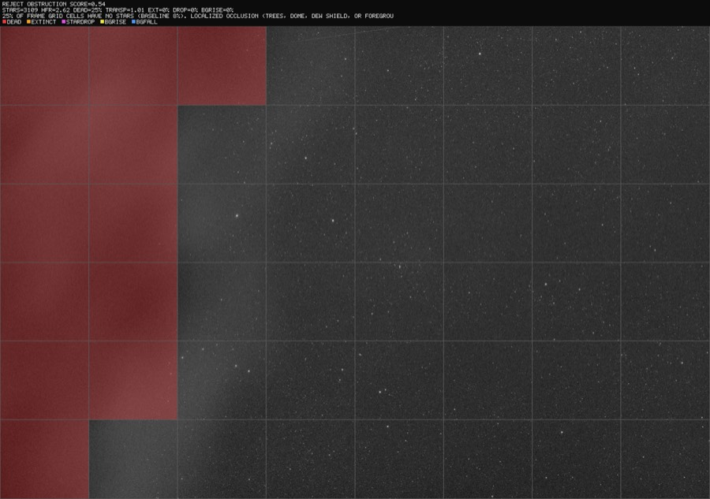
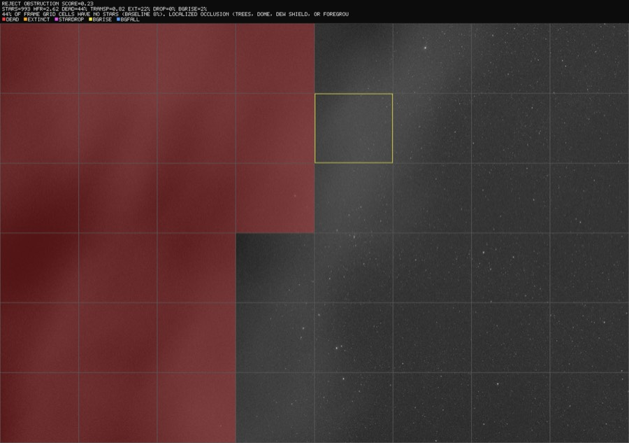
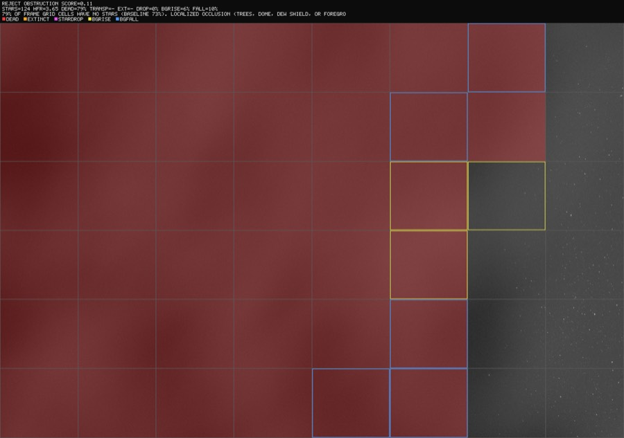
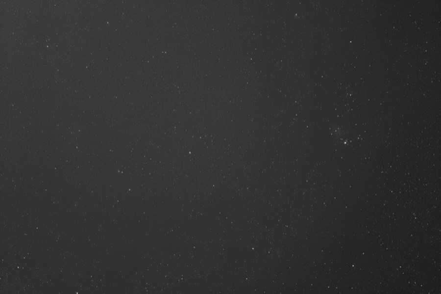
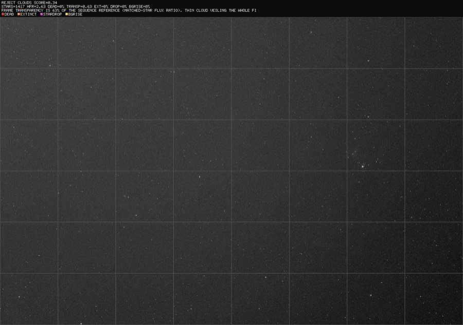
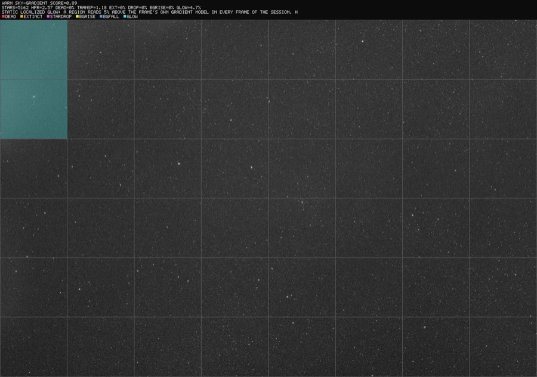

# Quality Screening: Image Conditions & Astrometry

PSF Guard can automatically screen light frames for problems that ruin
integrations but slip past conventional grading: trees or a dome edge
occluding part of the field, small clouds passing through, thin veils that
dim the whole frame, errant light, and static glow at the field edge. Every
verdict can be rendered as an annotated diagnostic image showing exactly
which part of the frame drove the decision.

When the scan has catalog target context, fresh pixel-derived plate
solutions also catch images captured away from the intended field, pointing
jumps, tracking drift, and deterministic solve failures. See
[Astrometry quality grading](ASTROMETRY_QUALITY.md) for target provenance,
failure semantics, score caps, and the guarded regrade workflow.

All pixel detections are classical statistics — no machine learning or
training data. An explicit server **Analyze Quality** run may download and retain
orbital elements needed for satellite checks. Merely opening Sequence Analysis
and CLI regrading remain cache-only. Thresholds were calibrated against real
sessions (measured clean-frame envelopes across multiple nights and filters),
and each detector carries regression tests pinning its behavior.

## Why global metrics are not enough

Star count and HFR — what conventional graders use — barely move when a
frame is partially ruined. Measured on a real session where a tree line
progressively occluded the field:

- Frames with a visibly occluded corner kept **star counts within normal
  variation** (the rest of the field is fine).
- **HFR stayed flat (~2.6) until the frame was more than 60% occluded** —
  the surviving stars are still in focus.
- A thin cloud veil dimmed every star by 37% while star count, HFR, and
  background all looked normal — the frame was Accepted by the capture
  software's own grader.
- N.I.N.A.'s rolling star-count baseline *adapts to* slow occlusions: on the
  measured session it Accepted 31 of 33 occluded frames, including one that
  was 90% blocked.

The screening stack answers with signals that are local (per grid cell),
photometric (flux ratios, not counts), and temporal (each cell compared to
its own history) — with baselines that refuse to normalize slow-growing
problems away.

## The detection stack

| Signal | Catches | How |
|---|---|---|
| **Dead cells** | Occlusion (trees, dome, dew shield) | Fraction of 8×6 grid cells whose star density collapsed vs the frame's own median cell |
| **Transparency** | Thin uniform veils | Median flux ratio of stars matched against a per-sequence reference catalog; 0.7 = whole frame ~0.4 mag dimmer |
| **Localized extinction** | Small clouds | Per-cell flux ratios ÷ global transparency; a passing cloud is a coherent dip in one patch of stars |
| **Star-share drops** | Small opaque clouds | Each cell's *share* of the frame's stars vs that cell's own temporal median (Poisson-aware) |
| **Background rise** | Errant light (headlights, flashlights) | Per-cell background vs the cell's own history, after subtracting the frame's gradient (robust plane fit) |
| **Background fall** | Dark occluders, cloud shadow | Same, downward: something blocking skyglow reads *darker*, not milky |
| **Static glow** | Corner haze, lit occluder edges | Cells brighter than the frame's own gradient model — catches problems present from a session's *first* frame, while a fresh solve masks cells covered by large cataloged emission nebulae |
| **Fresh plate solution** | Off-target frames, pointing jumps/drift, deterministic no-solves | Seiza solves the current pixels; solved centers are compared to the authoritative target, stable framing clusters, and within-segment drift |
| **Satellite prediction + pixel alignment** | Potentially bright satellite trails | A solved WCS plus FITS exposure/site metadata projects cached orbital elements through the shutter-open interval, then a bounded matched-filter search tests the nearby pixels; prediction and aligned-path evidence remain separate |

The signals feed two comparisons:

- **Session comparison** ranks frames from one capture run. It catches a
  cloud, focus change, or tracking loss within a night.
- **Target/filter stack comparison** ranks all frames that could enter one
  stack across capture runs. It can expose a whole weak night that looked
  stable by itself. It compares only frames with matching exposure, gain,
  offset, binning, readout, and sensor-region metadata.

Both scores run from 0 to 1, shown as 0 to 100 on the chips. They are
relative ranks, not verdicts. Catalog star count, HFR, eccentricity, SNR, and
background use a robust good reference with a no-penalty band for normal
variation. Star count is measured against the sequence's 90th percentile and
HFR against its 10th: at the calibrated penalty, a frame loses nothing within
10% fewer stars or 5% more HFR, and that term reaches zero at 40% fewer stars
or 30% more HFR. When a fresh solve places a large
cataloged emission region in the field, raw background receives no score
weight: lower can mean lost target signal, not a better frame. Matched-star
transparency still detects that loss. Missing signals receive no weight.
Fresh spatial, photometric, and plate-solve results add pixel evidence when a
quality scan has run.

Capture software rarely records an SNR, so a quality scan measures one from
the frame's photometric zero point: the catalog magnitude of a star that
gives one ADU per second. The scan measures up to 80 of the brightest
unsaturated stars in a wide aperture (five times the frame's HFR, with a sky
annulus from six to eight), judging saturation on the raw pixels because a
deep frame clips hundreds of its brightest stars. After the plate solve it
places Gaia stars with the frame's own solution, matches them to the measured
stars, and takes the median of magnitude plus 2.5·log10(flux per second).
The SNR is the flux that zero point promises divided by the pixel-to-pixel
sky noise.

Cloud, haze and dew lower the zero point, and a brighter sky raises the
noise, so the SNR falls with either. Soft focus does not move it: a wide
aperture holds a star's light whatever its size, which HFR already scores. The
zero point needs no reference frame, so different nights and both sides of a
meridian flip compare directly; scoring still compares it only between frames
of the same exposure and settings. It needs a fresh plate solve and a Gaia star
catalog. A Tycho-2 catalog mixes two bands and is not used. A value in the image
metadata is used as recorded. Frames scanned before this measurement existed
have no SNR until **Rescan All Quality** runs.

A low relative score alone gives no cause and does not recommend rejection. The
UI labels catalog-only results as **Catalog-relative score** and says which
comparison produced them. A frame gets a cause such as clouds, obstruction,
focus drift, tracking error, or off-target only when that detector has enough
evidence. Reviewed rejection recommendations use those causes, not the score
alone.

One absolute exception: a frame whose star measurement found **zero stars**
is capped at a condemned score with a **No Stars Detected** cause, even when
it has no sequence peers — zero stars in a light frame is direct pixel
evidence of clouds, trailing, or an obstructed aperture, not a normalization
artifact. A frame with no star measurement at all is never capped; grading
does not punish an image because an optional scan has not run. Two
measurements that disagree do not cap a frame either: when the quality scan
finds no stars where the capture software counted 20 or more, the scan failed,
and its star count, HFR and dead cells for that frame are dropped, so the score
renormalizes around them. The same holds the other way round.

**Soft stars** are judged against the whole target, not the night. A frame's
HFR is compared with the best of its target and filter across every night
(the 10th percentile, once a capture profile has ten measured frames).
Against its own night, a whole night of poor seeing or lost focus looks
normal; and as one part of eight in the score, an HFR twice the best still
left a frame near 0.8. From 1.5× the best the score is capped, falling to the
condemned score at 2× and beyond, with a **Soft Stars** cause. From 1.75× the
frame also gets an `[Auto]` reject recommendation, so stacks leave it out. On
one rig's catalog, 96.7% of frames sat within 1.3× of their best, and 1.5%
beyond 1.5×.

The scan also refuses to record a zero it cannot trust. A frame written within
the last hour whose data ends in a long run of one value is taken as a copy
still under way (Windows copies, sync tools and moves between volumes create
the file at full size and fill it in after), and is measured on a later pass,
once the finished copy changes the file. And before it records no stars, the
scan runs HocusFocus on the same pixels. If that finds 20 stars or more, the
frame has stars and is poor, not starless: the scan records HocusFocus's
count under HocusFocus's name, and the frame scores on it like any other
count. A frame with a few dozen stars beside frames with hundreds scores
low. HocusFocus measures HFR on another scale from N.I.N.A. Fast, so that
frame's HFR is shown in its details but not scored, and neither number is
written back into the catalog's metadata. The frame's details say "N.I.N.A.
Fast found no stars; HocusFocus found 68, used instead".

Star counts and HFR come from one source per target and filter. The quality
scan and the capture software count on different scales (HocusFocus and
N.I.N.A.'s own detector differ several-fold, and a rig's settings can change
between nights), so frames are compared on the scan's values when at least
as many frames have a scan count as were measured only by the capture
software, and on the capture software's values otherwise. A failed scan
counts on neither side, so a rig whose every scan fails is scored on the
capture software's counts. Values the scan wrote back into imported metadata
count as the scan's. With the scan's values, a frame whose scan failed or
has not run yet is left unmeasured, which the score renormalizes around, so
a new frame waiting for its scan does not change how the rest are scored. A
frame that can never be scanned, because its file is offline, loses its star
dimension once most of its target is scanned. Absolute limits and the zero-star cap still judge each
frame on its own measurement: the scan's when it counted stars, else the
capture software's. A scan measured from a file that has since changed, such
as a copy still arriving, is measured again the next time the target is
scanned, and the values it wrote back are replaced.

How hard event evidence hits the score is adjustable. The **Scoring**
control in the Sequence view scales the score hit from satellite trails,
pointing failures, and temporal anomalies between 0% (ignore that evidence),
100% (the calibrated default), and 200% (double the hit). Setting the
satellite penalty to 0% turns satellite-trail checking off: trails neither
lower the score nor drive reject recommendations, though a pixel-confirmed
trail still shows as a warning — useful when trails are removed during
stacking anyway. The CLI equivalent is `screen-fits --ignore-satellites`.

**HFR rise** and **Star loss** set, the same way, how hard a frame is marked
down for an HFR above, or fewer stars than, the sequence's good frames. The
scale divides both ends of the band above: at 200% a frame loses score from
2.5% more HFR and reaches zero at 15%, at 50% the band doubles, and at 0%
standing behind the good frames costs nothing. A sudden drop in stars or
jump in HFR from one frame to the next is a temporal anomaly, which the
**Temporal anomalies** penalty scales, whatever these are set to. Unlike
the Max HFR and Min stars limits below, these keep the score graded and
relative to the night.

The same control sets optional **reject limits**, fixed cut-offs like
N.I.N.A. subframe selection: **Max HFR** rejects any frame whose measured
HFR is over it, and **Min stars** rejects any frame with fewer detected
stars. Both are off by default. Limits judge each frame on its own, whatever
the rest of the sequence looks like: a frame past a limit is capped at a
condemned score and gets an `[Auto]` reject recommendation. A frame missing
the measurement is exempt. The CLI equivalents are `screen-fits --max-hfr`
and `--min-stars`.

A third absolute check is always on: **sensor temperature**. A frame whose
sensor ran more than 10 °C warmer than the median of its capture session,
or more than 20 °C above the cooler's recorded set point, is capped and
recommended for rejection the same way, with a `Sensor Temperature` issue.
Dark current and hot pixels climb steeply with temperature, and no dark
shot at the set point removes them, so a cooler dropout ruins a frame even
when its stars still measure well. Colder never flags, and a frame without
a temperature reading is exempt. Target Scheduler records the temperature
and set point per exposure; PSF Guard imports carry the sensor temperature
from the FITS header. API callers can change the margin with
`sensor_temp_tolerance_c`.

**Defaults and the current view.** Every view starts from your scoring
defaults, set in **Settings › Review › Sequence scoring**. Each field shows
its built-in value, and **Reset to built-in defaults** brings back the
calibrated scoring: every penalty at 100% and no limits. A change in the
toolbar applies to the current view only. The control then reads
**Scoring (changed)**, and its popover offers **Save as default**, which
makes the view's values your defaults, and **Reset to default**, which
returns the view to them.

The same rules hold in the toolbar, the address and Settings, and the server
checks them too: a penalty from 0% to 200% in steps of 10%, a Max HFR above
0 and up to 100 pixels, and a Min stars that is a whole number from 1 to
1,000,000. Either limit may be empty, which turns it off. A value outside
them is refused and shown, never quietly changed.

Once any value differs from your defaults, the address names all of them:
`penaltySatellite`, `penaltyPointing`, `penaltyTemporal`, `penaltyHfrRise`,
`penaltyStarLoss` (1 is 100%), `maxHfr` and `minStars`, with `off` for a limit turned off. A link therefore
scores the same for whoever opens it, whatever their defaults. A reload, the
project's other targets, Images, the detail view and Stacks keep the view's
scoring, so a frame scores the same everywhere in the project. Those views
show **Scoring (changed)** with a **Reset**, and Stacks says beside **Build**
which values a build will use: a stack records the scoring it picked its
frames with, and the automatic refresh reuses it. Moving to another project
or database drops the view's scoring, and the defaults apply there.

Signed in to a server with user accounts, your defaults are saved with your
account (see [view preferences](AUTHENTICATION.md#view-preferences));
otherwise the browser keeps them. The values an earlier version's Scoring
control remembered become the browser's defaults the first time this version
loads.

The zero-star cap does not scale: a frame measured to have no stars is
ruined whatever the setting. API callers pass `penalty_satellite`,
`penalty_pointing`, `penalty_temporal`, `penalty_hfr_rise`,
`penalty_star_loss`, `hfr_reject_above`, or `star_count_reject_below` on the
analysis endpoints.

Capture sessions split at a Target Scheduler session change, a capture-profile
change, or a 60-minute gap. Where a target and filter hold frames from two or
more Target Scheduler profiles, each profile forms sessions of its own and is
part of the capture profile, so two rigs merged into one catalog by Sync are
scored apart even at the same exposure, gain and binning. The profile stands in
for the camera and telescope: catalog rows do not record them, and reading
every light's header would make scoring slow. One rig kept under two N.I.N.A.
profiles is therefore scored as two. With one profile, nothing changes: rows
with no profile, which Target Scheduler leaves on frames from before it
recorded one, score with that profile's rows as they always did. Beside two
or more profiles, rows with no profile form a set of their own. Frames measured from calibrated pixels (a light
catalogued from its [calibrated copy](design/calibrated-subs.md), or measured
from one) form sessions and stack comparisons of their own, since their
background, flux and star counts differ from raw frames of the same sky. CLI screening still reports **OK**, **WARN**, and
**REJECT** verdicts for its file-screening workflow.

## Quick start

```bash
# Screen a night of lights (no database needed)
psf-guard screen-fits "/path/to/2026-06-30/LIGHT"

# Render an annotated diagnostic PNG for every WARN/REJECT frame
psf-guard screen-fits "/path/to/LIGHT" --annotate /tmp/diagnostics

# Add target-aware astrometry and propose/write supported [Auto] rejections
# (dry-run first; frames matched by filename AND capture timestamp)
psf-guard screen-fits "/path/to/LIGHT" --regrade-db my-db-slug --dry-run
psf-guard screen-fits "/path/to/LIGHT" --regrade-db my-db-slug

# Then archive the rejected files out of your stacking tree
psf-guard move-rejects --db my-db-slug
```

From the **web UI**: choose one target. **Analyze Quality** appears in the
Images grid or Sequence view when that target/filter has new frames or cached
results from an older quality model. It stays hidden when every frame is up to
date. Use **Rescan All Quality** in Settings when you need to force a full
rescan. The target scan runs spatial/photometric screening and fresh plate
solves in the background, then
refreshes the sequence scores. The header's background jobs chip counts the
scan while you move between views, in every database; hover or click it for
the frame and solve progress. A database-wide analysis, or the analysis of
new frames, steps aside while you work: while a scan, build or plate solve
you started runs, the chip lists it as **waiting** under **Automatic**,
with what it waits for and how far it had got, and it goes on when your
work ends. A scan you
start on the same database is listed above the analysis, which waits for
it. A scan whose frames failed leaves a note there,
with a link to the target's sequence, until you dismiss it; with nothing else
running the chip reads **Finished with errors** until then. Results persist
across restarts. The
sequence analysis shows coverage badges, classifications, solved-center
scatter, a session view, and an all-session stack comparison for each filter.
In its score chart, a dot under each bar shows the frame's grade: green for
accepted, red for rejected, faint grey for pending. The dots follow grading,
undo and redo.
When analysis finds a cause, the same reason and supporting evidence appear on
the Sequence card, the matching Grid card, and the image detail panel.
For a localized finding, image detail also offers **Show affected regions**.
The optional overlay marks the measured 8×6 scan cells behind the finding and
shows a legend for low star coverage, dimming, star loss, background shifts,
or glow. Whole-frame findings, such as a thin uniform veil, do not offer a
region overlay because the scan has no local boundary to draw.
Grid reuses one target, project, or database-wide scoring request. **All
Projects** scores each target/filter group on its own; it never compares frames
from unrelated targets. This request reads stored metadata and cached evidence
but does not start the full FITS quality scan. Grid states how many visible
images remain unscored because they lack a comparable sequence or enough
evidence.
The stack comparison scores only capture profiles with at least three matching
frames across two sessions. It reports profiles without enough matches instead
of assigning them a perfect score. Stack previews use the same cross-session
score when choosing a reference frame; profiles without enough matches keep
their session score.
The **Cutoff** in the Sequence toolbar measures the **Score** (0 to 100, as
the chips show it), **Stars** or **HFR**. The chart's bars, its dashed line,
the slider and the marked cards follow the measure chosen. The Stars and HFR
sliders run over the readings in the session on screen, and their cutoff
starts where the score's own star or HFR term reaches zero under the view's
**Star loss** or **HFR rise** penalty: at 100%, 40% fewer stars than the
session's 90th percentile, or an HFR 30% over its 10th. Fewer stars and a
lower score fall below the cutoff; a larger HFR falls above it. The address
keeps the measure as `cutoffBy` and each measure's cutoff on its own key, so
switching back finds the cutoff where you left it: `cutoff` holds the score
as 0 to 1, as older links do, and `starCutoff` and `hfrCutoff` hold a share
of that reference, such as `starCutoff=0.75` for three quarters of the
90th-percentile star count. A Stars or HFR cutoff therefore means the same
on every session tab and filter, however their readings differ, and one
left at its default stays out of the address.

Use the **Select** pill to pick frames by a rule: past the cutoff, clouds or
obstruction, off target, failed plate solve, recommended rejects, or poor
calibration. The cutoff rule takes its name from the measure: **Below the
cutoff**, **Fewer stars than the cutoff** or **HFR above the cutoff**. Each
choice shows how many frames it selects in the view on screen. A rule stays
on, and the address keeps it as `selectRule` beside the cutoff: moving the
cutoff, changing its measure, rescoring, or opening another session tab
selects again without choosing the rule a second time. Frames clicked by hand
stay as you left them when the rule selects again. **×** beside the pill
turns the rule off and keeps the frames; **Clear** empties the selection and
turns the rule off. Rejecting a selection always opens a per-image review
before anything is written. After the reject the rule stays on with nothing
selected: a rule never picks a frame already rejected, so its counts show
what is left to reject.

### Dates are nights

The **Date**, **Filter + Date** and **Project + Date** groups in Images are
observing nights. An evening and the small hours after it share the date the
evening began, wherever the site is. A light's night splits at its rig's
local noon, as calibration splits its frames' nights (see
[calibration libraries](CALIBRATION_LIBRARY.md)): the rig's **Night starts
at noon in** setting, else the site longitude its frames record, else their
clock. A light finds its rig through its Target Scheduler profile, which
calibration and light imports bind to the rigs shot under it; where a
profile's rigs disagree, a setting beats a site, a site beats a clock, then
the split most of them share. A light whose profile no rig is bound to
splits at the global night setting if there is one, else where every placed
rig of the catalog agrees, else where the catalog's nights split: the middle
of the longest stretch of the day in which it never captured, which
`/stats/overall` reports as `night_boundary_seconds`.

The image list names each light's night as `night`, so Images, Sequence's
marks and the image detail's next and previous all walk the same nights.
The calibration reports, the calibration health behind the chips and the
image detail's calibration account name a light's night the same way, so
a report's night links to the same lights and a same-night flat is the
one Images would show beside it. The AstroBin
export and the sky coverage still split at the catalog's split.

**Nights end** in Settings › Calibration chooses **At each rig's noon**
(the default) or **Same time for all rigs**, the catalog's daytime gap
when nothing is shot, for every
rig or, as a rig's own setting, for one rig's lights; a light no rig is
bound to follows the global choice. The server keeps it, so every view
and viewer splits alike. **Nights end** in the Images and Sequence
View panel shows the other split in that view alone: the link carries it
as `nights=rig` or `nights=catalog`, the image list and the calibration
reports name their nights by it, and the View button says **nights:
same for all rigs** or **nights: each rig's noon** while it differs from
the setting. Choosing the
setting's own split there clears it.

A link that names no group by today's keys but names one by the UTC date
older versions used opens the nights holding that date's frames. A date that
is a night's key today names that night alone, so folding a night stays
folded even west of Greenwich, where a night's small hours fall on the next
night's date. The boundary moves only when frames arrive in an hour the
catalog had never captured in. That can move some frames to the neighbouring
night, and a link naming only nights that no longer exist opens the default
groups.

### Night and hour marks

Images and Sequence mark where the frames cross into another night or hour,
so a long grid that wraps across many rows still shows the time passing. A
line runs down the gap before the first frame of a night, with the night's
date above it, and every other night takes a faint band behind its cards.
Nights split at each rig's local noon (see above), not at midnight.
Thinner lines mark the hours, in the time the cards show: every hour while
frames come every ten minutes or faster, every two or three hours for longer
exposures, and none when even three hours would hold fewer than six frames.
The marks sit in the gaps and behind the cards, so no card moves for them.
Under a Date grouping each group is one night, so only the hours are marked.
**Marks** in the View panel, or **Night and hour marks** in Settings ›
Review, draws nights and hours, nights only, or no marks; the choice is kept
with the other review preferences and changes both views.

### Order and new frames

Images and Sequence show frames in capture order. **View › Sort › Newest
first** turns them around, and the View button is marked while it is on:

- **Images**: the frames in each group run newest first. The groups keep
  their place: Date and Session groups already start with the newest night,
  and Filter and Project groups stay A to Z, so they do not move about as a
  night's frames arrive. Under Filter + Date, each filter's newest night
  comes first. A group split by exposure keeps its exposures in the order
  they were first shot, as under oldest first; only the frames in each
  turn around, so the exposures do not trade places as frames arrive.
- **Sequence**: the strip runs newest first, and the session tabs too, with
  each filter's **All sessions** tab still first and the filter shot last
  leading. The score chart keeps time left to right. A mosaic's sequence
  follows the same order.

The arrow keys, `Space`, Shift-click ranges, Compare and the detail view's
next and previous follow the order on screen, and a view with no current
image opens on its first card. Selection rules pick the same frames in
either order.

What a flip does with your place depends on whether you have moved:

- **Not yet**: the cursor is still on the first card the view chose, and
  that card is in sight. The page stays where it is, and the cursor moves
  to the new first card. On a phone, where the Images toolbar scrolls with
  the page, the View panel stays in view.
- **Moved**: you used the arrow keys, clicked a card, or scrolled the first
  card out of sight. The current image, the selection and the current
  card's place on screen stay.

The order can also change by itself: a signed-in user's saved order can
arrive after the frames have drawn, and another tab can change the saved
order. A view you have not moved in treats that as a flip at rest: the page
stays and the cursor goes to the new first card. Otherwise the current card
stays current and is brought into view if the change left it off screen.

The address keeps the choice as `order=newest`, shared by both views. The
last choice, like the grouping and the thumbnail size, is remembered and
fills in a link that names none, such as a project opened from the Library.
Each view has its own thumbnail size: `size` in the address is the size of
the view it names, and the header leaves it behind when it moves to another
view. A link that names open groups (`expanded`) none of which the view has
any more, such as an All projects link from before All projects grouped by
project, opens the default groups. Group keys name projects by id, so two
projects with one name stay apart, and a link that names a project group by
its name, as older versions wrote it, still opens that group. A list merged
from several databases keys every group by its database too. Signed in to a server with accounts,
these choices follow you to another browser (see
[view preferences](AUTHENTICATION.md#view-preferences)).

A small dot before a card's date marks a frame captured since your last
visit to its project or target from the Library: the frames the Library's
"new" badge counted when you opened it, plus any captured since. Opening the
project from the Library again starts from there, as its badge does. A
project this browser has never listed marks nothing. The mark goes by
capture time, so frames imported late with an older capture time do not get
it.

The user-triggered scan resolves and durably caches suitable orbital elements
for each exposure, then caches exposure-specific crossings. Potentially bright
predictions warn; only a high-risk prediction with a matching pixel trail
creates a reviewed rejection recommendation. Merely opening Sequence Analysis
does not download anything, and CLI regrading remains cache-only.
See [Satellite track prediction](SATELLITES.md).

## Reading the diagnostics

`--annotate` renders each flagged frame with the analysis grid overlaid.
Cells are marked by the signal that fired; the caption strip carries the
verdict, score, per-frame metrics, and the classifier's explanation.

| Marking | Meaning |
|---|---|
| red fill | dead cell — star density collapsed (occlusion) |
| orange fill | localized extinction — stars dimmed (small cloud), labeled with the cell's flux ratio |
| magenta fill | transient drop in the cell's share of stars |
| yellow border | transient background rise (errant light) |
| blue border | transient background fall (dark occluder / cloud shadow) |
| cyan fill | static glow above the frame's own gradient model |

### Occlusion arriving (tree line)

25% of the field's cells have lost their stars; the red region traces the
visible out-of-focus occluder exactly. Note the caption: transparency is
1.01 — the *surviving* field is photometrically perfect, which is why global
metrics miss frames like this.



### Heavy occlusion with a stray-lit edge

Half the field is dead and a yellow border marks a cell whose background
rose above its own temporal baseline — the occluder's stray-lit edge
bleeding into a live cell.



### The advancing frontier — darkening and brightening at once

Late in the same session: blue borders mark cells reading *darker* than
their own history (the dark occluder blocking skyglow as it advances),
yellow marks its lit fringe. The frontier sits between the dead region and
the surviving starfield.



### Thin cloud veil — pure photometry

Same field, 13 minutes apart. Clean frame: 2,973 stars, transparency 1.05.
Veiled frame: 1,417 stars, transparency 0.63 (~0.5 magnitude of uniform
extinction). No cell is tinted because nothing is *locally* wrong — only the
matched-star flux ratios see it. This frame was Accepted by conventional
grading.

| Clean (frame 0025) | Veiled (frame 0034, REJECT) |
|:--:|:--:|
|  |  |

### Static corner glow

A haze present from the session's *first* frame — every temporal detector is
structurally blind to it (the affected cells' own baselines include the
glow), and it stacks into gradient artifacts. The static glow signal
compares each cell against the frame's own gradient model instead: the cyan
cells sit exactly on the haze at 4.7% above the plane. Found because a human
reviewer spotted it in a frame the pipeline had passed; now it's a detector.

Real nebulae can produce the same stable shape. If a fresh pixel-derived solve
projects a large emission nebula across a bright cell, PSF Guard treats that
cell as explained catalog context. It keeps any bright cells outside those
regions. This rule uses solved geometry only; a target name or FITS header does
not suppress the detector. The California Nebula Ha test set drove this guard:
healthy frames held a stable 16-18% residual over NGC 1499, while matched-star
flux still found the dim frames.



## Tuning

Defaults were calibrated against measured clean-frame envelopes (42+ frames,
4 nights, multiple filters). The main knobs:

| Knob | Default | Notes |
|---|---|---|
| `--min-score` | 0.35 | Composite score below which a frame is rejected |
| `--dead-cell-rise` | 0.08 | Occlusion onset sensitivity; clean-frame jitter is ≤0.04, so 0.08 is a 2× margin |
| `--session-gap` | 60 min | Splits sequences into sessions |
| `--max-hfr` | off | Reject any frame whose HFR (pixels) is over this, like N.I.N.A. subframe selection |
| `--min-stars` | off | Reject any frame with fewer detected stars than this |
| `--ignore-satellites` | off | Ignore satellite-trail evidence in scoring and rejection; trails still show as warnings |
| glow threshold | 2.5% of sky **and** >30 ADU | The ADU floor rejects weak structure. Fresh solved catalog geometry handles bright, large emission regions that exceed the floor. True haze measured 48–103 ADU. Rig-specific — tune `glow_min_adu` for your camera/exposures |
| transparency threshold | 0.80 | Global veil rejection level |

Safety properties worth knowing:

- **Regrade matching is double-keyed**: filename *and* capture timestamp
  (±10 min) must agree, so screening the wrong directory can never regrade
  the wrong row. Already-Rejected rows are never touched.
- **Fresh pixels are authoritative**: embedded FITS WCS and coordinate-only
  catalog association are never grading evidence. A quality scan plate-solves
  the current pixels, and cache reuse is fingerprinted against the FITS and
  solver resources. Only that fresh solve can exempt a background cell covered
  by a large cataloged emission region; unexplained cells still warn.
- **No-solve abstention**: a deterministic isolated solve failure lowers the
  score but is not automatically rejected without independent degradation.
  Missing catalogs, decode failures, and other operational errors abstain.
- **Bounded baselines**: a run of anomalous frames longer than
  `baseline_freeze_max_frames` (default 15) is accepted as a new steady
  state, so a permanent condition change (moonrise, light dome) cannot
  condemn the rest of a night. Occluded frames stay penalized through the
  absolute spatial term regardless.
- **Sparse-field abstention**: star-grid metrics abstain on legitimately
  star-poor frames (narrowband, short subs on slow optics) instead of
  reporting phantom dead cells.
- **Single-frame blips don't reject**: rise-based occlusion needs an
  adjacent frame to corroborate; photometric small-cloud calls rest on
  multi-star flux evidence and may be single-frame (clouds move).

## Limitations

- The server scan uses N.I.N.A. Fast for star count and HFR. These match a
  rig that runs N.I.N.A.'s built-in detector. A rig on HocusFocus counts on
  another scale, which is why a target is scored from one source at a time. Its full-resolution measurement aperture also supplies flux for
  photometry. `screen-fits` supports flux photometry with either detector.
- The photometric reference requires stars present in ≥50% of a session's
  frames, so it is blind to regions occluded for *most* of a sequence — by
  design; that case belongs to the dead-cell metric.
- Raw one-shot-color FITS files need a recognized `BAYERPAT` header. PSF Guard
  debayers them to luminance for quality measurements; the diagnostics remain
  luminance views.
- The glow ADU floor is rig- and exposure-profile-specific. A future
  extension is cross-session rig-signature baselining (comparing each cell's
  residual pattern against the archive's own signature).
