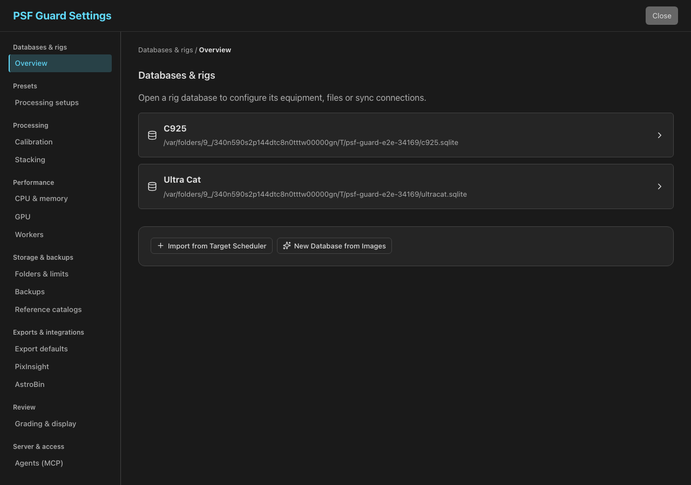

# Find a setting

Open **Settings** from the header menu. On a desktop, choose a page in the
grouped sidebar. On a phone, choose the same page from **Settings section**.
Only the selected page loads its controls.

| Group | Pages |
|---|---|
| **Databases & rigs** | **Overview**, then a rig database’s **Rig setup**, **Database & files**, or **Sync** |
| **Presets** | **Processing setups**, **Exposure templates** |
| **Processing** | **Calibration**, **Stacking** |
| **Performance** | **CPU & memory**, **GPU**, **Workers** |
| **Storage & backups** | **Folders & limits**, **Backups**, **Reference catalogs** |
| **Exports & integrations** | **Export defaults**, **PixInsight**, **AstroBin** |
| **Review** | **Grading & display** |
| **Server & access** | **Server**, **Users**, **Agents (MCP)** |

Pages depend on the connection and your permissions. Planning enables **Rig setup**
and **Exposure templates**. **Sync** appears when you have a database and an
editor account. **Server** configures the desktop app's server connection.
The web interface shows **Users** and API tokens when server login is
enabled. Instances without accounts show **Agents (MCP)**. The desktop app
also offers its own worker controls under **Workers**.

## Find controls that moved

- **Setups** is now **Presets → Processing setups**. Your saved setups,
  default choices and setup names are preserved. The processing editors
  still offer **Apply setup** and **Save as…**.
- **Exposure templates** is under **Presets**. Templates remain reusable
  across rigs; moving the page does not change any rig's exposures.
- **GPU** moved from **Stacking** to **Performance → GPU**. GPU settings
  still apply to PSF Guard processing, including stack builds on workers.
- Processor shares and **Processing memory** are under **Performance →
  CPU & memory**. A worker computer still allocates its own CPU and memory;
  server resource limits do not become per-worker limits.
- Export defaults, PixInsight and AstroBin have their own pages under
  **Exports & integrations**.
- **Storage** is now **Storage & backups → Folders & limits**.
- **Catalogs** is now **Storage & backups → Reference catalogs**, for
  downloaded astronomy data such as solver indexes and Gaia colors.

## Open a rig database

Choose **Databases & rigs → Overview**, then open a database such as **C925**.
Use **Rig setup**, **Database & files**, or **Sync** beneath its name:

- **Rig setup** shows equipment, field of view, observing site, scheduling
  limits and connections used by Planning. It keeps links to the Library and
  calibration settings for configurations recorded in this database.
- **Database & files** shows the catalog path, image folders, import and scan
  options, quality analysis, exports and processed-output folder.
- **Sync** configures the database's Target Scheduler connection, incoming
  uploads and pairing. It also offers reviewed transfers to another catalog
  or a remote PSF Guard. Peers and their credentials remain shared.

The database stays selected as you move between these pages. Click
**Databases & rigs** in the breadcrumb to return to the list and open another
rig database. Each form keeps its own Save control and permissions.

For **Data Transfer**, the opened database receives a **Merge catalogs**
operation and sends a **Send planning** or **Send reviewed grades** operation.
Choose the other endpoint, check **Source** and **Destination**, then click
**Preview changes** before applying. Returning to the list discards this
form's pending preview; unrelated staged previews remain in the overview
with their recorded database scope. An applied job keeps running.

Use the buttons below the parent list to create a catalog or import a Target
Scheduler database. After creation or import, PSF Guard opens the returned
catalog. Plugin onboarding opens its pairing controls under **Sync**.

## Keep edits when navigating

When you choose another Settings page or return to the database list,
Settings asks before discarding unsaved form edits. Choose **Keep editing**
to return to the form. Choose **Discard changes and
switch** to open the requested page without saving those edits. **Close**
also asks before discarding unsaved changes.

Shortcuts from the Library, calibration reports, processing cards and Sky
still open the requested page, rig or catalog package. A shortcut without a
selected database opens the parent list first. If an explicitly selected
database is no longer registered, Settings shows that problem and lets you
return to the list; it does not select a different database. Saved settings keep
their existing scope and permissions: account preferences follow the
account, server settings apply to that server, and desktop worker settings
apply to the computer running the app.

## Save changes and close Settings

Each form has its own Save control, or applies a change immediately as its
help text explains. Click **Close** in the header to leave Settings. **Close**
does not save changes. Database results and unsaved-edit warnings appear
below the header when needed. The desktop app also offers **Open logs** in
the header.

Most saved settings apply immediately. These changes need a server or app
restart:

- **Server & access → Server:** after you save a different port, click
  **Restart server** to use it. The same control appears when the desktop
  server could not start. The restart waits for running work to finish,
  then reloads the interface. The general restart control has been removed
  from the other Settings pages.
- **Storage & backups → Folders & limits:** after you save a new cache,
  stack or calibration folder, click **Restart now** in the desktop app.
  This restarts the whole app so PSF Guard can move files before opening
  the catalogs. A browser user needs the server operator to stop and start
  PSF Guard. WBPP folder changes apply to new runs after saving.

Save or discard unsaved form edits before restarting. See
[Storage folders](STACKING_PREVIEWS.md#disk-use) for how
PSF Guard moves existing files.
