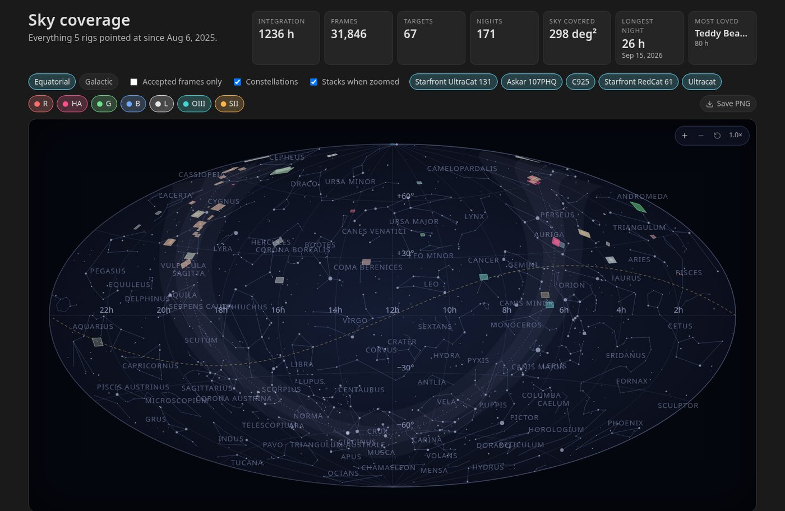
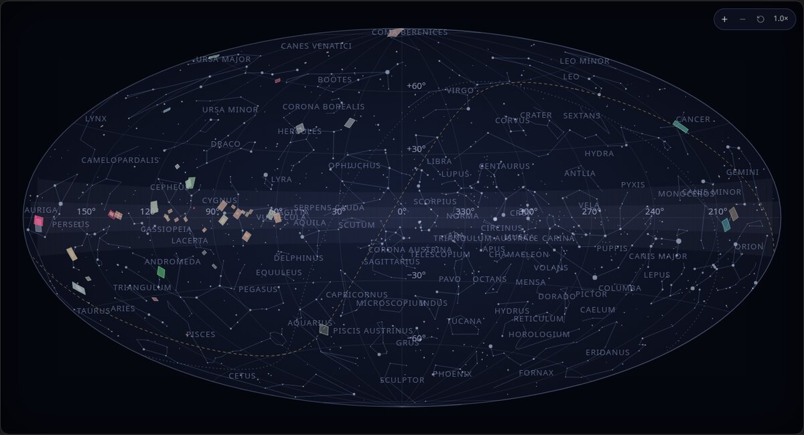
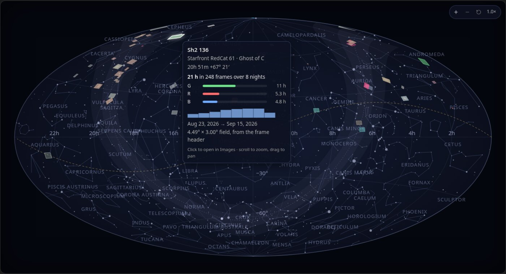
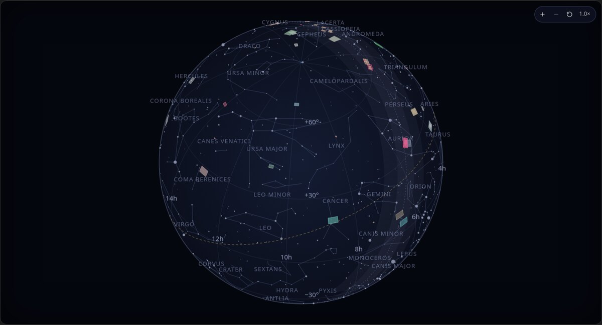
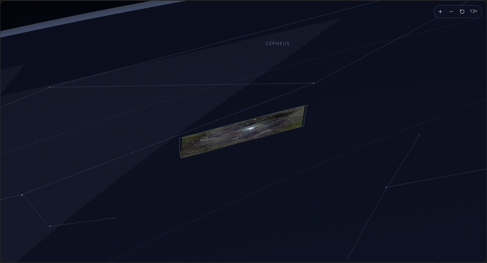
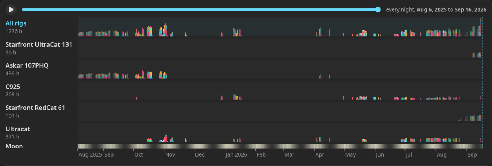
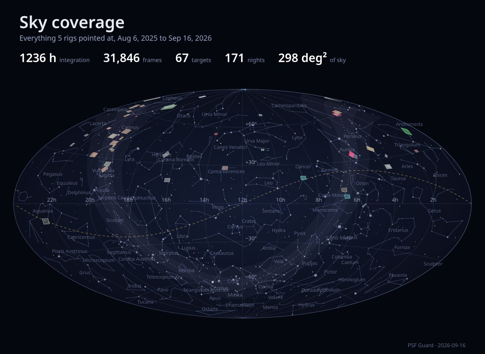

# Sky coverage

The **Sky** view draws everything your catalogs have pointed at on one map of
the whole sky, and lets you replay the nights that built it. It reads every
registered database at once, like the Library.

## The map

An Aitoff projection of the celestial sphere, east to the left as on a star
chart. Switch between **Equatorial** (right ascension and declination, with
the galactic plane dashed) and **Galactic** (galactic longitude and latitude,
with the celestial equator dashed). The ecliptic is the dotted gold line. A
soft band marks the Milky Way.

Each target is drawn as its field on the sky, coloured by the mix of filters
that went into it and brighter the more hours it has. Hover a field for its
card: rig, project, coordinates, hours per filter, a sparkline of hours per
night, frames, nights, first and last night, where the field size came from,
and which stack preview is shown. Click it to open the target in **Images**.

Behind the fields sit every star to magnitude 5.5, and the constellation
figures and names, which the **Constellations** switch hides.

**Flat** is the sky seen from inside the sphere, the whole of it at once at
first; **Globe** is the same sphere seen from outside. In both, a drag turns
the sky in any direction, sideways and up or down, at every zoom, and the
projection is centred on wherever you have turned it, so what you look at
is drawn with the least distortion. Scroll to zoom about the centre of the
view. The buttons in the corner step the zoom and return to the whole sky
as it first stood, and a double click does the same. The page remembers
its frame, shape, turn, zoom, and cuts for the browser session, so coming
back from Images lands on the same sky.

Zoomed in past three times, each field that has a stack preview shows the
picture itself inside its outline (**Stacks when zoomed**): the latest
colour stack of the target when one exists, else the mono stack with the
most integration. A preview is placed by its reference frame's plate solution
when the astrometry cache holds one, carried through the stack's own
orientation, so it lands where the pixels really are; without a solve it is
laid into the field by the planned rotation, north up and east left, which
can be a flip out.

The field size comes from the best source at hand:

- **from a plate solve** when PSF Guard has solved one of the target's
  frames: the solved footprint is drawn as it was measured;
- **from the frame header** otherwise: the sensor size and focal length in
  one frame's FITS header per capture profile, turned by the rotation the
  scheduler planned for the target;
- a dot when neither is available.

## Filters and counts

Chips turn rigs and filters on and off, and **Accepted frames only** counts
graded-in frames alone. Every number on the page follows the same cut: the
stat band, the fields, their cards, and the timeline.

The stat band gives integration hours, frames, targets, nights, the sky area
covered (the area of sky the shown fields reach, with overlaps counted once,
to a twentieth of a degree, and beneath it the fields added together when
that is more), the pixels on sky (each covered patch counted at the finest
plate scale of any field that reached it, so a long focal length earns more
per square degree), the
longest night (the most one rig captured in one night, and which rig), and
the target with the most hours.

## The timeline

Under the map, one lane per rig shows the integration of every night as a bar
stacked by filter, with month ticks below and a Moon row whose brightness is
the Moon's illumination that night. With more than one rig, an **All rigs**
lane on top sums them. The slider spans the nights the selected rigs and
filters captured on and has two thumbs: the right one shows the map as it
stood at the end of a night, the left one sets where the story starts, and
the year chips under it jump the start to January of a year. Press play to
replay from the start thumb: fields appear as their first frames arrive and
brighten as hours accumulate. The band above reads "from" and "as of" while
the range is narrowed.

A night is the civil date it began on. Each catalog's day is split at its
quietest hour, the middle of the longest stretch of the UTC day in which it
never captured anything, so an evening and the small hours that follow it
share one night whatever the site's longitude, and a rig east of Greenwich
that images across noon UTC is not cut in two. The response reports the
split it chose.

## Live

With Director on, the **Live** chip in the controls (or **Show the rigs on
the sky** on the Rigs page) draws each rig that reports to Director on the
map where it points now: a green ring while it exposes, gold while it does
anything else, dashed red with "(quiet)" when it has stopped talking or
"(old report)" when it talks but its last status is over ten minutes old.
A dotted ring labelled "at target" sits on the rig's target, not on a
position its mount reported. Saved pictures leave the
rigs out. A list beside the map shows each rig, whether it is
online, and what it says it is doing; choosing one turns the map to it and
comes in close. The full Live table, and each rig's plans for tonight and
the coming nights, are on the Rigs page, which the list links to and the
header's **Rigs** opens. A rig is
placed from the mount position its plugin reports, or failing that at its
target; see the status payload in [DIRECTOR.md](DIRECTOR.md).
The choice lives in the URL (`live=1`).

## Visible sky

With Director on, click **Visible sky** in the controls to draw a line
around the sky a rig can shoot. The line works in **Flat** and **Globe**,
and in both coordinate frames. It needs no frames: with an empty catalog
the page shows the line on a map with no targets.

1. Choose the rig. The line uses the rig's location, horizon and altitude
   limits from Rig setup. A rig uses the location and horizon of its
   **Planning site** unless it has its own.
2. Set how long a place must stay in view, in minutes. The field starts at
   the rig's Target Scheduler minimum time (30 minutes unless you changed
   it). The line follows a new value when you stop typing, press Enter or
   leave the field. After you type another value, **Use rig's 30 min**
   restores the rig's value.
3. Choose **Tonight**, or **Dates** and a first and last night. **Dates**
   opens with the two weeks from the rig's coming night; a range covers up
   to 31 nights, from 1970-01-02 to 2098-12-31. Nights are dated by their
   evening at the rig's site, as on Nights. Between dawn and noon there,
   **Tonight** is the night that has just ended, and the legend shows
   "last night".

A place is in view when the Sun is more than 12° below the horizon and the
place is above the rig's horizon and minimum altitude and below its maximum
altitude. These are the tests that Planning's Visibility and Nights use, on
the same five-minute samples. A place meets the minimum time on a night
when it stays in view that long without a break. A tree or a roof that
hides a place in the middle of the night splits its time in view in two;
the place counts only if one of the two parts is long enough.

For one night the map shows one solid line. For a range it shows two:

- The solid line surrounds the sky that meets the minimum time on every
  night of the range.
- The dashed line surrounds the sky that meets it on at least one night.

Short marks on each line point into the visible sky, so you can tell the
two sides apart without relying on colour. When the whole sky or none of it
meets the minimum time, there is no line; the legend shows the share of the
sky that does.

The legend under the controls shows the rig, the minimum time, the night or
range, and the horizon the line was drawn against: the site's or the rig's
custom horizon, or a flat horizon at the rig's minimum altitude. The line
always follows a custom horizon when the rig or its site has one. This
differs from a plan's Visibility, which follows the custom horizon only
when **Custom horizon** is on in the plan's Scheduling limits, as Target
Scheduler does.

When the rig has no location, the legend explains that and **Open Rig
setup** opens the rig's settings, where you choose a **Planning site**. On
a night when it never gets dark at the site, nothing is in view; the legend
notes how many nights of a range are like that.

PSF Guard remembers the rig, the minimum time and the nights for the
browser session, with the rest of the Sky view. A remembered range whose
last night has passed is dropped, and **Dates** opens with the coming two
weeks again.

To draw a night, the server measures the whole sky for that night and
minimum time, then keeps the result, so an overlapping range is quicker
the next time. A night takes about a tenth of a second. A month takes from
half a second to a few seconds, longest on a server with few cores and
with a minimum time of 10 minutes or less. The line for **Tonight** is
drawn again when the next night begins at the rig's site, and after you
save a setting. The request is `POST /sky/visible-region`, described with
the other Director endpoints in [DIRECTOR.md](DIRECTOR.md).

## Saving a picture

**Save PNG** renders the map at twice its on-screen size, as shown and as
zoomed, with the title and the numbers above it, for a wallpaper or a post.
The Visible sky lines are part of the picture when they are on, and a line
under the map shows the rig, the minimum time, the nights and the horizon
they were drawn for.
The button is a browser feature and is not offered in the desktop app.

## Where the numbers come from

`GET /api/db/{db}/sky/coverage` returns, for one database, every target with
its coordinates in degrees, per-filter frame and second totals, the nights it
was shot, and its footprint; every (night, target, filter) row; the filters
seen; and the totals. Seconds come from each frame's recorded exposure. A
target with a finished stack also carries `preview`: the preview URL, the
pixel grid it covers, whether it is colour or one filter, and a TAN solution
on that grid when the reference frame was solved.

## Third-party data

The constellation figures, constellation names, and stars to magnitude 5.5
drawn behind the fields come from the d3-celestial data set, Copyright (c) 2015,
Olaf Frohn, under the BSD 3-Clause License. The notice ships with the
frontend source in `static/src/data/d3-celestial-LICENSE.txt`.
