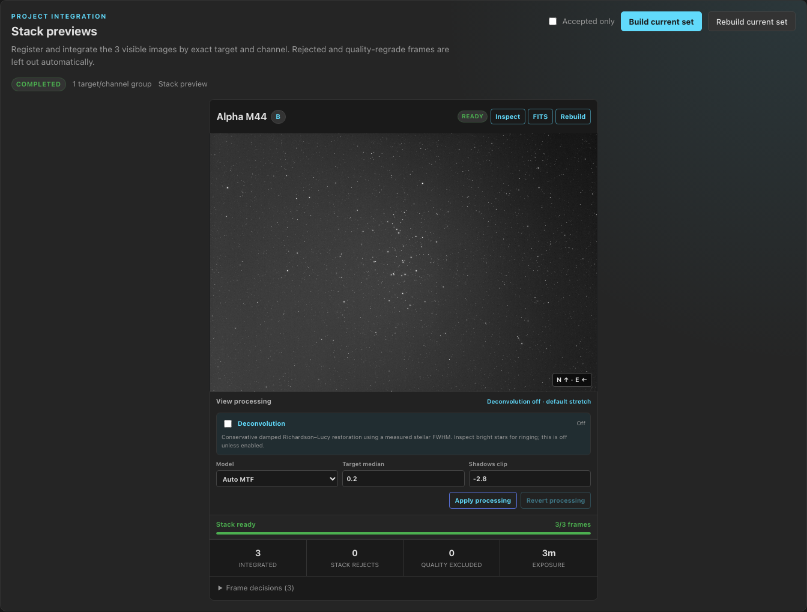
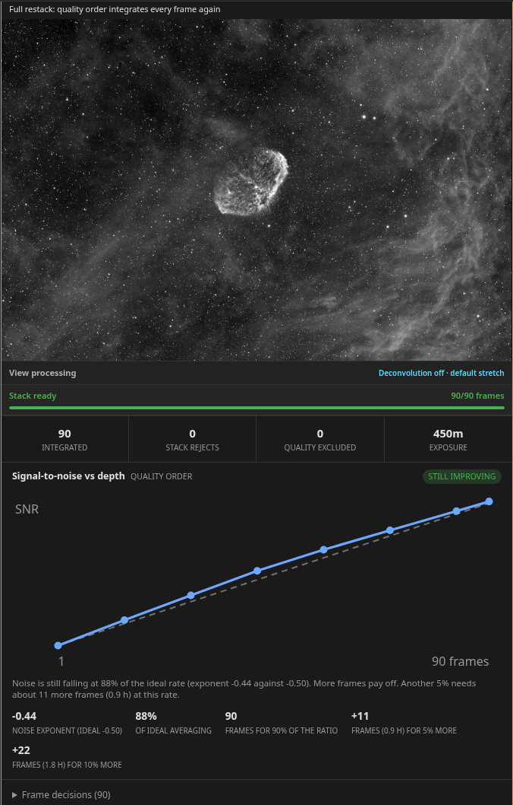
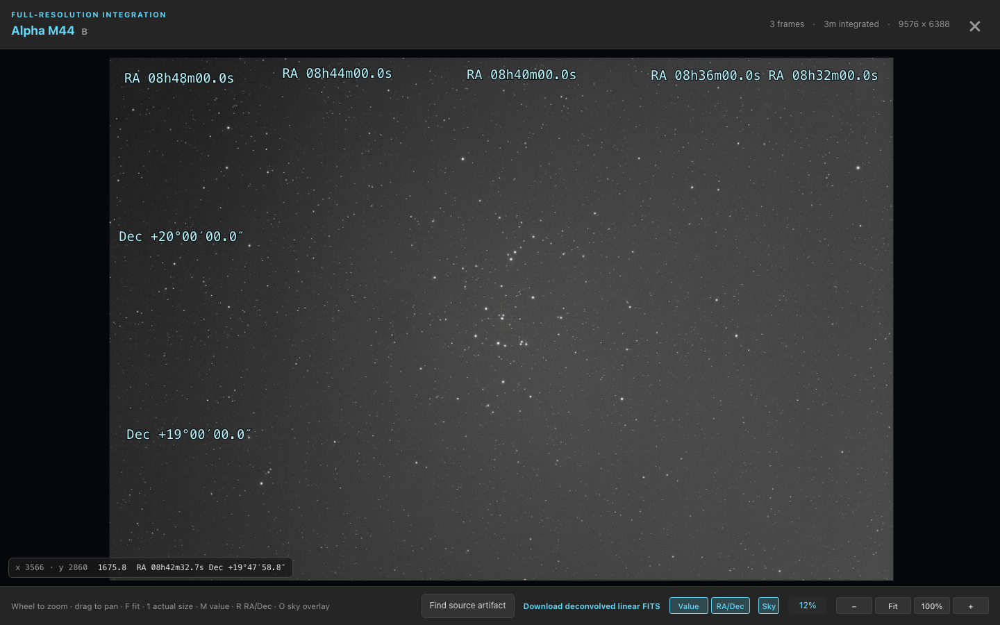
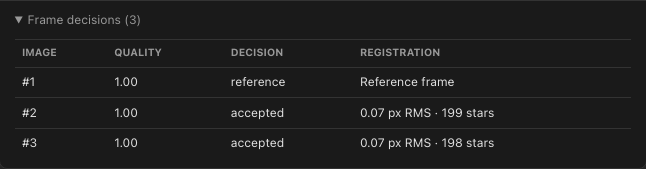
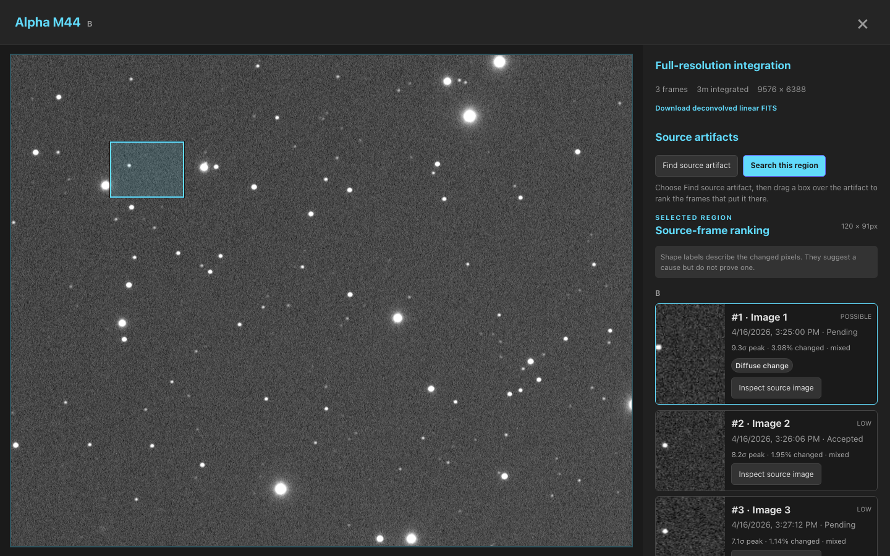
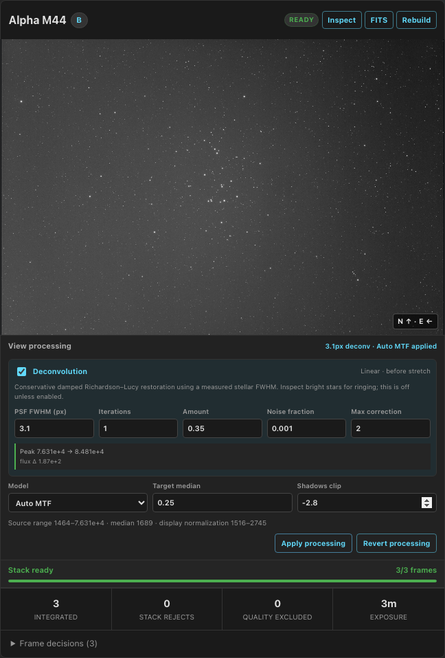
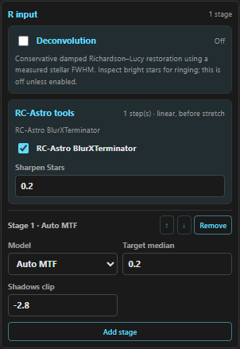
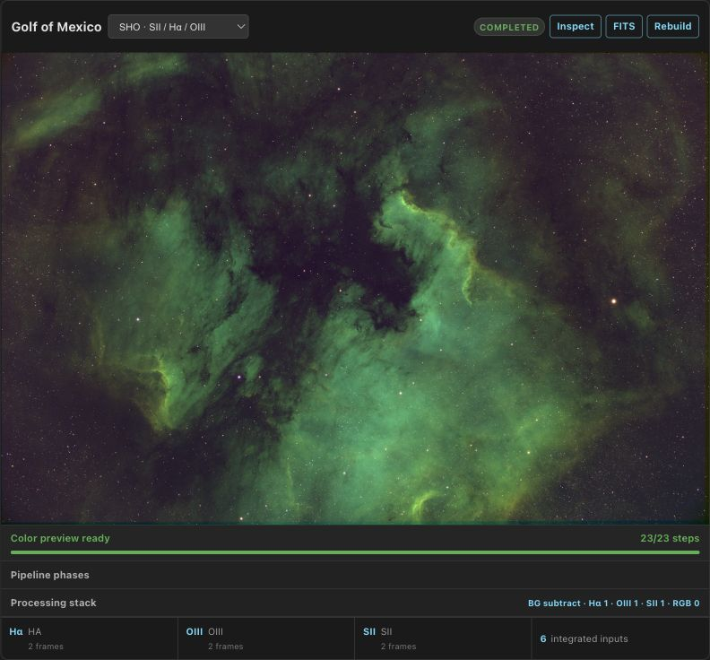
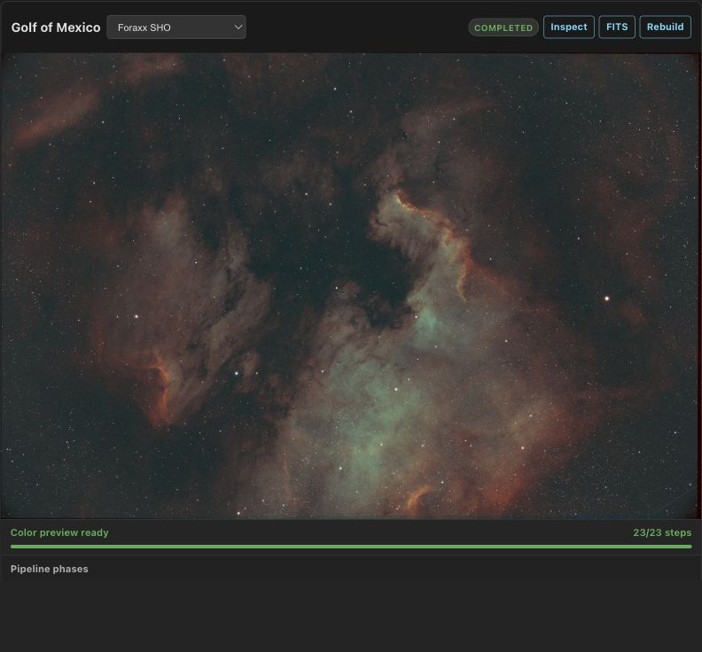
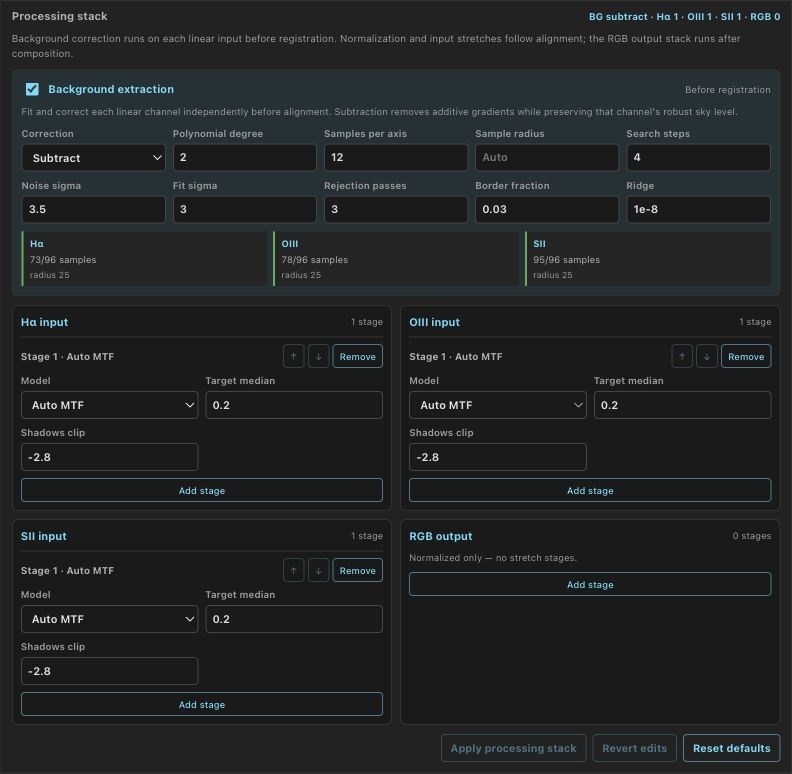

# Project stack previews

PSF Guard can build an on-demand integration of a project's frames in the
**Stacks** view, beside **Images** and **Sequence** in the header.
This is a fast visual answer to “what does this project/channel look like so
far?”, with the grading and registration evidence kept beside the result. It
can apply cataloged calibration data, but it remains a quick-look result rather
than a final-processing workflow.



## Build a preview

Open one project in **Stacks** and choose **Build stacks** to build
every target/channel group, or **Build** on one card to test only that
group. **Build stacks** asks the server for one build per channel, so the
header's queue lists each channel on its own, in channel order. A channel
already built for the same inputs and settings reuses its saved result; a
channel with too few frames shows as skipped. When grades, quality regrades or
**Accepted only** leave a channel with fewer than two frames, the card stops
showing the stack built before, and color composites stop offering it as a
source. A channel whose files are missing, or that has no matching
calibration, keeps its stack until the frames return.

The jobs list shows **Preparing stack build** immediately, and the button
shows **Preparing…**. Within each catalog, PSF Guard prepares requests in the
order received: it reads and scores the frames, then matches calibration data.
Each calibration file's header is read once per request, and other catalog
requests can continue during preparation.

Once preparation finishes, the panel and jobs list show the individual
channel builds. If a matching build is already queued, running or complete,
PSF Guard uses that build. A preparation failure shows the reason. You can
stop preparation before channel builds are queued. A build still being
prepared survives a server restart: it comes back in its place in the queue
and is prepared again (see [After a restart](#after-a-restart)).

Each channel uses the other channels' reference frames to determine pier-side
orientation when its own reference is unsolved. **Build** on a channel card
uses the same input set and cache as a full-set build. Once a result exists,
**Rebuild current set** and the card’s **Rebuild** button force a new build. Rebuilding
one channel replaces only that channel's saved result.

While a channel stacks, its card shows a **Live stack** preview and the number
of accepted frames in that image. PSF Guard refreshes it about every five seconds
between batches, then keeps the latest image visible during final rejection.
Slow frames can delay an update. The live image uses an automatic stretch and
the reference frame's orientation; final processing and orientation follow when
the build finishes.

On a rebuild, **Inspect completed stack** and **Download completed linear FITS**
still open the previous completed result. Live images are temporary displays;
they cannot be used for color composition, processing, or FITS downloads. When
the build completes, its finished preview replaces the live image. Stopping a
rebuild restores the previous preview.

- Every frame of the project, or of the target chosen in the header, is the
  input.
- To stack a hand-picked set, select two or more images in **Images** and
  press **Stack selected**: Stacks opens with that set, and **Stack every
  image instead** goes back to the whole project.
- The server always separates inputs by exact catalog target and
  filter/channel. It never combines different targets or filters.
- **Accepted only** removes Pending frames. By default both Accepted and usable
  Pending frames are eligible.

### Separate exposure lengths

**Separate exposure groups**, at the top of **Stacks** and in **Images**, keeps short exposures
apart from substantially longer ones. It is on by default: normalization
matches each frame's noise, not its signal, so a 120 s frame stacked with
300 s frames carries well under half their signal and dims the result. Turn
it off to mix them; the choice is saved for that
project in this database, and a project that never chose follows the default.
It does not change Target Scheduler templates or exposure plans.

PSF Guard uses each image's recorded exposure, not the template's current
default. Within each exact target and filter, it sorts known exposure lengths
and starts a new group when an exposure is at least twice the shortest one in
the current group. Small timing differences remain together, and intermediate
lengths cannot bridge a short group into a long one. For example, 10, 10.1, and
19 seconds share a group; 30 seconds and 300 seconds each start another.
Missing, zero, negative, or invalid exposure values form **Unknown exposure**.

Groups are calculated from the complete project catalog, before status, date,
target, or selection filters. Grid headings and stack cards show the exposure
length or range. Each group has its own calibration override, latest result,
and resume checkpoint. Changing the setting, or adding an exposure that changes
group membership, prevents incompatible remembered stacks from being reused.

Color previews offer separate RGB, LRGB, and narrowband cards for matching
exposure bands. For example, 30-second and 300-second RGB inputs produce two
cards, each ready to build without selecting its channels by hand. A band
without every required channel stays visible but disabled, and says which
roles are missing. Different exposure combinations retain separate color previews;
rebuilding one does not replace another. **Custom combination** exposes manual
source selection for deliberately mixed exposures or ambiguous channels. This
is not automatic HDR blending or saturated-pixel replacement.

Sequence grading already compares matching capture profiles, including exposure
length. This setting changes presentation and stacking boundaries, not those
grading cohorts or existing grades.

The build runs in the background and the panel polls its status. Different
target/channel groups are processed sequentially. Only one stacking job runs
in the PSF Guard process at a time, even when the server hosts multiple
databases, so full-frame accumulator buffers cannot multiply unexpectedly.
Cards are capped at two columns on wide displays so the inspection preview does
not become excessively wide.

### Stacking method

**Settings → Stacking → Stacking method** sets how every stack preview on the
server integrates its frames. The default is **Recommended**, the Seiza
stacking command line's defaults. On a 98-frame M45 night these gave
sharper stars and higher SNR than WBPP. On 16 H-alpha frames of Sh2 230 in
PSF Guard they cut the sky's block-to-block variation by a third, shrank the
median star, and doubled Seiza's star-signal score over Classic. **Draft** is the same method without
the final pass. **Classic** is what PSF Guard did before the method could be
chosen. Any single choice can also be changed on its own.

| Choice | Recommended | Others |
|---|---|---|
| Final pass | Reintegrate | Draft |
| Normalization | Local background | Global, Local |
| Frame weights | By noise | Equal |
| Reference frame | Chosen by Seiza | Best graded |
| Orientation group margin | 1° | 0°–5° |
| Registration | Quadratic | Affine, Similarity |
| Resampling | Lanczos-3 | Bilinear |
| Bayer drizzle | Off | On |

- **Final pass.** Reintegrate reads every admitted frame again and
  rejects outliers against all the others. A satellite trail in the reference
  or in the first few frames, which online rejection cannot revisit, is
  removed too. Draft publishes the live stack as it stands. It is much faster,
  but such a trail can survive. A Draft checkpoint extends into a full build,
  and back, because the final pass runs after the accumulator is complete.
- **Normalization.** Local background keeps one gain per frame and per
  channel, measured from star photometry, and matches each 256-pixel tile's
  background to the reference's with a smoothed grid of offsets. Frames whose
  sky gradients differ then leave no seams at their edges. Global fits one gain
  and one offset per frame. Local fits a gain per tile too, which a tile of
  cloud or nebula can push far enough to reject the frame.
- **Frame weights.** By noise lets quieter frames count for more. Seiza measures
  each frame's noise per channel after calibration and scales it by the
  frame's gain. A frame's weight is `(reference noise / frame noise)²`, so the
  reference weighs 1 and a frame twice as noisy weighs 0.25. Weights are
  clamped to 0.05–20. Expand **Frame decisions** on a weighted card to see each
  frame's weight; hover one to see the noise it came from. Weighting does not
  blend exposure lengths: **Separate exposure groups**, on by default, keeps
  those apart.
- **Reference frame.** The reference fixes the stack's grid and, under local
  background normalization, the background every frame is matched to. Chosen
  by Seiza scores every frame on a half-resolution luminance by its brightest
  unsaturated stars against its sky noise, which poor seeing, trailing, haze
  and twilight all lower. Among frames within 70% of the best it takes the
  flattest sky. Scoring reads each frame once more before stacking. The card
  shows `Choosing a reference` while it runs. Scores are cached by source
  fingerprint, so a rebuild reads only new frames, and the same frames always
  choose the same reference. Best graded uses PSF Guard's quality grade, as
  before. A group where no frame can be scored falls back to it and says so.
- **Orientation group margin.** Seiza rejects a frame rotated more than 10°
  from the reference, allowing for a meridian flip. When frames were captured
  at more than one rotator angle, Chosen by Seiza first finds the frames that
  would keep the most others within that limit, measured from each frame's
  cached plate solve or, failing that, the WCS in its header. Seiza's score
  then chooses among those frames. A frame counts toward a group only when its
  rotation is within the limit minus the margin. The default 1° margin counts
  frames within 9°. Registration measures rotation separately from the plate
  solve, so increase the margin if it still rejects frames near the limit.
  The setting accepts 0° to 5°. The card notes when the orientation group
  decided the reference. Frames without a solve are never the reference while
  groups are compared. A changed margin marks stacks with a chosen reference
  out of date; it does not affect Best graded.
- **Registration.** Quadratic and Affine fit a polynomial through up to 2 000
  paired stars after the similarity fit. Quadratic follows a wide field's lens
  distortion, which turns against the sky after a meridian flip. A frame with
  too few paired stars keeps the similarity.
- **Resampling.** Lanczos-3 gives sharper stars and clamps the negative lobes
  where they would ring, at edges that stand above the noise. Faint sky is
  left unclamped, so frames rotated slightly against each other leave no
  cross-hatch, and the stack's noise is the sky's own. Bilinear is faster.
- **Bayer drizzle.** Each registered pixel takes only the nearest photosite, in
  its own color, so nothing is interpolated. Each channel then sees a third to
  a quarter of the samples. It pays only when frames are dithered by several
  pixels; with little movement it lowers SNR. Color frames are otherwise
  demosaiced with VNG.

The final pass replays PSF Guard's ledger of admitted frames with the
registration, warp, resampling, normalization and weights the live pass
recorded. Seiza 0.19's own reintegration refits each frame's background
against the mean of the best frames instead. On a 14-frame Sh2 230 night that
mean carried a corner gradient into the whole stack, a gradient the live stack
did not have, so PSF Guard keeps the live pass's backgrounds. The replay cannot
fill the photosites Bayer drizzle left empty, so a drizzle stack publishes its
live stack, which Seiza does fill, and its card says so.

A change applies to the next build, automatic refreshes included. Cards built
another way show **Out of date — stacking method changed**, and cards built
before the method could be chosen show **Out of date — built before the
stacking method could be chosen**. The whole method
enters the job id, and a resume checkpoint records it. A build whose method
accumulates differently starts over and says `Full restack: the stacking
method changed`.

API callers may send `"method": {…}` in the build request; fields left out take
the recommended value, and a request without it uses the server's method.
The old `"weighting"` field is ignored.
`GET` and `PUT /api/settings/stacking/method` read and set the server's method.
Jobs and the latest index record `method`, and each admitted frame of a
weighted build records `integration_weight` and `noise_sigma`, one value per
channel.

### GPU stacking

Stack builds run their heaviest passes on the GPU: Metal on a Mac, Vulkan on
Linux and Direct3D 12 on Windows. Seiza runs these passes there:

- debayering a color camera's frames;
- star detection for registration;
- resampling each frame onto the reference grid;
- the live stack's running mean, with each frame's normalization;
- the final pass's rejection and integration.

Frames under about a million pixels stack on the CPU, as do computers
without a supported GPU. If a GPU pass fails, the build continues on the CPU
and Seiza logs the failure once. Every pass then stays on the CPU until PSF
Guard restarts. On an Apple M4 Max, 35 frames of 26 megapixels (mono, raw,
with the final pass) took 5–6 seconds instead of 12. Of that, the live pass
took 3.2 seconds instead of 8.2.

The GPU calculates in single precision and the CPU in double, so their stacks
differ by rounding: on those 35 frames, by 0.005 of the noise RMS. A pixel
where an outlier is rejected on one and kept on the other can differ by
several times the noise. The choice is therefore not part of the stacking
method or the job id, and changing it does not make built stacks out of
date.

**Settings → Stacking → GPU** controls it for every build on the server:

- **Use the GPU** is on by default. Off keeps all stacking work on the CPU:
  the live pass, the final pass, artifact searches and the channel
  alignment of color previews.
- **Passes on the GPU** turns single passes off: **Debayering**, **Star
  detection**, **Resampling**, **Live stack** and **Final pass**.
  **Debayering** and **Resampling** cover the live pass, the final pass and
  artifact searches. **Resampling** also covers rotating a stack north up.
  **Star detection** and **Resampling** also cover the channel alignment of
  color previews.
- **Frames at once** limits how many frames the GPU works on at the same
  time, 1 to 16; default 3. The others wait without using GPU memory.
- **Log GPU timings** writes each GPU call's stages and times to the server's
  standard error. The desktop app does not show this output.
- **Restore defaults** turns **Use the GPU** and every pass on, sets
  **Frames at once** to 3 and turns **Log GPU timings** off.

A change applies to the next build, color composition or artifact search,
including automatic refreshes. A build already running keeps the choice it
started with. A refresh that adds frames to a channel's last build continues
that stack under the current choice and does not restack.

`GET` and `PUT /api/settings/stacking/gpu` read and set the choice.

### Queue builds by hand

Build buttons stay available while a build runs. **Build channel** and **Build
stacks** queue work behind the running build. Stack builds and channel-processing
runs share one worker across databases. Short color compositions can run
alongside it; see [Color previews](#color-previews-from-channel-stacks).
Each card shows its own state:
`queued` cards wait, the `running` card shows live progress, and the status
line counts the builds in the queue. The header's background jobs chip lists
the same queue in every view. **Stop** becomes **Stop all** when more than one
build is pending and stops every queued and running job; channels that already
finished keep their previews.

### Additive rebuilds resume

A finished or stopped channel build checkpoints its integration state — the
running accumulator, the online rejection statistics, and the registration
reference — beside a ledger of every frame it integrated or turned away. A
later build of the same target and channel whose frame set only grew reopens
that checkpoint and registers just the new frames. The card marks restored
work as `resumed` in its frame counter. Final transient rejection still reads
every admitted frame again using the saved registration mappings; it does not
repeat star detection or registration. Adding a night therefore avoids the
old frames' registration cost, but still needs their source files for the
completed integration.

The resumed result is exactly the stack a from-scratch build would produce;
Seiza's checkpoint round trip is bit-for-bit and validates the format version,
dimensions, configuration, and payload checksum before continuing. The
checkpoint is only reused when it is provably an ancestor of the request:
every recorded frame must still be requested with an identical source
fingerprint, and the calibration set, Accepted-only policy, scoring policy,
stacking method, stacking order, and pipeline version must match. Only the
final pass may differ. Removing a frame, regrading
one in place, changing calibration or scoring, or a Seiza upgrade that
changes stacking output rebuilds from scratch — and when a checkpoint existed but could not be extended, the
card says why (`Full restack: the scoring policy changed`), so a slow rebuild
is never a mystery. The checkpoint it could not extend is deleted as the
restack starts, rather than left beside it until the restack saves its own;
only a quality-ordered build leaves it, as described below. A stopped build checkpoints the frames it finished, so
building again continues where the stop landed instead of starting over.
Checkpoints live in the project cache and cost one full-frame state file per
target/channel.

### Seiza upgrades

A Seiza upgrade keeps completed stacks, resume checkpoints, reference scores
and calibration masters when its calculated output is unchanged. **Build
current set** reuses these results. When stacking output changes, the next
build stacks each channel again and rebuilds the masters it needs.

When an engine update changes only the display stretch, **Build current set**
or automatic refresh renders the card preview again from the saved FITS. The
card and job list show **Waiting to render preview**, then **Rendering
preview**. The channel stays ready: processing, FITS downloads, calibration
masters and source-frame searches remain available. One-shot-color stacks
refresh the same way when their color calibration is out of date.

Refreshing a card preview preserves the stack's artifact revision, applied
processing and color combinations. If you stop the refresh, the completed
stack stays ready and the next build can retry the preview. A failed refresh
keeps the old preview and explains the error on the card. It does not retry
at the same stretch output version unless you rebuild the stack.

Color combinations and WBPP previews keep their previous stretch until they
are created again. Calibration master previews can also render again after
an app update; this does not rebuild the masters.

Stack cache keys use `seiza_stacking::OUTPUT_VERSION`; stretch results and
card previews use `seiza_stretch::OUTPUT_VERSION`. These identify compatible
output, rather than the installed crate release. Card previews record
`preview_stretch_version`, and a new `preview_revision` lets the page load
the refreshed image without discarding the completed stack.

### Frame preparation and worker budgets

Within one channel, upcoming frames can be read, calibrated, debayered,
registered, and normalized while earlier frames are integrated. Seiza reads and
prepares frames as tasks in the group's pool, a pool of the workers the build
leased, and integrates them in source order on the calling thread, including
frame decisions, calibration-session boundaries, signal-to-noise measurements,
and checkpoints.

Every leased worker is a thread of that pool. Up to half as many frames as
workers are in preparation at once, as Seiza's command line sizes it, so one
frame's serial steps overlap another's parallel ones; the memory plan below can
lower that number. A one-worker allowance keeps the sequential path.
Calibration setup, initialization, depth measurements, checkpoints, and final
processing run on the same pool after a batch's frames are integrated; those
stages never run concurrently with preparation.
The memory plan reserves stack buffers, every session's resident masters, and
the active-master replacement peak before allowing queued frames. If even one
preparation worker cannot fit but known RAM supports the serial-processing
estimate, the build processes one frame at a time with the full compute pool
and logs the memory fallback. If serial processing cannot fit either, the build
reports that clearly.
Admission reserves 40 bytes per output sample before budgeting preparation.
Initialization, checkpoints, and final rejection have a separate 96-byte
per-sample estimate because their peaks do not overlap the preparation queue.
Both checks include the resident masters and two copies of the largest active
master set. If available RAM cannot be queried, preparation gets a bounded
1 GiB allowance, but the serial-processing peak cannot be checked.
An unknown-RAM build that cannot fit one preparation worker in that allowance
fails instead of silently starting an unbounded serial job. The intentional
one-CPU serial path applies the same allowance to its single-frame workspace.
These are reference-sized estimates, not a hard process-memory limit: larger
source frames, decoder scratch buffers, and other activity can need more RAM.
Separate channels and queued stack jobs still run one at a time.

Logs report the configured workers, estimated memory, and for each batch the
pipeline mode, frames in preparation at once, integrated, rejected and failed
frames, and elapsed time. Final transient rejection still replays frames sequentially within the
compute pool. No extra full-frame pre-measurement pass is required.

### Cache housekeeping

Stack artifacts are content-addressed by job, so every rebuild writes a new
directory and old ones used to accumulate forever. After a build settles, and
once an hour in every database, a janitor sweeps the stack folder and deletes
what nothing references any more:

- mono and color job directories absent from every durable latest and WBPP
  index and from the in-memory job list, and cached color inputs no kept job
  points at;
- stretch and deconvolution results no processing selection uses, a week
  after they were last selected or used, so a variant you might pick again
  stays a while;
- artifact searches whose stack is gone;
- the indices of deleted projects, and with them the stacks only they listed.
  Merging a project moves its indices onto the project it merged into, so its
  stacks stay.

WBPP run folders use their own intermediate/master retention and volume limit;
see [Manage WBPP storage](WBPP.md#manage-wbpp-storage).

Both indices replace entries per identity — mono per target/channel, color
per target/kind/palette — so a job's output is durable until its input set
changes and a newer build of the same identity supersedes it. A full day of
grace on top means nothing a long build session or an open inspector still
touches is swept out from under it. An index or processing selection that
cannot be read, from a newer build or a torn write, stops the sweep of that
database, since the sweep can no longer tell which files are in use; the
server log says which file.

Resume checkpoints are replaced in place when their group's input set
changes. One that no build has written or resumed from for 30 days is
deleted, as an unused master is; the stack it led to stays. Checkpoints that
can never resume again — written by another stacking pipeline version, or
unreadable — go at once, and an orphaned half of an interrupted save after a
day.

A build belongs to the server, not to the page that started it. The header's
background jobs chip counts it for as long as any mono or color build, or
processing run, is queued or running, in every view and in every database. The chip shows only
the overall progress and a count for each kind of job, each an icon:
running, queued (in a line you can reorder), waiting (automatic work stepped
aside for yours) and needs attention. Hover, focus or click it to open the
queue. It lists the work you started under **Started by you** and the rest
under **Automatic**, each heading with its counts; in each, rows that need
you come first, then running work, then queued builds, then waiting work.
Each build shows its target and channel and how far it has got. The build
line is one line for both headings, since an automatic refresh's build can
wait ahead of yours, so a waiting build says its place in the whole line
and how many are ahead of it, as `queued · 4 · 3 ahead`. Waiting automatic
work is drawn muted, since it is normal; only a row that needs you, such as
a transfer to review, takes the warning colour.
Catalog refreshes,
quality scans and WBPP runs share the same chip. Click what a row works on to
go there: a build or WBPP run opens its target's stacks, a quality scan the
target's sequence, and a catalog refresh the database's images.

The overall percent and each build's bar count frame reads: the live pass
reads each eligible frame once, and the final rejection pass reads each
admitted frame once more and then integrates it, counted as a second read, so
the bar keeps moving through the final pass instead of sitting at 100%. While
that pass runs the build's line reads, for example, `Rejecting transients ·
pass 2/2 · frame 4/14`. The final pass keeps each frame it reads in a scratch
file below the stack folder, `stack-scratch`, four bytes per sample per frame
(twelve per pixel in colour), until it ends. When its disk lacks the room, or
a scratch file cannot be written, the pass reads every frame on each of three
passes instead, and the progress line counts three passes.

Builds wait in a line of their own, and the line, not the order they were
asked for, decides what runs next. In the queue, **↑** and **↓** move a
waiting build one place. The arrow-to-top button (**Move to top**) moves a task
under **Started by you** straight to the front, including past automatic tasks.
It runs next after the current task finishes. The button is disabled when the
task is already next. **×** takes a queued task out of the line, and **Stop**
ends the running build after asking once. Mono and color builds share the line,
and so do stretch, deconvolution and RC-Astro processing runs (see
[Processing runs wait in the build line](#processing-runs-wait-in-the-build-line)).
**Stop** on a running
color composition ends it at its next channel or step, and kills a running
RC-Astro tool at once; the tool steps it finished stay cached. Its row says
what it is doing, such as `H-alpha: BlurXTerminator (42%)`, and its percent
moves while a tool runs. An automatic refresh still settling after new
frames, a sync or grade changes is not listed or counted: nothing runs yet.
Once due, its builds join the line marked `automatic`, behind anything you
started (see [Automatic refresh](#automatic-refresh)). A queued build reads
its frames, grades and calibration again when its turn comes. When they
changed while it waited, it runs as a new build, and the card follows it. These controls need
write access. `POST /api/stack-activity/{job_id}/move` with
`{"position": n}` (0 is next) and `POST /api/stack-activity/{job_id}/cancel`
do the same from scripts; `GET /api/stack-activity` lists builds running first,
then the line in order, each waiting one with its `queue_position`; the
automatic refreshes under `scheduled`, each due one not yet planned marked
`waiting` with `waiting_for`;
and re-applies of processing waiting for their turn under
`waiting_reapplies`. A processing run is an entry
of `kind` `processing` whose `job_id` is its stretch id; its `processing`
object carries `operation`, `channel`, `stoppable`, the stack build and group
it processes as `stack_job_id` and `group_index`, and, while it waits,
`waiting_for`, or, once it runs, `stage`, `fraction` and
`started_unix_seconds`.
`POST /api/stack-activity/scheduled/run-now` starts one within seconds and
`/scheduled/skip` drops it until the next change; both take
`{"database_id": …, "project_id": …}`. Reopening **Stacks** re-attaches the stack panels to the
running job, so leaving the page and coming back restores the live per-card
progress instead of an idle panel.

## Stacks made by WBPP

**Stack in WBPP**, beside **Build stacks**, runs PixInsight's WBPP on the
server for the project, or for the target chosen in the header; it opens the
same run dialog as the Library's project cards, needs an editor, and
shows the run's state while one is queued,
running or finished. With a target chosen it shows only that target's run.
For a project with several targets it asks for a target first: WBPP stacks
a project's targets together, so PSF Guard cannot import their masters as
separate target stacks.
A WBPP run started from PSF Guard ends by taking its master lights in as
stacks before PixInsight takes the next run, and the page shows them as soon
as they are in. **WBPP stacks**, below PSF Guard's own in **Stacks**, shows each one
with a preview and its FITS, and the **Combine channel stacks** section offers
it as a channel source marked *WBPP*: choose, for example, L, R, G and B from
WBPP and PSF Guard composes the color preview, with the same background,
stretch and processing as for its own stacks. When that fails the section
says why, and **Take in the last run** appears to try again. It reads only that run's folder, and it needs an
editor, like starting a run.

- One master per filter and exposure is taken: without drizzle first, since
  drizzle changes the scale and color composition aligns channels of one
  scale, then cropped. A drizzled master is taken when it is the only one.
- WBPP groups frames by filter, exposure and binning, not by target. Masters
  are tied to a target only when a project's run covered one: a run for one
  target of the project, or for a project with one target. A run across
  several targets mixes them, and its masters are not taken in.
- WBPP records no frame count in a master, so its cards say *WBPP master*
  instead.
- WBPP stacks live in their own index, `wbpp-project-<id>.json`, so they never
  replace PSF Guard's stack of the same channel. A newer master for the same
  target, filter and exposure replaces the older one there.
- A color preview built from WBPP channels is kept apart from one built from
  PSF Guard's stacks of the same filters, and a rebuilt PSF Guard stack never
  takes a WBPP channel's place in a remembered preview.
- **Combine channel stacks** shows a card marked *WBPP* that composes the
  masters when they cover the channels a preview needs (Hα and OIII at least
  for narrowband). It appears in a project that splits stacks by exposure,
  and beside PSF Guard's own stacks in one that does not. A target with only
  WBPP masters and no exposure split has one card, which uses them.
- The target's other cards use PSF Guard's stacks when each channel has
  exactly one. Otherwise they ask you to choose each channel, so PSF Guard
  stacks and WBPP masters are never mixed unless you choose them.
- A master's label gives its sub-exposure, such as `R (WBPP, 300 s)`. When
  WBPP made two masters of one filter at different exposures, the WBPP card
  says so and stays disabled. Choose the master in **Custom combination**,
  or in the card's source lists when the project does not split exposures.
- A master that cannot be read is listed as skipped and the rest go in.

## Stop a build

**Stop** appears beside the build buttons while a build is queued or running.
The stop takes effect between frames, between channels, and between the
frames a calibration master reads, so it lands within one frame's work rather
than instantly. A master stopped part way writes nothing.
No partial stack artifact is published: a channel that stops before its FITS and preview
are written leaves no artifact, and the card says the channel was stopped.
Its temporary live image disappears from the card.
Channels that already finished keep their previews and are remembered as usual.
Build again when you are ready; a stopped job is never reused as a cached
result.

## How deep is deep enough

Every stack build measures how its signal-to-noise ratio grows with depth, and
the card draws the result. When every accepted frame has the same known
exposure, the card also compares that curve with ideal averaging and estimates
what more frames would buy. Mixed or missing exposure lengths keep the measured
curve, but PSF Guard withholds that model-dependent verdict instead of treating
unequal frames as interchangeable.

For equal exposures, perfect averaging halves the noise for every four frames,
so noise should fall as the square root of the frame count. On the card's
log-log chart that ideal is a straight dashed line, and the solid line is what
your frames actually did. The gap between them is the reading.



The stack above ran in quality order, which is why its curve rises above the
ideal after their shared first point: the best frames went in first, so the
early depths beat what averaging alone would give, and the line settles back
towards the ideal as the weaker frames arrive.

### What is measured, and what is predicted

The curve is measurement. The stack accumulator already holds the integration
of every frame pushed so far, so the build reads it on the way past instead of
integrating the same frames again once per depth: depths double — 1, 2, 4, 8,
16 and so on, plus the full set — which keeps the whole curve to about nine
extra batch boundaries across five hundred frames and costs no extra pass over
the pixels.

At each depth the build records:

- **Noise**, a robust two-dimensional difference measurement scaled to a
  standard deviation. It removes a local linear sky gradient, reads both axes
  so row or column banding cannot disappear, and uses medians so stars do not
  set the result. What remains is the pixel-scale noise of the integration —
  the quantity that should fall as the square root of the frame count for
  comparable exposures.
- **Background**, the median sample.
- **Signal**, how far the brightest one percent of the frame sits above that
  background.

Every depth's ratio is read against the deepest depth's signal, not its own. A
target's flux does not change as a stack deepens; only the noise does. But the
brightest-percent statistic is itself lifted by noise where the stack is
shallow — a one-frame stack's brightest percent is part star and part noise
peak — so reading each depth against its own signal would write that bias into
the ratio and flatter the early frames. Each depth keeps the signal it
measured, which is worth seeing when it drifts: that is normalization moving,
not the sky.

Everything past the curve is prediction, and is labelled as such. For equal,
known exposures, the fitted exponent, how far short of the ideal the run falls,
where the returns flattened, and how many more frames a further five or ten
percent would take all come from a least-squares fit through the deeper part of
the curve. If those deeper measurements do not establish a consistent trend,
PSF Guard labels the result inconclusive and withholds the projection.
It also applies a scatter threshold before calling a run worse; a tiny upward
wobble is a plateau, not evidence that later frames hurt.

The verdict is one word:

| Verdict | What it means |
|---|---|
| Inconclusive | The deeper measurements do not fit one stable direction, so PSF Guard makes no projection. |
| Still improving | Noise is falling at three quarters of the ideal rate or better. More frames pay. |
| Diminishing returns | Noise is still falling, but each frame buys well under what it should. |
| Plateau | Noise has all but stopped falling. More frames like these will not help. |
| Getting worse | Noise rose over the deeper part of the run. |

A plateau is usually a floor the frames cannot get under: light-pollution
gradient residual, a fixed pattern an undithered run cannot average away, or
walking noise. It is a reason to change something about the acquisition, not to
shoot more of the same.

### Capture order or quality order

The **Order** control decides which question the curve answers.

**Capture sequence** is the default. The server seeds the stack with its
best-graded registration reference, then integrates every other eligible frame
chronologically. The curve therefore shows how the captured sequence grows
after that fixed reference; it is a broad time trend, not a claim that the
reference itself was the first exposure. It costs nothing because this is the
order the stacker already integrates in.

**Quality** puts the best-graded frames first. Its curve reads as the frames
you would keep before the ones you would throw away, so the depth where it
leaves the ideal is where the weaker frames stop paying for themselves — the
answer to "which of these should I reject?". A span where the noise rose is
called out under the chart.

Quality order integrates every frame again. A frame added later can sort into
the middle of the order, and the accumulator has already integrated everything
that would come after it, so a quality build never resumes from a checkpoint
and never writes one. Your capture-order checkpoint is left untouched, and a
quality build is a full restack every time. It is a question you ask
deliberately, not a default.

The best-graded frame is the registration reference under either server order.
Only what follows it changes. A resumed capture sequence is used only when its
saved ledger is an exact prefix of the new sequence; a backfilled exposure or a
changed reference forces a full restack.

### Folding the chart away

Click **Signal-to-noise vs depth** on any card to fold the chart away, the same
way frame decisions and view processing fold. The choice is remembered across
reloads and applies to every card, so folding it once is enough.

Folded is not hidden. The heading keeps the frame order and the verdict beside
it, so a glance still answers whether more frames are worth shooting — you lose
the chart, not the answer. And nothing about the build changes: it measures the
curve either way and still writes it to the FITS header, the JSON sidecar, and
the resume checkpoint.

The chart is folded only by this control. It never collapses on its own because
a channel is small or a reading looks dull.

### Where the curve goes

The card draws it live as the build passes each depth, and keeps it with the
finished result. It is also published three ways:

- as JSON beside the stack's FITS, at
  `/api/db/{db}/stack-previews/{job}/{group}/snr`; the card receives the same
  data in job status, and the endpoint serves an atomic sidecar that survives
  a server restart;
- as `SNRORDER`, `SNRNOISE`, `SNRVALUE`, `SNRSLOPE`, and `SNRVERDT` cards in
  the downloaded stack FITS;
- inside the resume checkpoint, so a target stacked one night at a time still
  ends with one curve over the whole season rather than one per session.

### Without a catalog

`psf-guard stack-snr` runs the same measurement over a folder:

```bash
psf-guard stack-snr /path/to/lights
psf-guard stack-snr /path/to/lights --order quality --csv curve.csv --json curve.json
psf-guard stack-snr /path/to/lights --weight-by-noise
```

`--weight-by-noise` applies the same inverse-noise weights as the stacking
method's **By noise**, relative to the first frame, and prints each frame's
weight and noise. The command otherwise keeps the classic method.

It stacks the frames raw — calibration lives in the catalog, and a folder has
none to match against — and prints the curve and its reading. Its quality order
ranks frames by detected stars against their sharpness rather than by a catalog
grade, so it need not agree with the server's order frame for frame. Unlike the
server, a capture-order folder run has no separately chosen registration
reference, so its first frame and every point after it are chronological.

## Stack orientation

A stack keeps the rotation of its reference frame. Registration matches star
triangles at any angle, so frames taken on either side of a meridian flip land
on the same grid without a reprojection, and the result looks like the frames
you graded. The downloaded FITS carries the reference frame's own WCS when it
has one.

### Which side of a meridian flip

A German equatorial mount turns the field 180 degrees when it flips. Both
halves of such a night stack cleanly, but the reference frame alone decides
which way up the result comes out, and the reference is whichever frame scored
best — it can sit on either side of the flip, and it can move to the other
side when a regrade or a quality rescan changes the scores.

So PSF Guard turns the finished stack when the reference faces the wrong way,
choosing that by the strongest anchor it has. The turn is an exact reversal of
the pixel order, so it costs no resampling and loses no accuracy, and it is
always a half turn — the camera's own rotation is kept either way.

1. **The sky.** A cached pixel-derived solve of the reference frame, or a valid
   embedded FITS WCS, says which way north points across the frame. PSF Guard
   publishes with north the upper half of the frame. No plate solve is run for
   this; if neither is already there, it falls through. A matrix that cannot
   describe a sky rotation is not trusted over the anchors below it.
2. **The pier.** Failing that, the reference frame's `PIERSIDE` header. A pier
   side on its own says nothing about where north is, so PSF Guard reads every
   reference frame in the build before it stacks anything, and learns from any
   channel that reported both which way a west-of-pier frame faces. Channels
   that were never solved then follow that mapping instead of an assumption
   that need not match. Frames that disagree are counted rather than trusted in
   order, so one bad solve cannot invert the rest. When nothing in the build
   was solved there is nothing to learn, and the shared assumption still leaves
   every channel agreeing with the others.
3. **Its own exposure.** Failing both, whichever way most of that stack's own
   integrated seconds faced.

The first two anchors are absolute, so every channel of a target reaches the
same answer and the cards agree. The third only knows about one stack: it keeps
that stack facing the way most of its night was shot, but two channels whose
reference frames sit on opposite sides of a flip can still come out half a turn
apart. Solve one frame per channel, or record `PIERSIDE`, to pin them together.

A night that never flipped is never turned, and the choice does not move when
quality scores change the reference frame. Each card records which anchor
decided it, as `sky_anchor`, `pier_side`, or `exposure_majority`.

PSF Guard records the source-to-output mapping on every stack, so
source-artifact search maps a selected stack region back to the right source
pixels, and background protection maps catalog bounds forward onto the stack.
That mapping is the identity for an untouched build and the half turn for a
turned one, so both consumers follow the published pixels without special
cases.

### The shared north-up grid

A caller can ask for the canonical celestial frame instead — north up, east
left — by sending `north_up: true` when it starts a build. Several stacks then
share one grid, which is what a sky mosaic needs. The UI never sets it; each
card and inspector shows the `N ↑ · E ←` marker only for a stack built this
way.

An oriented build reprojects the integration after registration and expands the
output grid to keep the source frame's four corners, so a rotated camera
produces blank, masked wedges around the valid sky footprint instead of losing
data to a crop. PSF Guard first uses a current pixel-derived solve, then a valid
embedded FITS WCS. If neither exists, it plate-solves the reference frame before
it publishes the result. The build fails with a catalog or solve error when it
cannot prove the orientation; it never marks an unknown view as sky-up. The
FITS then contains a replacement TAN WCS for the reprojected pixels and records
`SKYORIEN='N-UP E-LEFT'`. A color preview registers its channel stacks onto the
reference channel's grid, so RGB, LRGB, and narrowband outputs inherit whichever
frame their channels were built in.

## Automatic refresh

Once a project's previews have been built, PSF Guard can keep them current on
its own. Turn on **Automatically refresh stack previews** under Settings →
Stacking → Stack previews. It applies to every database on the server and is
off by default.

A refresh rebuilds what the project's cards remember: the same targets and
channels, the same Accepted-only policy, order, and per-channel calibration
choices, over the frames the project holds now. It uses the server's current
stacking method and scoring defaults (see
[scoring defaults](SCREENING.md#scoring-defaults)), so a change to either
reaches the next refresh. A card built with other scoring, which shows
**Out of date — scoring settings changed**, is stacked again with the
defaults by that refresh, and the job list shows it as one to restack.
Its color previews are composed again afterwards, as after any
build (see [Color previews from channel stacks](#color-previews-from-channel-stacks)). Like **Build stacks**, it
queues one build per channel, the same builds a person's Build stacks makes,
so after either one only the channels whose frames or grades changed stack
again; the rest are cache hits.

**Also stack channels that have no stack yet** goes further: a channel with
two or more usable frames, one of them captured recently enough, is stacked
on the next refresh too, with the settings of the
project's other cards (for a project with none: every frame that is not
rejected, and capture order), scored with the server's defaults,
so frames that arrive are stacked before anyone opens the project. **A new
channel needs a frame from the last (days)** sets how recent (a week by
default); older channels are left alone, so turning it on does not stack a
whole catalog. **Also stack old channels, of any age** drops the cutoff: each
database's next refresh (every database's, after a restart) then stacks every
channel there without a stack,
which on a large catalog keeps the stacker busy for a long while, as
background work that yields to anything you start.

A refresh also composes a target's first color preview once its channels are
stacked, with the pipeline of the default Color setup (see
[Default color setup](#default-color-setup)). This includes a target whose
channels were already stacked and only came back from the cache. PSF Guard
reads the default setup at each refresh, so a setup you mark as the default
applies from the next refresh on. A target that already has a color preview
keeps it: the preview follows its channels, as after any build. If a target's
first color preview fails, later refreshes do not try the same composition
again while the server keeps the failed job, at most until it restarts. To try
it again, click **Build** on its color card.

A refresh waiting for its delay does not appear in the header's jobs list
or count. Once it is due, the scheduler checks within 15 seconds. It plans
the refresh when nothing you started has run for the last 30
seconds, no automatic build is already queued or running, and no quality
analysis of its database runs. Planning reads every light's header in the
background. The refresh then queues one build per channel, marked
`automatic`. Automatic builds run after every build
you queued, one at a time, and starts none while work you started runs
anywhere on the server, such as a quality scan. The header lists them as
queued under **Automatic**. Until a due refresh is planned, the header
lists it as **Refreshing stacks**, marked **waiting**, with what it waits
for, and counts it with an hourglass beside the running count.

A build you start pauses a running automatic build at its checkpoint. The
automatic build returns to the queue ahead of other automatic builds.
It resumes from its checkpoint after your work. If frames or grades changed,
PSF Guard rebuilds the affected results. An automatic build
you stop yourself stays stopped. A refresh is never listed twice: once its
builds are in the line, its row becomes those builds. A refresh that would find only cache hits does
not start a build, nor does one whose channels an earlier refresh of the same
database already covers. When a refresh finds an older finished build of the
same frames, the card points back at it instead of stacking again.

What queues a refresh, and how long it waits first:

- **New frames** — an import, a remote upload, or a scan of quality metrics
  finishing — wait for the arrival delay (5 minutes by default). Each further
  arrival pushes the refresh out again, so a night's stream of uploads is
  stacked in batches; a stream cannot push it past four delays from the
  first arrival.
- **A sync** — a scheduler sync or a database transfer — waits the same
  arrival delay.
- **Grade changes**, by hand or by a regrade, wait for the grade delay (15
  minutes by default) because grading is interactive. Each further change
  pushes the refresh out again, up to four delays. New frames outrank waiting
  grades and pull the refresh in to the arrival delay.
- **New scoring defaults**, saved in Settings › Review or with the Scoring
  control's **Save as default**, refresh every database's projects after the
  arrival delay, when the values differ from the old ones. The first
  editor's copy at the update counts as a save. When that editor's values
  are the built-in ones, nothing changes, so cards stacked with other
  scoring wait for the next refresh, whatever queues it.

A refresh runs on the same single stacking worker as any other build, as
background work that yields to previews and quality scans, waits while a
quality scan of that database runs, and steps aside for you: starting a
build, a color composition, a stretch, or an artifact search stops the
automatic build or color recomposition running on the worker, which goes
back in the line and resumes after your work. A recomposition's finished
RC-Astro steps stay cached. Starting the very build the refresh queued or
is running simply makes it yours, and moves it ahead of the automatic
builds. The header's background
jobs queue marks automatic builds `automatic`. A refresh follows only the
cards the grid shows and, with new channels on, projects with recent frames,
and never changes the calibration library, grades, or files. Target merges, exposure
moves, and peer pulls count as syncs.

An automatic build uses the background share of the processor, 25% of the
cores by default, while a build you start uses the interactive share, 50%.
**Settings → Performance → Processor use** sets both; see below.

### After a restart

The queue survives a restart. PSF Guard keeps a job journal beside the
database registry (`<registry>.jobs.json`), rewritten a few seconds after the
queue changes and once more when the server stops cleanly (Ctrl+C, SIGTERM,
or quitting the desktop app). It holds stack and color builds and processing
runs queued or running, in the order they would run, automatic refreshes
still settling with their due times, and the WBPP line. A stopping server
asks every build to stop and waits for it: a running build checkpoints the
frames it has integrated, and the journal keeps it to resume. A running
RC-Astro tool is killed rather than waited for; see
[Processing runs wait in the build line](#processing-runs-wait-in-the-build-line).

On start PSF Guard puts them back before the automatic scheduler may start
anything:

- Each stack build and color composition, including one still being
  prepared when the server stopped, goes back in its place in the queue
  under the ID it had, so a page
  left open finds it on its next poll. The server does not wait to prepare
  them before it starts: each is prepared again from the catalog as it is
  now, in the background, as a build you start is. One whose database is
  gone is skipped with a note in the log. One that finished before the
  restart shows its finished stack; a forced rebuild still runs. One that
  cannot be prepared yet, because its disk is not mounted, is retried every
  minute for half an hour and keeps its place meanwhile.
- A build cut off part way resumes from its checkpoint where it can. A build
  cut off by two crashes or killed processes in a row is not started a third
  time, since it is the likelier cause of them. A clean stop does not count.
- A processing run comes back in its place in the line, under the request
  that asked for it, so a page left open finds it on its next poll. One whose
  database or stack is gone, or whose stack was rebuilt, is dropped with a
  note in the log. Its RC-Astro chain resumes after its last finished step.
  A run cut off by two restarts in a row, clean stops included, is not
  started a third time.
- A build you adopted from the automatic refresh comes back as yours.
- Settling refreshes keep their due times, or run at once if those passed.
- Waiting WBPP runs keep their order. A WBPP run the restart cut off is not
  started again on its own, because it would begin from nothing after every
  restart: its database shows it as stopped by the restart, to start again
  when you are ready. If its PixInsight outlived the server, nothing else
  starts in PixInsight until that process ends.

With automatic previews on, every database is also checked once after the
usual settling delay, so frames that arrived while the server was down still
reach their stacks; a check that finds nothing new starts nothing. One entry
the journal can no longer read, after an upgrade, is dropped on its own. A
server without a registry keeps no journal.

## Processor use

**Settings → Performance → Processor use** sets how many cores each kind of work
may use, as a share of the logical cores:

- **Interactive work**: stack builds you start, quality scans, and previews
  being looked at. Default 50%, or the server config's `scan_worker_ratio`.
- **Background work**: automatic stack refreshes, preview pre-generation, and
  quality backfill. Default 25%, or `background_worker_ratio`.

Each share is a limit for all such work together, not for each job. Jobs
running at once draw their workers from the same budget: a stack refresh,
a quality backfill in every database and preview pre-generation split the
background share between them, and a build you start shares the other with
the previews you look at meanwhile. A job takes what is free when it starts
and gives it back when it ends. It never waits for workers: one that starts
while the budget is spent runs on one. Interactive work also pauses
background work, as before.

The limit covers Seiza's own threads too. Seiza splits debayering,
stretching, star detection and stacking across the threads of the pool it
runs in, so each job runs it in a pool of the workers it took, and a
background preview no longer spreads over every core. Previews you look at
and requests such as a plate solve, a star list or a PSF view still use every
core, since background work pauses while they run. RC-Astro's tools are
programs of their own and choose their own threads.

A share chosen here is kept in the registry and wins over the config file;
**Use the default** goes back to the file's value. A change applies to work
that starts after it. Memory can lower the count further: a pool never holds
more frames than half the free memory allows. `GET` and `PUT
/api/settings/workers` read and set the shares; `null` means the default.

## Cached results

PSF Guard remembers the last successful preview for every target/channel in the
project cache and restores those cards after navigation, page reload, or server
restart. Each card retains the exact input image IDs and scheduler grades used
to build it. PSF Guard hides previews built by an older orientation rule; build
each channel once to replace them. The card is marked **Out of date**—without
hiding the usable older preview—when the current filter/selection changes the
image set, an image is
accepted/rejected/pended, or the **Accepted only** policy changes. A failed
rebuild never replaces the last successful result.

## Disk use

Each database keeps its generated files below three folders, one slug folder
in each:

| Folder | Holds | Set with |
|---|---|---|
| Cache | image previews, star lists, plate solves, other per-image results | `--cache-dir`, `[cache] directory` |
| Stacks | stacks, color previews, WBPP stacks, saved processing, WBPP runs | `--stack-dir`, `[cache] stack_directory` |
| Calibration masters | masters built from calibration frames | `--calibration-dir`, `[cache] calibration_directory` |

Stacks and masters go in the cache unless something sets their own folder.
The command line wins over the config file. A folder neither sets can be
chosen in Settings → **Storage** → **Folders**, in the desktop
app too; Settings shows a fixed folder but cannot change it. Choosing
folders needs database management.

A folder saved in Settings takes effect at the next full start, which moves
the files there first. Saving records each move, from the folder in use to the
new one, as `storage.moves` in the settings file. Before the databases open,
PSF Guard renames each file, or, on another file system, copies it into a
`.partial` folder that is renamed into place before the original is removed.
Copies keep file times, which the disk limit reads. Folders merge: a file
already at the target with the same size and time counts as moved, so a start
that stops halfway finishes the move the next time. A file that differs is a
conflict. A folder whose move fails is moved back, PSF Guard keeps using it,
**Folders** says why, and the move is tried again at the next start. A folder
that holds another of the three is never carried along with it, and Settings
refuses folders that sit one inside another. Calibration master records in
the catalog follow their files, so masters are not built again. A large move
delays the start, and PSF Guard logs each folder it moves.

Only Settings moves files. A folder changed on the command line or in the
config file is used as it is, and its old files stay where they were. In the
desktop app, **Restart now** restarts the whole app, because a server
restarted inside a running app could still have the old server writing; such
a restart keeps the old folders until the next full start.

Settings → **Storage** → **Disk use** shows every volume the three folders sit
on: how full it is, which folders and databases it holds, and how much of it
is previews, stacks and masters.

**Volume usage limit** (90% by default) is the highest share of the
whole volume, other files included, that may be used, as `df` counts it. Limits
accept every whole percentage from 0% through 100%. The limit applies to all
three folders unless **Separate limits for stacks and
calibration masters** gives those two their own. A volume holding more than
one folder uses the lowest of their limits. Edit the limits and folders, then
click **Save storage settings** to apply them. Cache, stack, and calibration
folder changes take effect after a restart; WBPP folder changes apply to new runs.

Every five minutes, and right after a limit is changed, PSF Guard reads each
volume. When one is over its limit it deletes only what lives on that volume.
First go image previews, annotated previews and star lists from caches there,
least recently viewed first, until the volume is two points under, sparing
any viewed in the last quarter hour (viewing a cached preview or star list
marks it as used, every few minutes at most). If that is not enough it
deletes resume checkpoints a day old or more from stack folders there. A full
stack volume never deletes previews from a cache on another disk. Last, and
only while no build runs and when it would bring the volume back under, it
deletes calibration masters from master folders there that nobody used for a
week, least recently used first, those no stack uses before those one does.
A master the catalog does not record, or whose frames are gone, is never
deleted: it could not be built again. Changing a limit in Settings checks the
volumes at once but leaves masters to the next regular pass. Stacks, color previews and WBPP stacks are never
deleted: they take minutes to hours to make, while a preview comes back the
next time someone opens the image and a master is built again from its
frames. PSF Guard records use itself because many mounts, NFS among them, do
not record reads.

Background preview pre-generation checks disk use before each batch and stops
when use reaches two percentage points below the limit. A batch already
rendering can exceed that threshold; the next cleanup may delete those previews.
On a volume shared with stacks or calibration masters, pre-generation uses the
lowest configured limit. Previews someone opens are still made. A volume still over the
limit once nothing more may go is reported in red. The sizes in Settings are
measured at most hourly, and after a cull. On a file system that keeps snapshots,
deleted previews free no space until the snapshot goes, so each pass culls
further until none are left. 100%
turns culling off. Changing the limit needs database management. On Windows,
background preview generation and WBPP cleanup can check volume usage, but
the general preview/master cleanup pass is not available.

To give stacks more room, put the stack folder on a larger volume, such as a
network share, and keep the cache on a fast local disk.

WBPP work folders have their own path, percentage limit, and intermediate/master
retention policy under **Settings → Storage**. WBPP uses the same **Limits**,
**Folders**, and **Save storage settings** action as the other storage options. See
[Manage WBPP storage](WBPP.md#manage-wbpp-storage).

## Inspect calibration masters

Choose **Masters** on a completed mono or color stack to inspect the bias,
dark, dark-flat, and flat files recorded for that result. The picker lists
each master once and shows the sessions and color channels that used it,
including fitted pedestal values. Source counts and rejection or star-masking
statistics appear when their calibration catalog records remain available.

The inspector provides pan, zoom, native-size inspection, and display-only
midtone and shadow controls. It preserves floating-point flat detail and the
original sensor grid: CFA masters are not debayered, rotated, or registered.
Already-RGB masters retain their color channels. **FITS** downloads the cached
master unchanged; display settings never change calibration or the stack.

The **Masters** tab of the
[Calibration page](CALIBRATION_LIBRARY.md#browse-the-library) opens the same
inspector for any master the library recorded, without a stack. From a
stack's inspector, **Open in Calibration** goes to that master there, while
the library still records it.

Inspection reads the completed artifact's recorded master references, not the
current library selection. Color stacks follow their recorded channel
revisions. Missing master files or older stacks without sufficient provenance
are reported explicitly, without rebuilding masters or substituting today's
selection. A changed artifact revision requires reopening the inspector.

## Calibration before registration

Before Seiza registers the reference, PSF Guard matches the light against the
calibration library in the same database. It builds and caches sigma-clipped
masters from two or more matching inputs, then supplies the bias, dark, and
flat masters to Seiza. Raw CFA data is calibrated before debayering.

While masters build, the card and the header queue show the master, Seiza's
stage, and the frame or tile under way, for example *Building master dark ·
integrating frame 5/8*. Seiza reports each step: a bias or dark reads every
frame, rereads the darks it kept when the stray-light screen set some aside,
then reads them again to integrate; a flat reads each frame once and then
combines its scratch file tile by tile. Calibration weighs as much as one pass
over the channel's frames in the bar and in the queue's percent. The number of
masters is not known ahead, so each build fills half of what is left of that
share: the bar only moves forward, and stacking settles the rest.

The card reports the calibration phase, input counts, whether a complete or
partial set was applied, and missing-file or coverage warnings. The stack job
key includes the matched calibration files and their current file
fingerprints. Adding, replacing, or removing a matching frame therefore marks
the prior preview out of date instead of silently reusing it.

PSF Guard does not cross a known camera, dimensions, channel count, binning,
gain, offset, readout mode, or Bayer mismatch. Darks also match exposure and
temperature; flats match filter, telescope, and focal length when those values
exist. It prefers the nearest captures in time and caps each master at 64
inputs. Missing required metadata causes that candidate to abstain rather than
guess.

If no safe set exists, the card says that calibration is absent or incomplete.
PSF Guard never labels an uncalibrated preview as calibrated. See
[Calibration libraries](CALIBRATION_LIBRARY.md) for the full rules.

The panel's **Calibration** control chooses how the next build calibrates:

- **Auto** (the default) applies the safe masters. A flat with no bias or
  dark master is applied only when the light's pedestal can be fitted from
  the lights themselves; otherwise it is held back, because dividing an
  unsubtracted light brightens the vignetted edges.
- **Force on** applies every master that can be built, including the ones
  Auto refuses. The calibration warning still says what to expect.
- **Off** stacks the raw frames without touching the library.

Lights whose calibration session has no dark master keep their hot pixels,
so a spatial impulse filter runs over each of those frames before
integration; the calibration card says which sessions it covered. A session
with a dark master is left to the dark, which subtracts hot pixels with
real measurements. The online pass that admits frames can hold only one
setting for the whole group, so it filters only when no session has a dark;
the final integration that produces the stack decides per session.

The choice is remembered across reloads, becomes part of the stack job key,
and a finished preview built under a different mode is marked out of date.
Source-frame searches re-create the stack's own mode, whatever the control
says now.

Each channel card carries its own smaller select that can override the
panel-wide choice for that target and filter alone — one channel with a bad
flat can stack raw while the rest calibrate. "Project" follows the
panel-wide control; the override is remembered per database, project, and
channel, and staleness is judged against the mode the channel actually
stacks under.

## Frame selection and admission

PSF Guard owns project policy; Seiza owns image registration and integration.
Before handing frames to Seiza, PSF Guard excludes:

1. images marked Rejected in the catalog;
2. Pending images when **Accepted only** is enabled; and
3. images for which the current sequence analysis has a `regrade_reason`,
   including confirmed cloud/obstruction, off-target, tracking-loss, and
   corroborated no-solve decisions; and
4. when **Leave out lights that can't be calibrated** is on (Settings ›
   Calibration › Stacks and exports, off by default) and calibration is
   on or automatic, images the library cannot calibrate properly: no
   matching flat, no bias or dark,
   or flats past the age limit,
   each only where the library holds that kind for the sensor (see
   [Lights that cannot be calibrated](CALIBRATION_LIBRARY.md#lights-that-cannot-be-calibrated)).
   They are left out before the reference is chosen, and the card counts
   them under **can't calibrate**.

The server log lists each frame a build leaves out, once as each group
starts, and each frame Seiza rejects or cannot read, with the reason. The
desktop app writes that log to a file; see the README's desktop install
section.

That analysis runs with the caller's scoring preferences (penalty scales and
reject limits), so stack exclusion agrees with every other scoring surface:
a satellite penalty of 0% keeps trailed frames in the stack, and a frame
over Max HFR stays out. Each artifact records those preferences;
changing them marks the existing preview out of date and gives the rebuild a
separate cache identity.

The reference is the frame the stacking method picks: Seiza's choice by
default, or the highest-scoring remaining frame. It stays fixed. The other
eligible frames are offered to Seiza in acquisition order. Seiza decodes the
linear FITS samples, debayers when required, normalizes as the method says,
registers each source to the reference, applies its overlap/RMS/scale/rotation
admission gates, and accumulates accepted samples with online delta-sigma
rejection.

Before publishing a stack with at least three admitted frames, PSF Guard
reintegrates them with Seiza's three-pass, leave-one-out rejection, unless the
method is Draft. Each sample
is tested against the other frames, so a bright satellite or aircraft trail
in the reference or early warm-up frames is no longer permanently admitted.
Small-sample predictive thresholds avoid excessive rejection of ordinary
noise in shallow stacks. Pixels with fewer than three finite observations
are averaged without rejection. Several overlapping transients at the same
pixel can still mask one another; this is not a guarantee that every trail
will disappear, and quality-based frame exclusion still applies.

The final passes repeat calibration, cosmetic correction, debayering,
normalization, and resampling using each frame's saved registration mapping.
Progress shows the pass and frame, and logs report the rejected sample count.
Changing or removing a source while the build runs fails the build rather
than publishing a mixed-source result. Stop retains the online checkpoint;
the next build restarts final rejection. The signal-to-noise depth chart still
describes the online intermediate stacks, not the final rejected image.
Older cached previews are rebuilt under the new pipeline version.

Expand **Frame decisions** to audit what happened. Each result retains the
PSF Guard quality score and disposition. Accepted frames also report matched
stars, registration RMS, registration drift, overlap, and integrated-sample
fraction; excluded or rejected frames retain their reason.

Choose **Inspect full size** to open the native-resolution integration in PSF
Guard's image inspector. It uses the same controls as individual images: scroll
to zoom, drag to pan, **F** or **0** to fit, and **1** for one image pixel per
screen pixel. The full-size stretched PNG is loaded only when the inspector is
opened, so the project grid continues to use the smaller screen preview.



Choose **Download linear FITS** on the card or in the inspector to retrieve the
full-resolution floating-point integration from the cache. The FITS is
unstretched and contains the stack's WCS plus Seiza's accepted/rejected frame
counters, making it suitable for inspection or as an input to a separate
processing workflow.



## Find a stack artifact in its source frames

A stack can make a satellite trail, reflection, hot region, or other local
defect easier to see. Open **Inspect full size**, choose **Find source
artifact**, and drag a box around the suspect area. **Search this region**
starts a background job that maps the same sky area back into every integrated
source frame.

PSF Guard calibrates and prepares each source as it did for the stack, applies
the retained source-to-stack registration and normalization, and compares the
aligned crops against their per-pixel median. Results rank unusually bright or
dark crops within each filter. For a result that separates from its peers, PSF
Guard also checks the changed pixels' shape. It can label a broad dark patch as
a dust-shadow candidate, a hollow round patch as a ring or donut candidate, a
thin feature as trail-like, or a small feature as a compact spot. Each result
shows its crop, capture time, deviation strength, changed-pixel fraction, shape
label, and a link to the full source image. Color-preview searches also apply
the retained channel-to-color registration, so the selected area maps through
both registration steps.
Every integrated frame contributes to the comparison. For a large stack, the
result panel keeps the 50 strongest crops per filter instead of creating and
loading an unbounded list of preview images.

The search is evidence for review, not a grade. **Strong**, **possible**, and
**low** describe how far one crop differs from the other crops in that small
area. Shape labels describe geometry, not a proven cause: a dust-shadow
candidate may instead be a cloud edge or obstruction, and a ring may instead
be a reflection. Low-evidence results stay unclassified. The search never
accepts or rejects an image. It cannot isolate a defect that appears in the
same registered place in every source because that defect becomes part of the
peer baseline. At least three integrated frames are needed for a filter. A
color search skips a channel that has fewer than three inputs and says why. A
region must measure at least 8 pixels on each side; dragging past 512 stops the
box at 512 rather than clearing it, keeping the corner the drag started from.



This real three-frame M44 check finds no source that clearly separates from
its peers. PSF Guard keeps the ranked crops visible and labels each result
**low** instead of inventing a culprit.

Stacks made before this feature lack the retained frame mappings and source
fingerprints. Rebuild the mono stacks and color preview once before searching
them. PSF Guard also asks for a rebuild if a source file, calibration choice,
channel stack, or color registration changed after the displayed preview was
built.

## Reversible view processing

Expand **View processing** on any mono stack card to configure its optional
linear restoration and display rendering. **Apply processing** reads the cached
FITS and renders both the grid and full-resolution inspection PNGs. The source
stack is never rewritten. **Revert processing** immediately returns the card,
inspector, and FITS download to the original integration.

**Deconvolution is off by default.** When enabled, PSF Guard uses
`seiza-deconvolution` before display normalization and stretching. Supply the
measured unsaturated-star FWHM in pixels, then tune the conservative damped
Richardson–Lucy iteration count, restored-image blend, noise damping, and
per-iteration correction limit. The defaults—3.1 px, four iterations, 35%
blend, 0.001 noise fraction, and 2× correction limit—are only populated after
the checkbox is enabled. Inspect bright stars at full resolution for ringing;
this is a circular, spatially invariant Gaussian PSF model, not blind or
spatially varying deconvolution.

An enabled restoration creates its own content-addressed linear FITS with WCS
and observation metadata preserved plus `SEIZADC`, `DCFWHM`, `DCITER`,
`DCAMT`, `DCNOISE`, and `DCMAXCOR` provenance cards. While that variant is
active, the full-size inspector downloads the deconvolved FITS. Turning the
processing off returns to the original cached stack FITS.
Changing only the display stretch reuses the same restored FITS. Its cache key
depends on the source revision, restoration settings, and Seiza algorithm
version, not the display model.

**RC-Astro tools are offered when the server has them.** With RC-Astro's
standalone `rc-astro` CLI installed (and licensed), **View processing** adds
an **RC-Astro tools** card offering BlurXTerminator, NoiseXTerminator, and
StarXTerminator on the linear stack, after deconvolution and before the
stretch. The controls are built from each tool's own machine-readable schema
(`rc-astro <tool> --json`), so the knobs track the installed CLI version.
Star removal keeps both halves: the starless image becomes the processed
linear source, the stars image is stored beside it, and the card gains a
**Starless / Stars** switch plus a stars FITS download — each stretched
independently, which is the point: stretch the starless data hard without
bloating stars, then screen the stars back in your processing tool. Results
are content-addressed like deconvolution, keyed by the settings and the
CLI and neural-network model versions, so a tool upgrade rebuilds instead of
serving stale output. Each step of the chain caches under its own identity:
turning NoiseXTerminator on after a BlurXTerminator run, or retuning a later
step, reuses every artifact before the change instead of rerunning the whole
chain. Runs use the tool's saved compute device (GPU where
supported, CPU fallback) and PSF Guard exchanges 32-bit-float FITS
normalized to the unit scale the tools expect, restoring the physical scale
afterward. The exchange file always says `ROWORDER = 'TOP-DOWN'`: rc-astro
reverses the rows of a file without `ROWORDER`, such as a WBPP master, or one
that says `BOTTOM-UP`, and PSF Guard keeps rows in the order they are stored.
A result cached before PSF Guard did this is used again only when its stack
said `TOP-DOWN`; any other runs again. Find the CLI on `PATH`, or set its path in the `PSF_GUARD_RC_ASTRO`
environment variable for service units with a minimal `PATH`.
`GET /api/tools/rc-astro` reports the probe the UI uses.

A chain takes minutes on CPU. Every **Apply processing** — a stretch,
deconvolution or RC-Astro chain — runs on the server as a *processing run*,
detached from the request that started it. The request waits up to five
seconds for the result, so a plain stretch usually answers at once; past that,
or when the run has to wait for the stack worker, it answers `202 Accepted`
and the client re-sends the same request until the result is ready. No
reverse-proxy timeout can kill the run, and identical concurrent requests
join the same computation instead of duplicating it. A run that stays
completely silent for ten minutes is killed (a first run downloads ML models;
run `rc-astro download-models` once ahead of time). Unused chain results are
swept after two weeks. A selected view or current color preview keeps the
RC-Astro artifacts it still needs.

The controls expose Seiza's identity, explicit linear, asinh,
percentile-asinh, MTF, Generalized Hyperbolic Stretch (GHS), Auto-MTF, median
anchor, and layered models. Auto-MTF with PSF Guard's established target median and
shadow clipping is the default for linear mono-stack artifacts.

**Median anchor** places the background median exactly on **Target median**
(0.25 by default) with one closed-form curve. Its black point sits
**Black point σ** robust sigmas below the median, with the noise measured from
the darker half of the image so stars do not move it; turn **Clip black** off to
use the image minimum instead. **Curves boost** (0–0.9) lifts the tones above
the target, **Highlight compression** (0–1) softly lowers the tones above its
**Knee** to keep star cores and bright structure from saturating, and
**Normalize** brings the brightest sample to white.

**Layered** applies the median anchor curve to luminance and treats large
structure and fine detail apart. **Target background** (0.15 by default) sets
where the background median lands. **Aggressiveness** (0–1) moves the black
point from 6 robust sigmas below the median at 0 to 1.5 at 1. **Contrast
recovery** (0–1) keeps more local contrast on bright structure, which the
global curve would otherwise flatten; **Scale (px)** sets the size, in stack
pixels, that separates structure from detail. **Dynamic range compression**
(0–1) lowers star cores without dimming broad nebulosity. Colour follows
luminance, so the stage shows no **Color** choice and keeps the stack's colour
balance: calibrate colour first, or a cast stays in the result. On colour
stages, **Saturation** lifts colour without changing hue or brightness;
**Saturation boost** favours weakly coloured pixels, and **Lightness mask**
keeps dark background noise from gaining colour.
Explicit black, white, shadow, and highlight points use normalized zero–one
display units. PSF Guard maps a robust 0.1%–99.9% range from linear FITS into
that domain before invoking Seiza. After an application, the card shows the raw
source range, median, and normalization bounds so the transform remains
inspectable.

Applied PNG variants are content-addressed by the source artifact revision,
restoration artifact, stretch configuration, robust-normalization policy, and
Seiza processing versions. Reapplying the same settings reuses the cached PNG
pair. Stretch edits also reuse a matching processed linear FITS. The server
remembers the active selection and its complete processing request for that
exact stack revision. Reloading restores the cached image, tool/model versions,
and editor settings without rerunning the tools. **Revert processing** clears
that selection across reloads. Rebuilding the source stack starts a new
selection; it never silently applies the old result to changed pixels.



### Processing runs wait in the build line

A channel card's **Apply processing** starts a processing run on the same
worker as stack builds, so it joins the build queue. Color compositions that
need new deconvolution or RC-Astro results also use this worker; short color
compositions can run alongside it. While a channel-processing run waits,
**Apply processing** shows which job is using the worker — `Waiting for the
stack build of M44 · Ha to finish`, `Waiting for the color composition of M44
· RGB to finish`, or `Waiting for BlurXTerminator on M44 · G to finish` — and
how many runs are ahead of it. Once it runs, the button shows the step under
way and, while an RC-Astro tool works, the chain's share done:
`Applying… 42% · BlurXTerminator`. The server log says when a run queues,
when it starts and how long it waited, and when it finishes.

The run continues on the server when you leave **Stacks**. When you return
while it waits or runs, the channel's card shows the same progress on
**Apply processing**, which stays disabled until the run ends; then the card
shows the result. A run the server re-applies after a stack refresh shows on
the card's reprocessing line instead (see Re-apply processing when a stack
refreshes).

The header's background jobs chip counts processing runs and lists them
beside builds: what the run does (`BlurXTerminator`, `Deconvolution`,
`Stretch`, or a chain's steps joined with `+`), the target and channel, and
whether it is queued, with its place in line, or running, with its share
done. Its target and channel link to that target's **Stacks**. Because the
run waits in the builds' line, **↑** and **↓** move it and **×** takes it out
of the line. **Stop** ends a running RC-Astro run: the tool is killed, its
exchange folder is removed, the steps already finished stay cached, and the
button says `Processing was stopped`. A running stretch or deconvolution has
no **Stop**; it finishes in moments. A build you start still waits behind
processing runs asked for earlier unless you move it; automatic refreshes
stop for processing runs as they do for builds you start.

Processing runs survive a restart: the job journal keeps them with the
builds, in line order. A server stop kills a running RC-Astro tool at once
and removes its exchange folder; it does not wait minutes for the tool. The
steps of the chain that finished stay cached, so after the restart the run
resumes from the last of them and redoes only the step that was cut. A
stretch or deconvolution in hand finishes, which takes seconds; the run then
stops at its next check, before deconvolution or before each tool, and a
stretch that finished rendering keeps its result. A run still waiting leaves
the line and comes back in it. A page left open keeps polling through the
restart and shows the run again once the server is back. Because the tool
in hand is lost, a stop counts as a cut-off: a run cut off by two restarts
in a row is not started a third time, and the log says so.

### Re-apply processing when a stack refreshes

Processing applies to one revision of a stack. When a stack rebuilds,
PSF Guard can apply the previous stretch, deconvolution and RC-Astro settings
to the new revision. **Re-apply processing when a stack refreshes**, under
Settings → Stacking → Stack previews → Processing, is on by default.
Reprocessing runs even when no page is open.

- After a build you start, or an automatic build you take over, processing
  appears under **Started by you** and runs next, ahead of other queued
  builds. For an R, G and B rebuild, the order is R build, R processing,
  G build, G processing, then B build and processing. PSF Guard reserves the
  next queue position for up to one minute while it checks the tools.
  Once this processing starts, new work does not interrupt it. Stopping a
  processing run lets the next waiting run start. If you stop the build,
  completed channels wait for automatic reprocessing; stopping does not
  immediately start RC-Astro.
- After an automatic refresh, processing appears under **Automatic** as
  **Re-applying processing**. It waits for the project's refresh delay, and
  joins the queue once no work you started is running. In the queue it
  waits behind everything you started and behind builds of its own target,
  which may bring a newer stack. This avoids running RC-Astro after every
  frame in a burst. The job shows what it is waiting for. A build you start
  stops running automatic reprocessing, which waits for its turn again; an
  automatic refresh of the same project does the same. It resumes when its
  turn comes.
- PSF Guard processes only the newest stack for a channel. A newer stack
  cancels queued or running reprocessing for the old revision, including
  any running RC-Astro tool. Tool results from the old pixels are not reused.
- Until processing finishes, the card shows the previous processed result,
  marked `From the previous stack · reprocessing`, with the current status.
  The new result then replaces it and remains available after a reload.
- If processing fails, the card keeps the previous result and shows
  `reprocessing failed` with the reason. The log records the error, and
  PSF Guard does not automatically retry that revision.
- **Apply processing** or **Revert processing** on the new stack replaces
  scheduled reprocessing. Applying the same settings promotes the queued
  run to work started by you.
- Turning the setting off cancels reprocessing that has not started. A
  running job finishes, unless other work interrupts it; it then stays stopped.

Reprocessing survives a restart, including its priority as work started by
you or automatic work. PSF Guard restores queued and running jobs from the
job journal and schedules waiting jobs from the saved processing settings.
A run interrupted by two consecutive restarts, or one that cannot be
restored, stays stopped. The card shows the reason.

## Follow color processing steps

Open a color card's **Processing stack**. **Setups** stays at the top; the
numbered steps below show the current choices. Expand a step to edit it.
Closing a step keeps your edits, and applying a saved setup fills the steps
without starting a build.

- **Prepare inputs** chooses the channel-card tools and background correction.
  Expand **Per-channel tools** to inspect or override individual channels.
- **Subtract continuum** appears for combined recipes. It contains the linear
  fit, manual weights and advanced validation/export settings.
- **Process linear color** separates the color/nebula branch from the RGB-star
  branch. RGB BXT/NXT runs before Gaia and StarXTerminator. Natural RGB/LRGB
  emission amounts are here, after color calibration and before stretching.
- **Stretch and narrowband balance** contains physical narrowband stretches,
  balance, star masks and green reduction. RGB/LRGB cards show **Stretch
  channels** instead. Continuum-reference channels have no stretch lane here.
- **Combine and restore stars** contains broadband structure blending and RGB
  star reduction. Its summary shows the selected star policy and the resolved
  result when available. RGB reduction is disabled for explicit narrowband or
  no-star choices; its saved amount is retained.
- **Finish RGB** contains additional output stretch stages after composition.

Only the steps for the current recipe appear. The narrowband-only built-in
setup is offered on narrowband cards. Click **Apply processing stack** to
render the draft, or **Revert edits** to restore the applied settings.

## Named processing setups

Both processing editors can save their parameters under a name and load them
back later. **Setups** at the top of **View processing** and the color
**Processing stack** offers the built-in setups, the saved ones, **Apply
setup**, and **Save as…**. Applying a setup only fills the editor; nothing
renders until **Apply processing** runs it, so a setup is always inspectable
before it costs anything. The rest of the management — the full list across
both editors, deletion, import, and export — lives in **Settings → Setups**.

Setups are global. One list serves every configured database, stored in
`processing-setups.json` beside the database registry, so the desktop app and
a server keep them across restarts. On a server with accounts, viewers can
list, apply, and export setups; saving, deleting, and importing need an
editor.

A **view** setup holds a display stretch, optional deconvolution, and RC-Astro
tool steps with their parameters. A
**color** setup holds the whole pipeline: background extraction, per-channel
input processing, and output stretches. A color setup remembers the channels
it was saved from, and applying it to a card with different channels matches
channels by name: the rest fall back to the default input stretch, except that
one treatment shared by several saved channels follows the setup to every
channel. Deconvolution and RC-Astro steps never follow a setup onto a channel
it did not include; these remain opt-in per channel. A color setup also keeps
whether its inputs take these steps from each channel card; one saved before
that choice existed sets them itself. Saved tool settings remain visible and
removable when a server lacks that tool or its license.

The built-in setups are derived from the editors' own defaults and cannot be
deleted. In **Settings → Setups**, **Export all** downloads every saved setup
as one JSON file, and each row exports on its own; both use the same document
shape, so any export feeds the import. **Import…** merges such a file,
replacing setups of the same name, and refuses the whole file if any entry does not
validate. The server checks
every saved or imported setup against the same types the build endpoints
parse, so a setup that saves is a setup a build can use.

### Default color setup

New color previews start from the Color setup marked as the default. This
applies to the first color preview a build or an automatic refresh composes
for a target, to **Build** on a color card that has no preview yet, and to
**Reset defaults** in the color **Processing stack**. **Settings → Setups**
labels it **Default for new color previews**.

PSF Guard adds a Color setup named **Default** the first time it reads a
setups list that has no default. Its pipeline is the built-in one: background
extraction, an automatic MTF stretch on each channel, solar color calibration,
and inputs that take their deconvolution and RC-Astro steps from each channel
card. If you already saved a Color setup named Default, PSF Guard marks that
one instead. If a view setup is named Default, the new Color setup is named
**Default color**. PSF Guard writes the new setup to the setups file with your
next change to the list: `processing-setups.json` beside `config.json`, or
`<stem>.processing-setups.json` beside a custom database registry such as
`catalogs.json`. Until you save over it, its row shows **Not edited**.

- To change the default pipeline, apply the default setup on a color card,
  edit it, and choose **Save as…** with the same name.
- To use another pipeline, click **Make default** on that Color setup's row in
  **Settings → Setups**.

You cannot delete the default setup until another Color setup is the default.
You cannot save a view setup under its name either, with one exception: a view
setup named Default, saved or imported while the added Default is not edited,
takes the name, and the Color setup moves to **Default color** and stays the
default.

A default setup saved from some channels, such as an SHO card, gives the other
channels the stretch it applies to all of its own; when its channels have
different stretches, the other channels get the built-in stretch. A server
without a database registry uses the built-in pipeline. Changing the default
does not change color previews that already exist.

**Export all** leaves out the added Default until you edit it, since every
install has the same one. An import replaces the default setup when the file
has an edited setup of the same name, skips an unedited Default when this
install already has a setup of that name, and never changes which setup is
the default. The setups file records the default only when it is not
**Default**, so PSF Guard 0.12 and earlier can still read the file.

The whole **Stacks** panel collapses from its title, like the detail sections
inside it, and stays collapsed across reloads. **Card size**, at the top of
the view, sets how wide the stack and color cards are, from 300 to
1600&nbsp;px. Until you choose one, the cards fill the row: one to a row, or
two on a screen wider than about 2000&nbsp;px. A size you choose stays in this
browser and in the address; **Fit** goes back to filling the row. As many
cards fit to a row as the window allows, the rows sit centred, and a card
never grows past the window. Below 980&nbsp;px wide the cards take one
full-width column whatever the size. A
collapsed panel
shows how many remembered channels it is holding, or that a build is running;
the header's background jobs chip keeps reporting progress either way.

## Color previews from channel stacks

Once one target has completed mono stacks for **L/R/G/B** or **H-alpha/OIII**,
Stacks adds a **Combine channel stacks** section. Color generation is a
separate job: rebuilding or changing a color palette never changes the mono
integrations or their admission evidence.

Color follows the channels in the queue. Once a build leaves none of a
target's channels waiting, every color preview composed for that target
before is composed again from the newest stack of each of its channels, with
its kind, palette, crop and processing unchanged; one whose channels did not
change is left alone. A failed channel still releases the color its finished
siblings were waiting on; a stopped one does not, so **Stop all** starts no
color work, and the next build composes what is due. Each channel keeps its family: its
filter, exposure group, and whether WBPP or PSF Guard made it. A target with
no color preview yet gets its first one after a build started from Stacks,
for the whole set or one channel, or after an automatic refresh: LRGB when it
has L, R, G and B, else RGB, else the first narrowband palette its channels
allow, with the pipeline of the default Color setup (see
[Default color setup](#default-color-setup)). A narrowband palette is never
color calibrated, whatever the setup says. A role with two of PSF Guard's own
stacks, such as two exposure groups of R, is a choice left to you.

When you click **Build** or **Apply processing stack** on a color card, the
composition joins the queue at once, as **Preparing color preview**, and the
button reads **Preparing…**. If any of the target's channels is still queued,
building, or being prepared, the composition waits for those builds to finish
and the card shows **Waiting for the channel builds to finish**. It then uses
the newest stack of each channel: a channel stack you picked is replaced by
the newest stack of the same filter and exposure group. If a build leaves a
channel with no stack, the composition fails and the card explains which
channel is missing. You can stop a composition while it waits.

A color composition you start can run alongside queued or running stack builds
when either condition holds:

- PSF Guard has cached the prepared channels, including any deconvolution and
  RC-Astro results, with the same inputs and preparation settings.
- Every channel's deconvolution and RC-Astro results are already cached, or
  the composition needs none, and no other queued or running composition is
  preparing the same inputs. A channel card that ran the same settings on the
  same stack counts: the composition reads the card's results.

For example, change a color card's stretch, color calibration or crop and click
**Apply processing stack**. PSF Guard reuses compatible prepared channels.
The same rule applies to color previews after **Build current set** or **Build
channel**: once that target's channels finish, its color can compose while
other targets' stacks build.

Only one such composition runs at a time. Further compositions in this separate
queue run in request order. The header's jobs list shows **Composing color**
without a position in the build queue. While queued, the row shows **Waiting
for the composition ahead**. The composition and stack build share CPU and memory.

These compositions still use the build queue:

- Compositions that need deconvolution or RC-Astro results that are not cached.
- Compositions whose prepared inputs are not cached when another queued or
  running composition is preparing those same inputs.
- Automatic compositions after automatic stack refreshes. Starting one of
  these yourself while it is queued keeps its existing place.

After a server restart, PSF Guard applies the same rules to restored color
jobs. If a source channel rebuilds while a composition runs, that composition
keeps its saved result but does not replace the latest color preview.

- **RGB** requires one Red, Green, and Blue stack in its exposure band.
- **LRGB** requires one Luminance, Red, Green, and Blue stack in its exposure band.
  Luminance supplies the output luminance while Seiza retains the RGB
  chromaticity.
- **Narrowband** requires H-alpha and OIII. HOO and Foraxx HOO are then
  available. Adding SII enables SHO, SOH, HSO, HOS, OSH, OHS, and Foraxx SHO.
- The palette picker is part of the cache key. Previously generated palettes
  remain available, and selecting another palette builds or restores its own
  artifact.

### Automatic narrowband and RGB stars

Use the regular narrowband card beside RGB and LRGB. Its header has three
choices: **Palette**, **Stars**, and **Edges**. You do not need to open a
custom combination to use automatic processing.

New narrowband previews start with **Palette → Automatic**. PSF Guard chooses
SHO when one usable SII stack matches the selected narrowband exposure band;
otherwise it chooses HOO. You can still choose a specific palette. An existing
preview keeps its saved palette and processing when you rebuild it.

**Stars** chooses what appears over the nebula:

| Choice | Result |
| --- | --- |
| Automatic | Uses RGB stars when R, G, B and licensed StarXTerminator are usable; otherwise keeps narrowband stars and explains the fallback. |
| RGB | Separates narrowband and RGB stars, then screens the RGB stars onto the starless narrowband nebula. A missing source or failed tool stops the build. |
| Narrowband | Keeps stars in the narrowband inputs. |
| None | Runs StarXTerminator and produces the starless narrowband nebula. |
| From channel cards | Preserves the behavior of an older saved preview, including its channel-card star removal. |

For the new star choices, the color build reuses channel-card sharpening and
denoising before alignment, but defers StarXTerminator to the **Stars** choice.
Star removal set on the color channels is also deferred. A failed explicit
RGB or None build leaves the previous completed preview available.

Open **Custom combination** within the card to choose exact source stacks.
**RGB star inputs** can use shorter exposures than the nebula. Automatic RGB
selection uses the same source origin as the nebula (PSF Guard stacks or WBPP
masters); an explicit selection can use another origin. Multiple RGB candidates
require a choice; Automatic keeps narrowband stars until the ambiguity is
resolved. All selected channels register onto the H-alpha grid. **Edges** also
respects RGB coverage when RGB stars are used.

Open **Processing stack → Stretch and narrowband balance** to adjust the
nebula. The initial narrowband recipe resolves one stretch from H-alpha and
applies it to the physical H-alpha, OIII and SII planes, then balances OIII and
SII toward H-alpha before the palette maps them to RGB. **OIII boost** and
**SII boost** start at 1; **Shadow protection** starts at 1 to protect each
channel's median background. Flat or noise-dominated channels stay unchanged;
the completed preview reports the reason. This is a display balance inspired
by Narrowband Normalization, with no claim of matching the PixInsight script.
A default Color setup with different per-filter stretches keeps those stretches.

RGB color calibration runs on star-containing linear RGB before star removal.
The original and starless RGB then receive the same linked display stretch;
their difference supplies the RGB stars without adding a second nebula. The
nebula's output stretch stages run after recombination. Foraxx keeps its
existing dynamic mapping and disables the new shared H-alpha stretch and
narrowband balance controls.

### Sharpen RGB stars with BlurXTerminator

Open the narrowband card's **Processing stack → Process linear color → RGB star processing**. Enable
**RC-Astro BlurXTerminator** and adjust **Sharpen Stars**, or add NoiseXTerminator. These
steps run on the linear RGB branch before Gaia calibration and
StarXTerminator. They apply when **Stars** uses RGB. The nebula keeps its own
channel and color processing. BXT starts off; enabling it uses the tool's
normal defaults, including stellar sharpening. The result reports the tools
that ran. A failed explicit RGB build keeps the previous completed preview.

### Combine broadband and narrowband images

Open a collapsed **RGB + emission**, **LRGB + emission**, or
**Narrowband + broadband structure** card below the ordinary previews. LRGB
appears when an L stack exists. Choose exact stacks under that card's
**Custom combination**; broadband and narrowband exposures may differ.
Ordinary RGB/LRGB and narrowband cards retain their current recipe.

Open **Processing stack → Subtract continuum**:

- **Automatic** fits isolated stars on aligned linear inputs. R supplies the
  Ha/SII reference; G and B supply independently fitted OIII references.
  Producer clipping maps exclude saturated stars. If those maps are missing,
  enter known saturation limits for the exact prepared pixel units under
  **Advanced fit and saturation limits**, or choose Manual/Off. The server
  never guesses a ceiling from the image maximum.
- **Manual** requires each reference weight. For OIII, leave **Stellar B/G
  flux ratio** blank to use a measured ratio, or enter one if photometry
  cannot measure it. Manual results are labeled as manual.
- **Off** preserves the original narrowband signal, including continuum.
  In RGB/LRGB + emission it adds no emission contribution.

Each natural-color line starts with **Emission amount** 0.25. **Add positive
emission only** starts on and affects only the display contribution; signed
residual downloads retain negative pixels. Broadband star colors are calibrated
before emission addition, with those gains applied to the contribution. L
joins through the existing luminance step, then the result is stretched.
A failed line is omitted and the broadband preview completes with warnings.

A mapped palette starts with **Broadband structure** 0, using the mapped nebula.
Increase it toward 1 to mix the prepared starless broadband structure. Choose
RGB/Automatic stars to restore one RGB star layer, or None for a starless
result. **RGB branch processing** applies BXT/NXT to the RGB branch used for
broadband structure as well as its optional stars. SXT is required for both branches. A required line that fails Automatic
stops that build and keeps the previous preview; inspect its fit, choose Manual
or Off, or choose another palette. Continuum subtraction always precedes SXT on
the exact linear inputs. No fitted plan is transferred onto changed starless
pixels.

Expand **Continuum results** to inspect weights, used and held-out star counts,
RMS, the stellar residual plot, and the full report. Open **Residual preview**
or download **Signed residual FITS**. The residual is not calibrated pure line
flux: broadband filters can also transmit nebular lines, and aperture-level
PSF compatibility does not guarantee perfect cancellation of every star.
Fits examine eligibility before the 400 usable-star budget and validate the
sample against the broader eligible pool. Automatic fits also require held-out
pixel-profile validation: the 90th percentile noise-adjusted absolute residual
must be at most 15% of stellar flux. The report shows separate core/halo
fractions. This catches rings that an aperture-sum check can miss.

Under **Advanced fit and saturation limits**, enable **Match continuum PSFs
with Gaussian broadening** to prepare copies for fitting and subtraction.
Leave **Target FWHM (pixels)** blank to choose 1.05 times the broadest measured
profile, or enter a target at least as broad as every input.
Default 8/12/20 photometry permits targets up to **8 pixels**. Larger targets
require larger aperture/sky-annulus radii in the options JSON, with a hard
target limit of 32 pixels. The result shows the target and kernel widths. Original RGB stars keep their
own processing. Gaussian matching may leave different halo shapes; pixel
validation still decides acceptance. Disable matching before choosing Manual.

Under **Stretch and narrowband balance**, optionally enter an exclusion radius
for stars in the balance statistics. Blank includes stars. **Reduce green
excess** starts at 0; it changes mapped display nebula before broadband
structure and RGB stars are restored. A value of 1 removes green above both
red and blue, preserving neutral pixels.

**Calibrated line-flux export** accepts a response calibration JSON for exact
source objects from the full fit reports. Supply calibrated NB/reference
responses, explicit calibrated residual zero levels, line labels, a revision
and common flux unit. PSF Guard corrects
broadband line leakage and exports signed **Calibrated line flux FITS** plus a
**Response and uncertainty report**. Without calibration, downloads remain
emission residuals. Unknown covariance is reported as unknown uncertainty;
response and coefficient uncertainty are not included. Display amounts continue
to use the signed residuals. Invalid calibration stops the build.

Adjusting an emission amount reuses the exact fit and residual; changing sources,
fit controls or matching rebuilds them. Color BXT/NXT on RGB/LRGB + emission
processes the broadband base before Gaia calibration and emission addition.
Channel SXT is unsupported for this natural-color recipe: choose **Set in this
build** and remove SXT, or select a mapped recipe with RGB stars.

See the [combined-image processing contract](design/color-channel-processing.md#subtract-continuum-for-combined-images)
for cache boundaries, units and recovery behavior.

With exposure grouping enabled, the default cards match channels by their
recorded duration ranges, not their filter-specific group identifiers. Starting
with the shortest range, a band accepts another channel only while its longest
exposure remains less than twice its shortest. The whole range must fit, so
small timing differences can match without chaining short and long exposures
together. RGB and LRGB use their required channels. Narrowband bands include
the available H-alpha, OIII, and SII stacks so palette changes stay within the
same exposure band; each palette still requires only its own channels.

Incomplete bands show their missing roles and cannot build. Multiple candidates
for the same role remain ambiguous rather than choosing one arbitrarily.
Unknown durations and ranges already spanning a factor of two or more require
manual selection. Open **Custom combination** for the target and composition
to choose those inputs, deliberately mix short and long exposures, or inspect
a saved custom combination. A source that disappears or changes revision must
be chosen again; PSF Guard never silently substitutes another stack.

PSF Guard recognizes the ordinary short and long filter names (`L`, `Red`,
`Ha`, `H-alpha`, `OIII`, `SII`, `O3`, and `S2`) plus descriptive names such as
`Red`, `H-alpha`, and `OIII` as distinct tokens in vendor labels. It
deliberately does not guess when two stacks in a band map to the same role or
when a multi-band filter name is ambiguous. Choose a known-role stack under
**Custom combination**, or rename ambiguous Target Scheduler filters to make
their roles explicit before building color.

PSF Guard prepares the channels of a color preview in this order:

1. Load each channel's stack.
2. Measure how each channel registers onto the reference stack: R for RGB, L
   for LRGB, or H-alpha for narrowband. The measurement uses the stacks as
   they came, so no tool setting changes it.
3. Run each channel's deconvolution and RC-Astro steps on its own stack, the
   same way and in the same cache as its channel card.
4. Fit and correct each channel's background.
5. Resample each channel onto the reference with the transform from step 2.
6. Normalize each channel, apply its stretches, and compose.

PSF Guard uses `seiza-background` to fit and correct each
linear channel independently. Background extraction is enabled for new UI
builds and defaults to additive subtraction, which removes the fitted gradient
while preserving that channel's robust sky reference level. Multiplicative
division is available for vignetting-like fields, and extraction can be
disabled when the source stacks are already corrected. A strength control can
apply part of the fitted correction when a full pass is too strong.

The default automatic model compares constant, linear, and quadratic surfaces
on held-out samples, then picks the simplest model that earns a clear
improvement. It does not consider a radial-basis surface by default. That model
can follow smaller-scale variation, but costs more to apply and can mistake
real extended emission for sky. Enable it only as an advanced option, or select
a fixed polynomial or radial-basis model for manual control.

Automatic selection scores every channel, but all channels of one color
preview get the same surface. PSF Guard averages each candidate's held-out
error across the channels, picks one model by the same rule, and refits any
channel whose own choice differed. Correcting one channel with a curve and
another with a constant tints the corners; on an NGC 7023 RGB stack that
mismatch left the preview green in one corner and magenta in the opposite
one. The manifest keeps each channel's candidate scores beside the shared
choice.

When a channel stack has a fresh pixel-derived plate solve, PSF Guard protects
large cataloged emission regions from background sampling. It uses closed
catalog or curated contours when the object catalog supplies them, then falls
back to the object's projected ellipse. Embedded FITS WCS alone does not enable
this protection. Each channel uses its own stack reference frame, and PSF Guard
maps its catalog bounds through the stack's saved source-to-output transform
before it fits the background. The manifest records the reference image,
catalog version, object names, region count, and a geometry fingerprint. These
values form part of the cache key and stale check, so a new solve or catalog
projection cannot reuse or present a fit made with stale bounds. After
correction, each non-reference stack is resampled onto the reference with
the transform measured by the same bounded Seiza star/similarity
registration used by the Seiza color CLI.

The **Processing stack** editor exposes correction mode and strength, automatic
or fixed surface selection, sample-grid density and radius, sample-search
steps, sample and fit rejection thresholds, rejection passes, border exclusion,
and model-specific controls. After alignment PSF Guard robustly normalizes
each input and applies that role's ordered stretch stages before
composition. Which deconvolution and RC-Astro steps each input runs is set
under **Deconvolution and RC-Astro**, described below. Expand those input lanes
or RGB output to add, edit, remove, and reorder Seiza
identity, linear, asinh, percentile-asinh, MTF, GHS, Auto-MTF, median anchor,
and layered stages.
**Apply processing stack** starts a new cached color job; **Revert edits**
returns to the last rendered pipeline and **Reset defaults** restores additive
background extraction, deconvolution and RC-Astro steps from each channel card,
color calibration on for RGB and LRGB, one Auto-MTF stage per input, and no
post-composition stage.

Each color input offers the same BlurXTerminator, NoiseXTerminator, and
StarXTerminator controls as mono view processing. Tools run before that
channel's stretches, not on the already-stretched RGB composition. The job
retains each tool's CLI/model version and the requested parameters. Processed
input FITS downloads remain available; star removal preserves a separate
stars FITS as well as the starless channel used for composition. Named color
setups include these tool steps.

A channel's tools run on that channel's own stack, before background
extraction and alignment, and use the same cache as its channel card. The
results depend only on the stack and the tool settings:

- When a card and a color preview use the same settings on the same stack,
  the tools run once. Whichever runs first stores the result, and the other
  reads it. This holds whether the input follows its card or sets its own
  steps.
- New frames in OIII rerun the tools on OIII alone; H-alpha and SII reuse
  theirs. A new reference stack reruns no other channel's tools.
- Changing background extraction or a stretch reruns no tools.

The background fit, alignment and normalization still run again whenever an
input changes, but they take seconds where a tool can take minutes.

### Deconvolution and RC-Astro on color inputs

**Deconvolution and RC-Astro** in the **Processing stack** editor chooses where
each input's deconvolution and RC-Astro steps come from:

- **From each channel card** is the default for a new color preview and for
  **Reset defaults**. Each input runs what its channel's card applied to the
  stack the preview uses: a card showing BlurXTerminator gives that input
  BlurXTerminator, and a card showing only a stretch gives it no tools. The
  server reads the cards when the
  preview is built, so an automatic rebuild after new frames follows the cards
  too. When **Re-apply processing when a stack refreshes** is off, a refreshed
  stack's card shows no processing, so the automatic rebuild runs no
  deconvolution or RC-Astro on that channel. Apply the steps on the card again,
  then build the color preview. A card that applies other steps afterward
  makes the preview out of date; build it again to use them. Each input lane
  shows what its card had applied when the preview was built and, when the
  card has changed since, what it applies now.
- **Set in this build** shows the deconvolution and RC-Astro controls in each
  input lane. Choosing it starts from what the cards show, so nothing you tuned
  on the cards is lost.

Color previews made before this choice existed keep their own settings. When
an input's settings match its card's, the color preview uses the card's
results and runs no tool again.

Color previews built before tools ran on each channel's own stack ran them
after registration. Such a preview shows as out of date, and the next build
runs its tools in the new order once. Previews without deconvolution or
RC-Astro keep their cached results.



### RC-Astro on the color channels together

**RC-Astro on the color channels together** in the **Processing stack** editor runs
BlurXTerminator and NoiseXTerminator on the aligned, normalized channels as
one three-channel image, after alignment and before color calibration and the
stretches. It is off by default and is shown when the server has RC-Astro.

- BlurXTerminator starts in **Correct only** mode, which corrects star shapes
  and the color fringes left where the channels' stars differ, without
  sharpening. Sharpen each channel on its card or in its input lane instead.
- NoiseXTerminator reduces color noise, which a run on one channel cannot see.
- StarXTerminator is not offered here; it runs on channel stacks.

The image is the channels the composition colors with: R, G and B for RGB and
LRGB, whose luminance is left out, and H-alpha, OIII and SII for a narrowband
palette. A palette without SII sends OIII twice and keeps one copy. Each step's
result is cached under the prepared channels and the tool settings, so a
change to calibration, a stretch or the crop reuses it. **Processed color
channels FITS** downloads the result as a three-channel FITS.

**Correct only** in any BlurXTerminator section sets Sharpen Stars, Sharpen
Nonstellar, Adjust Star Halos and Nonstellar PSF Diameter to 0, with
automatic nonstellar PSF on and lunar/planetary mode off. These are the values
rc-astro's own `--correct-only` switch uses, and they give the same pixels.

Every intermediate remains `f32`, and each automatic stage resolves against
the preceding stage's output. These are sequential transfer passes, not pixel
values added together. Seiza receives the independently prepared channels as
display-referred inputs, so Foraxx uses those values directly instead of
applying a second shared stretch. RGB output stages may use linked, unlinked,
or luminance-preserving color strategies. The downloadable RGB FITS contains
the exact processed color result, records `COLORSPC`, `SEIZACLR`, and
`SEIZATRF='DISPLAY'`, and preserves supported WCS cards from the reference
stack. The manifest retains the requested background configuration,
per-channel deconvolution parameters and peak/flux diagnostics, and stage
arrays, plus each resolved background model and Seiza stretch plan. The UI
reports the chosen surface, accepted/candidate sample counts, resolved sample
radius, protected-region count, and protected object names for every input
role. The complete processing definition, resolved dependency versions, source
revisions, and solver-derived protection are part of the job ID, so
applying the same pipeline restores its prior artifact. Artifacts from before
background extraction are rebuilt with the new additive default; a current
artifact whose extraction was explicitly disabled keeps that choice.

PSF Guard caches each set of prepared linear inputs after optional
deconvolution and RC-Astro, background correction, alignment, and
normalization. Input or
output stretch edits reuse those FITS files, so they do not repeat source
loading, tools, background fits, or registration. Aligned channels may
contain `NaN` at uncovered borders. The tools run before alignment, so they
never see the borders alignment adds; normalization and the stretches keep the mask
instead of treating gaps as data.

### Color calibration

RGB and LRGB previews, and one-shot-color stacks, are color calibrated
against Gaia star colors by default. Narrowband palettes are false color and
never are.

Seiza does the calibration (`seiza_stacking::calibrate_and_stretch`). It
measures each Gaia star in R, G and B, fits instrumental color against Gaia
BP−RP, and finds the gains that make a star the Sun's color come out white.
It also offsets each channel so the sky is one gray. PSF Guard gives Seiza
the solution of the image it calibrates: the fresh pixel solve of the
reference stack's reference frame, carried through the stack's saved
source-to-output transform and, for a composition, its edge crop
(`seiza_stacking::transform_wcs`). Every other channel was registered to
that stack's grid (R for RGB, L for LRGB), so the stars land on all three
channels.

Where calibration runs depends on the stretches:

- **The composed channels share their stretch stages**, as they do by
  default. The channels are composed linear. For RGB, Seiza then calibrates
  the composition and stretches it with those stages and the RGB output
  stages, so one linked stretch keeps the calibrated balance. For LRGB, the
  R, G and B channels are calibrated before luminance joins them, and the
  composition is stretched the same way.
- **The channels have stretches of their own.** R, G and B are calibrated
  before anything stretches them. Each channel then gets its own stretch, as
  configured, which pulls it toward its own median and undoes most of the
  calibration. The card adds `channels stretched separately` to its
  calibration line. Give the channels the same stretch to keep the balance.

Bright star cores clip in the raw frames, at a different level in each
channel once the stack scales them, so calibration's gains would tint them
cyan or blue. Each stack therefore keeps where its frames clipped, in
`group-N-clipped.fits` beside its FITS. After calibrating, Seiza renders those
pixels neutral, from none where under 5% of a pixel's frames clipped to fully
at half. A composition takes, at each pixel, the largest share any colour
channel clipped, carried through that channel's registration; luminance does
not count. A stack built before PSF Guard kept the map, a WBPP stack, or a
sensor whose saturation level is unknown has no map, and its cores calibrate
as before. A starless image, from StarXTerminator in the stack's or a channel's
RC-Astro steps, is not rendered neutral: its clipped cores became nebula. A
composition whose channels share their stretch is rendered neutral even when
calibration cannot run, since Seiza does so before it stretches; elsewhere
only a calibrated image is.

PSF Guard hands the shared stages to Seiza as per-channel stretches. Once
Seiza has calibrated, it links them, so the balance survives. When
calibration cannot run, Seiza keeps them per channel, so the preview looks as
it would without calibration. One linked stretch of uncalibrated channels
would show the camera's color cast.

The card shows what happened, as `Calibrated on 143 stars · R ×1.12, B ×0.87`,
or why it did not:

- **Gaia colors not installed.** Install **Gaia colors** (about 480 MB) in
  Settings › Catalogs. The card's **Install** opens Settings there.
- **Reference frame not plate solved.** Solve that frame. Embedded FITS WCS
  does not count.
- **Too few Gaia stars.** The catalog stops at G 15. Seiza needs 20 clean,
  uncrowded stars down to G 13 for each fit, which a narrow field can lack.
- Anything else shows Seiza's reason.

Turn calibration off with the **Color calibration** switch in the
**Processing stack** editor.

A one-shot-color stack is calibrated the same way, on its own linear RGB
pixels, through the solve of its own reference frame carried through its
layout. Its card preview is calibrated when the stack is built, and its
**View processing** calibrates before the stretch unless its **Color
calibration** switch is off. The stack's FITS stays as integrated. The
default stretch is linked, so the balance survives it. A view whose stretch
is set to unlinked stretches each channel on its own, and the card adds
`channels stretched separately`. The calibration settings, the reference
frame's solve and the Gaia catalog are part of the view's processing ID, so
a mono stack's processing IDs do not change. The card preview and the
processing each record the solve and catalog their calibration rested on.
When either changes, as when Gaia colors are installed or the reference
frame is solved again, the card shows `Out of date — Gaia colors were
installed; click Build current set to render the preview again`, or `…;
apply the processing again` for processing. **Build current set** renders the
card preview again from the stack's FITS without stacking again, unless the
channel's frames or settings changed too, in which case it builds the stack
again. A stack built before 0.12 keeps its uncalibrated card
preview until **Build current set** refreshes it or its view processing is applied.

The request's `processing.color_calibration` takes `enabled`,
`neutralize_background` (default true), and `white_reference`, either
`"solar"` (the default) or a Gaia color such as `{"bp_rp": 0.65}`. An RGB or
LRGB request without it is calibrated with the defaults. The manifest's
`color_calibration` records the gains, offsets, sky levels, both color fits,
and star counts, or the reason calibration was skipped. The FITS gets
`COLORCAL`, `CCWHITE`, `CCGAINR`, `CCGAING`, `CCGAINB` and `CCSTARS` cards.
The settings, the reference frame's solve, and the Gaia catalog file are part
of the job ID and the stale check, so a new solve or a newly installed catalog
makes a new preview and marks the old one out of date.

Installing Gaia colors runs in the background, like every catalog
installation, and shows in the header's job line with its progress. Settings
and the color cards update when it finishes.

### Edge crop

Registering one channel onto another leaves blank edges where that frame did
not reach. The **Edges** picker on each color card chooses what the composition
keeps:

| Choice | Keeps |
| --- | --- |
| Keep blank edges (default) | the whole reference grid, as earlier releases produced |
| Trim to covered box | the box the covered pixels span |
| Trim to full coverage | the largest rectangle every channel covers in full |

Dithered channels overlap in a rectangle, so the covered box is enough for
them. A meridian flip or a rotator leaves uncovered corners inside that box,
and only full coverage removes them. Pick full coverage when a later step
cannot handle `NaN`.

The crop is chosen before normalization, so every channel is scaled from the
same patch of sky and a bright edge that the crop discards cannot set a white
point. The downloadable FITS moves `CRPIX` onto the cropped grid and records
that origin in `SEIZACRX`/`SEIZACRY`, so the preview keeps the reference plate
solution. The choice is part of the job ID: each crop keeps its own cached
artifact, and applying a processing stack retains the crop the card is showing.

A completed card reports the kept size and the share of the grid retained. When
one channel's coverage sits far enough from the others to look like a pointing
error rather than dither, the card says which: that channel bounded the crop, and
reshooting or dropping it recovers the field. The server logs the same warning.

| Standard SHO | Foraxx SHO |
|:--:|:--:|
|  |  |

Both previews above come from the same six accepted Gulf of Mexico (NGC 7000)
acquisitions: two each in H-alpha, OIII, and SII. Switching palettes reuses the
three registered mono artifacts; it does not repeat their integrations.

The expanded color card shows the complete phase ledger plus independent input
and output stretch lanes. Each lane can add, remove, and reorder stages;
**Apply processing stack** creates a new content-addressed preview while
**Revert edits** restores the last rendered configuration.



This real Foraxx SHO run retained 73 of 96 H-alpha samples, 78 of 96 OIII
samples, and 95 of 96 SII samples. The rejected locations contain excess noise
or nebular structure that should not influence the fitted sky surface.

Color cards retain the compact loading/status strip directly below the image.
Its determinate total covers, in order, source loading, channel registration,
every enabled channel deconvolution, every RC-Astro step, one background fit
and one correction per channel, aligning each channel to the reference,
per-input normalization, every input stretch stage, composition,
every output stretch stage, FITS writing, full-size rendering, screen rendering,
and artifact publication. When extraction or deconvolution is disabled, its
phase is retained as explicitly skipped. **Pipeline phases** preserves each
phase's completed, skipped,
reused, or failed state and identifies the active role and stage in the live
label. A failed fit stops the build and says which input role failed; disable
extraction or adjust the sampling controls to retry. **Inspect** opens the same
native-size pan/zoom inspector as a mono stack. **FITS** downloads the full RGB
result for further inspection. A color result is marked **Out of date**—but
remains viewable—when any source channel stack is rebuilt, a cached artifact
goes missing, or the Seiza/background/color-processing cache version changes.

## Output, caching, and invalidation

Each group produces a default display-stretched PNG no larger than 2400 pixels
on its longest side, a native-resolution stretched PNG for interactive
inspection, and an unstretched, source-resolution, 32-bit floating-point FITS.
Applied stretch variants live beside separate configuration and resolved-plan
manifests. A JSON provenance manifest describes the stack job. Seiza sees the original star profiles
during integration, and its incremental accumulator keeps memory bounded
independently of frame count. A conservative memory estimate is checked against
the server worker policy before integration starts. Full-size PNGs and FITS
downloads stream from disk rather than buffering the full artifact in server
memory.

Artifacts live below the database cache directory:

```text
<cache>/<database>/stack-previews/<job-id>/
  manifest.json
  group-0.png
  group-0-original.png
  group-0.fits
  group-1.png
  group-1-original.png
  group-1.fits
<cache>/<database>/stack-previews/stretch/<processing-id>/
  manifest.json
  preview.png
  preview-original.png
<cache>/<database>/stack-previews/deconvolution/<restoration-id>/
  manifest.json
  deconvolved.fits
<cache>/<database>/stack-previews/latest-project-<project-id>.json
<cache>/<database>/stack-previews/color-inputs/<input-id>/
  manifest.json
  red.fits
  green.fits
  blue.fits
<cache>/<database>/stack-previews/color/<color-job-id>/
  manifest.json
  preview.png
  preview-original.png
  color.fits
<cache>/<database>/stack-previews/color/latest-project-<project-id>.json
<cache>/<database>/stack-previews/artifact-searches/<search-id>/
  manifest.json
  image-<image-id>.png
```

The content-addressed job ID includes the database/project, exact ordered
inputs and grouping, grades, quality scores and regrade reasons, source path
fingerprints, matched calibration fingerprints, an explicit PSF Guard
cache-policy version, Seiza stacking output version, processing parameters,
and preview format. Seiza solver, FITS, satellite and background versions come
from the resolved Cargo lockfile at build time, so dependency updates also
refresh their cache provenance. Restoration and prepared
color-input caches use narrower keys so display-only edits can reuse earlier
linear work. Repeating an unchanged request loads the persistent result. A
rebuild bypasses that lookup and atomically replaces the PNG, FITS, and
manifest. The per-project latest index is also written atomically and is
updated only for successfully completed groups. Each run receives a distinct
artifact revision in its download/display URLs so clients cannot mistake an
immutable cached response for the rebuilt output.

## Deliberate limits

- Calibration selection is automatic and conservative. There is not yet a UI
  for forcing a different master set.
- The retained FITS is a quick-look integration, whether calibrated or not. It
  is not a final science product.
- RGB and LRGB color is calibrated against Gaia broadband colors, not
  spectrophotometrically; narrowband color is a visual channel combination.
  There is no custom mixing
  matrix UI, mosaic, or cross-target integration, and no drizzle beyond Bayer
  drizzle.
- Color frames are demosaiced with VNG. Seiza also offers MHC and bilinear,
  but PSF Guard's own replay cannot yet choose a demosaic, so the setting
  waits for Seiza to expose one. RC-Astro star removal runs on
  mono stacks or linear color inputs, not on an already-stretched composite.
- Deconvolution requires a user-supplied FWHM and one circular Gaussian PSF for
  the whole channel. It does not estimate a PSF, vary it across the field, or
  replace a final scientific restoration workflow.
- Satellite predictions and image-detail overlays are not applied to a stack.
  They describe individual shutter intervals, while one preview represents
  several exposures.
- Source-artifact search detects local differences between registered inputs.
  It does not label the cause, replace full-frame quality analysis, or change a
  catalog grade.

## HTTP API

The grid uses these per-database endpoints:

```text
GET  /api/db/{db}/projects/{project}/processing-settings
PUT  /api/db/{db}/projects/{project}/processing-settings
POST /api/db/{db}/projects/{project}/stack-previews
GET  /api/db/{db}/projects/{project}/stack-previews/latest
GET  /api/db/{db}/projects/{project}/stack-previews/{job}
GET  /api/db/{db}/stack-previews/{job}/{group}/preview[?size=screen|original]
POST /api/db/{db}/stack-previews/{job}/{group}/stretch
GET  /api/db/{db}/stack-previews/{job}/{group}/stretch[?v=revision]
DELETE /api/db/{db}/stack-previews/{job}/{group}/stretch[?v=revision]
GET  /api/db/{db}/stack-previews/{job}/{group}/fits
GET  /api/db/{db}/stack-previews/{job}/{group}/snr
GET  /api/db/{db}/projects/{project}/stack-previews/color
POST /api/db/{db}/projects/{project}/stack-previews/color
GET  /api/db/{db}/projects/{project}/stack-previews/color/{job}
GET  /api/db/{db}/stack-previews/color/{job}/preview[?size=screen|original]
GET  /api/db/{db}/stack-previews/color/{job}/fits
GET  /api/db/{db}/stack-previews/{job}/{group}/calibration-masters?revision={revision}
GET  /api/db/{db}/stack-previews/{job}/{group}/calibration-masters/{master}/preview?revision={revision}
GET  /api/db/{db}/stack-previews/{job}/{group}/calibration-masters/{master}/fits?revision={revision}
GET  /api/db/{db}/stack-previews/color/{job}/calibration-masters?revision={revision}
GET  /api/db/{db}/stack-previews/color/{job}/calibration-masters/{master}/preview?revision={revision}
GET  /api/db/{db}/stack-previews/color/{job}/calibration-masters/{master}/fits?revision={revision}
POST /api/db/{db}/stack-previews/calibration-masters/generation-status
POST /api/db/{db}/stack-previews/{job}/{group}/artifact-searches
POST /api/db/{db}/stack-previews/color/{job}/artifact-searches
GET  /api/db/{db}/stack-previews/artifact-searches/{search}
GET  /api/db/{db}/stack-previews/artifact-searches/{search}/crops/{image}
GET  /api/db/{db}/stack-previews/stretch/{stretch}/preview[?size=screen|original]
GET  /api/db/{db}/stack-previews/stretch/{stretch}/fits
GET  /api/db/{db}/stack-previews/rc-astro/{id}/fits[?stars=true]
GET  /api/settings/stacking
PUT  /api/settings/stacking
```

Project processing settings use `{ "split_exposure_groups": false }`. Writes
require editor access. `process_folder` is one name below the database's
process directory, cleaned when masters are saved. The stacking settings
carry `automatic_previews`, `arrival_delay_minutes`, `grade_delay_minutes`,
`build_new_channels`, `new_channel_window_days` (0 for any age, up to
3650), and `reapply_processing` (true by default), with
`default_new_channel_window_days` in the response; a PUT may omit a delay,
the new-channel switch, the window, or `reapply_processing` to keep it, and
needs editor access like the other server-wide settings. This is a catalog
setting, not a per-build request flag. Image and mono stack-group responses
include nullable `exposure_group` metadata with an opaque `key`, a display
`label`, and `min_seconds`/`max_seconds`. Unknown exposure has null bounds.

The color catalog's `source_candidates` lists every usable mono input with
its role, exposure group, and exact artifact reference. Color build requests
may specify `input_sources`, keyed by role:

```json
{
  "target_id": 42,
  "kind": "rgb",
  "input_sources": {
    "red": { "job_id": "<mono-job>", "group_index": 0, "artifact_revision": "<revision>" }
  }
}
```

An omitted role resolves automatically only when it has one usable candidate.
The UI supplies exact `input_sources` for each automatic exposure-band card;
the API does not infer an exposure band from the target and role alone.
Selected sources must belong to the same project and target, match the role,
and still have the selected revision. The worker checks again after waiting
in the queue. Color latest results have a `source_family_key` so distinct
exposure combinations remain separate when individual mono stacks rebuild.

Master previews return `202` while queued and use the shared generation-status
poller. They accept `size=screen|original`, `midtone=0.01..0.99` (default `0.2`),
and `shadow=-10..0` (default `-2.8`). Catalog responses supply opaque master IDs
and database-scoped preview and FITS URLs; clients never supply file paths.

The stretch GET returns the selected cached preview or `null`. DELETE clears
the selection and returns `204`. Send the displayed artifact revision as `v`
on GET, POST, and DELETE; a changed revision returns `409`. An initial POST
selects the requested processing. After `202`, repeat with `poll=true` to read
progress without changing the selection or starting a new job. A `202` body
is `{ "pending": true, "queued": true, "stage": "Waiting for the stack build
of M44 · Ha to finish", "waiting_for": "the stack build of M44 · Ha",
"queue_position": 0 }` while the run waits for the stack worker, and
`{ "pending": true, "queued": false, "stage": "RC-Astro BlurXTerminator",
"fraction": 0.42 }` once it runs; `fraction` is absent while waiting and for
steps that cannot say. A run a person stopped answers `400` with
`Processing was stopped` on the next poll. Cached
responses include `request`, the full stretch/deconvolution/RC-Astro settings
needed to restore the editor. While a refreshed stack's processing is being
re-applied, GET returns the previous stack's result with `reprocessing`:
`{ "state": "waiting" | "queued" | "running" | "failed", "from_revision": …,
"run_id": …, "error": … }`; `run_id` is the run's `job_id` in
`GET /api/stack-activity`. A result the stack has for itself has no
`reprocessing`.

Named processing setups are global rather than per-database:

```text
GET    /api/processing-setups
POST   /api/processing-setups
POST   /api/processing-setups/import
DELETE /api/processing-setups/{name}
PUT    /api/processing-setups/{name}/default
```

The save body is `{ "name": "Deep SHO", "kind": "view" | "color",
"settings": { ... } }` with settings shaped exactly like the matching build
request fragment above. The GET response is also the export document: the
import endpoint accepts it verbatim and replaces setups of the same name. It
also carries `default_color`, the name of the default Color setup (`null`
when none is marked), and `default_color_processing`, the pipeline new color
previews start from, with a stretch for every channel. The import ignores
both; its response counts the setups `imported`, `replaced`, and `skipped`
(an unedited Default, whose timestamps are 0, when this install already has
that name). `PUT …/default` marks a Color setup as the default and returns the
list; it needs an editor, like the other changes. `DELETE` answers `409` for
the default setup. A stack build's `color_defaults` is the pipeline a target's
first color preview gets; the page sends `default_color_processing`, and an
automatic refresh reads the same value from the setups file.

The POST body is `{ "image_ids": [...], "accepted_only": false, "force":
false, "order": "capture" | "quality" }`; `order` defaults to `capture`.
Status responses contain the group counters, captured image/grade
snapshot, and complete per-frame decision records used by the UI. The latest
endpoint returns the durable last-successful result for each target/channel.
The color catalog reports role/palette availability and durable results. Its
POST body is `{ "target_id": 42, "kind": "rgb", "force": false,
"processing": { "background_extraction": { "correction_mode": "subtract",
"strength": 1.0, "config": { "model": { "kind": "automatic",
"max_degree": 2, "ridge": 1e-8, "rbf_smoothing": 0.01,
"max_control_points": 192, "allow_radial_basis": false,
"minimum_improvement": 0.08 },
"samples_per_axis": 12, "sample_radius": null, "search_steps": 4,
"sample_rejection_sigma": 3.5, "fit_rejection_sigma": 3.0,
"fit_rejection_iterations": 3, "border_fraction": 0.03 } },
"input_deconvolutions": { "red": { "psf_fwhm_pixels": 3.1,
"iterations": 4, "amount": 0.35, "noise_fraction": 0.001,
"max_correction": 2.0 } },
"input_stretches": { "red": [{ "model": { "type": "auto-mtf",
"target_median": 0.2, "shadows_clip": -2.8 }, "color_strategy": "linked" }] },
"output_stretches": [] } }`,
`{ "target_id": 42, "kind": "lrgb", "force": false }`, or
`{ "target_id": 42, "kind": "narrowband", "palette": "foraxx-hoo",
"force": false }`. Omitting `processing` retains the earlier linear quick-look
behavior for API compatibility. The optional `"crop"` field takes `"none"`
(the default), `"bounds"`, or `"inscribed"` and trims the result to the area
every channel covers; a completed job reports `crop_report` with the kept
region, the retained fraction, and each channel's coverage. Clients cannot submit `protected_regions`;
the server derives them from fresh plate-solve evidence. Mono stretch POST
bodies use Seiza's tagged model shape, for
example `{ "model": { "type": "percentile-asinh", "black_percentile":
0.01, "white_percentile": 0.995, "strength": 8.0 }, "color_strategy":
"luminance-preserving", "deconvolution": null }`. Replace `null` with the
same deconvolution object shown above to opt in.

Both artifact-search POSTs take the displayed artifact revision and a region
in stack-image pixels:

```json
{
  "artifact_revision": "<revision>",
  "region": { "x": 1200, "y": 800, "width": 96, "height": 64 }
}
```

The response points to an asynchronous search. Poll its GET endpoint until the
state is `completed` or `failed`; completed results include immutable crop
URLs and per-frame outlier evidence.

Automatic continuum validation separately inspects isolated stellar candidates
excluded for clipping/saturation. They never train the fit. Every inspected
clipped profile must be measurable and below the same absolute residual limit;
reports show their count and worst residual. A clean unsaturated held-out sample
cannot conceal a clipped core or ring. This checks observed residuals and does
not reconstruct clipped flux.

### Reduce RGB stars

Open a narrowband card's **Processing stack → Combine and restore stars** and
adjust **RGB star reduction**.
It applies when **Stars** resolves to RGB, after BXT/NXT, Gaia calibration and
SXT extraction. Keep 0 for the original extracted stars; start around 0.3–0.4
for a gentler star field. Higher amounts make stars smaller and fainter and
can remove faint stars. One linked RGB adjustment preserves the star layer's
color ratios. The starless nebula and linear downloads are unchanged.

BXT's **Sharpen Stars** and **Adjust Star Halos** remain independently
configurable under **RGB star processing** (or **RGB branch processing** on a
combined card). Star reduction changes the restored display layer after
extraction. Changing its amount reuses RGB preparation/SXT caches and rebuilds
the final composition. It does not affect native narrowband stars or the
retained broadband stars in natural RGB/LRGB recipes.

Flux calibration also requires exact `continuumCoefficients` snapshots in each
plan's reference order. The server rejects a changed fit/manual coefficient
before exporting flux: retained source revisions do not establish that the
previous residual zero levels still apply. Update the explicit zero-level
calibration and coefficient snapshots when the subtraction model changes.
