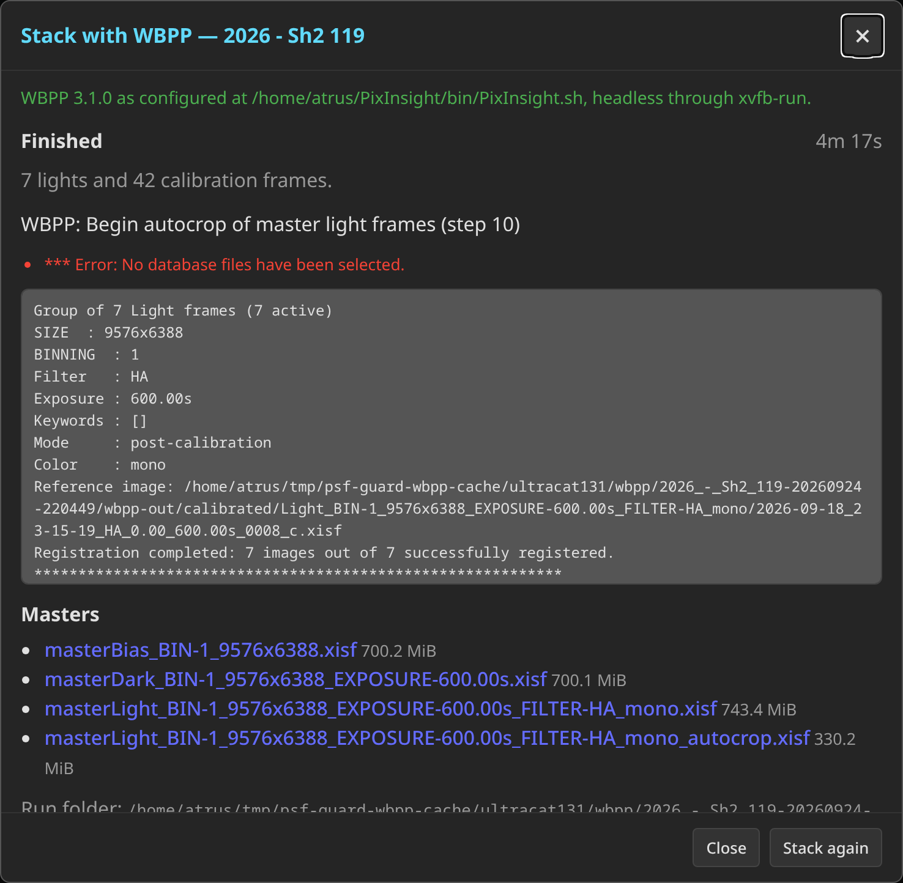

# Stacking with PixInsight's WBPP

PixInsight's WeightedBatchPreprocessing (WBPP) is the stacker most people
end up in. PSF Guard hands it a project two ways: as an **export** whose
runner scripts you start yourself, on any machine, or as a **run** PSF
Guard starts on its own server from the Library. Both send WBPP the same
thing: the graded lights where they already are, each night's flats
matched to its lights, and every setting spelled out, so a headless run
does what you meant.

Checked against PixInsight 1.9.5 with WBPP 3.1.0.

## WBPP settings

WBPP's automation mode takes most of the dialog's controls as `name=value`
parameters. Two of the settings people reach for are not among them,
because WBPP keeps them per light group: drizzle, and Fast Integration.
PSF Guard's runner script sets those on every light group itself, just
before WBPP builds its pipeline. The settings PSF Guard offers:

| Setting | Choices | What it does |
|---|---|---|
| Quality | Maximum, Good, Fast | WBPP's own Presets: local normalization on with PSF Auto and every star (maximum), on with Moffat 4 and 500 stars (good), or off (fast). Default maximum. |
| Fast Integration | Off, WBPP decides, On | The in-memory stack with less weighting. WBPP switches any group of 150 frames or more to it on its own, which nobody sees happen headless, so PSF Guard's default is off. |
| Drizzle | Off, 2x, 3x | Drizzle integration of the lights, at WBPP's default drop shrink and kernel. Off by default. |
| Autocrop | WBPP's default (on), On, Off | Crop the masters to the area every frame covers. |
| Light rejection | WBPP's default (automatic), or an algorithm | The pixel rejection for the light integration. |

Pick them in the export dialog when the layout is WBPP, and in the run
dialog. **Settings → Exports & integrations → Export defaults** holds the defaults both start from.
A headless run starts from WBPP's own defaults, not from what its dialog
last saved, so the settings above are the whole story.

Anything else WBPP takes can ride along: the run dialog has a box for more
`name=value` parameters, and the launcher scripts forward whatever is
appended to `PARAMS`. WBPP prints its full list with Alt+A in its dialog,
or with `automationMode=true,paramList` on the command line.

## Calibration frames

An export and a run hand WBPP the calibration frames a PSF Guard stack would
take for each light, matched by the settings in force for that light's rig
under **Settings › Processing › Calibration** (see
[Tune the checks](CALIBRATION_LIBRARY.md#tune-the-checks)). The flat rotation,
focal length and session limits decide which flats share a light's
`SESSION_<night>` folder; dark temperature, reach and choice decide its darks;
a rig set to do without darks gets none; and masters from other software
follow their setting. With **Leave out lights that can't be calibrated** on,
the lights a stack would leave out stay out of the export or run, as they do
out of every export. The
runner scripts list the settings that differ from the defaults, the rigs that
export no darks, and the lights left out; the run dialog shows the same. A run
always plans afresh into a new folder. An export into a folder that already
holds an earlier one keeps the earlier frames, which WBPP would scan along with
the new ones, so the runner warns about them.

The flats follow the [flat groups](CALIBRATION_LIBRARY.md#flat-groups): a
light gets flats from its own side of each measured change, as a stack
would. Lights of one night that take different flats get a session each,
`SESSION_<night>-<digest>`, so WBPP builds each its own master. A light a
stack would give flats corrected across a change gets the flats as shot,
in a `SESSION_<night>-across-<key>` folder of its own, because WBPP cannot
apply the correction. The runner names each change in force, and the
runner, the export summary, the run dialog and a `FLATS-ACROSS-A-CHANGE.txt`
beside a downloaded export list those lights and any light whose flats
may not match.

## Export a WBPP tree and run it yourself

The Export action on a project card or target row, with the **WBPP**
layout, writes the frames (or, with **Reference in place**, only the
scripts that point to them) and three files beside them:

- `run-wbpp.js`, the PixInsight script. It carries the frames, the
  settings and the per-group drizzle and Fast Integration choices, and
  runs WBPP inside PixInsight.
- `run-wbpp.sh` and `run-wbpp.cmd`, which start PixInsight on that script
  with the folder's own `wbpp-out` as the output. Set `PI_ROOT` or `PI_BIN`
  if PixInsight is not in the standard place.

By default the script loads the frames and stops at WBPP's dialog, so you
can check the groups before an hour of integration starts. Append `,run`
to `PARAMS` in the launcher, or pass `run` yourself, to go straight
through. See [Calibration libraries](CALIBRATION_LIBRARY.md#export) for
the layout and how flats are matched by night.

To run headless on Linux, put `xvfb-run -a` in front of the launcher.
PixInsight needs a display, and that gives it a virtual one.

## Stack from inside PSF Guard

**Stack in WBPP**, on a project card of the Library or beside **Build stacks**
in the project's **Stacks** view, runs WBPP on the server. It needs an editor and a PixInsight install the server
can reach. The program and the runs folder come from the PixInsight settings, which need the database-management
grant; without the grant a run may use a folder inside the runs folder only, and only an editor reads a run's files.

1. Tell PSF Guard where PixInsight is, once, under **Settings → Exports & integrations → PixInsight**. Leave the path empty to look in the standard places
   (`/opt/PixInsight`, `~/PixInsight`, the macOS application folder, or
   Program Files). The panel says what it found, which WBPP version, and
   whether the server has a display: a Linux server without one needs
   `xvfb-run` (the `xvfb` package), and the panel says so. PixInsight's
   licence must already be activated for the account the server runs as;
   activation itself needs the real GUI once.
2. Open **Stack in WBPP** on a project. Choose whether ungraded lights
   count (rejects never do), the settings above, and any extra parameters.
3. **Start stacking.** PSF Guard plans the frames as an export would,
   writes `run-wbpp.js` into a run folder, and starts PixInsight on it
   headless.

A run writes gigabytes: calibrated and registered copies of every light,
then the masters. So the run folder is yours to place. The **WBPP runs
folder** under **Settings → Exports & integrations → PixInsight** puts every database's
runs below it (`<folder>/<database>/<project>-<time>/`) and shows the
space free there. Without one, a database's runs go under its export
directory when it has one, and otherwise under its stack folder. The run
dialog can also pick a folder for one run. The dialog shows free space at start.

The dialog then follows WBPP's own log: which step it is on, how long the
run has taken, the last lines, and any line WBPP marked as an error. WBPP
writes its log between steps, so a long integration shows nothing new for
a while; the elapsed time keeps counting and PixInsight is still at work.
**Stop PixInsight** ends the run.

PixInsight takes every core it can get, so the server runs one WBPP job at
a time across all databases. Starting a second project while one runs
queues it: the dialog shows that project's name, identifies the running job,
and offers **Queue stacking**. A queued run starts when the current run ends,
using its queued settings, whether the current run succeeds or fails. While
a database copies masters to its process directory, that database's queued
runs keep their place and wait; queued runs of other databases start first.
The Library lists queued runs with their positions; **×** removes a queued run,
as does **Remove from queue** in its dialog. The header's background jobs
chip lists the running job and queue across all databases. There **↑** and **↓**
change the order one place at a time. The arrow-to-top button (**Move to top**)
moves a queued run straight to the front; it starts after the current run ends.
The button is disabled when the run is already next. **×** takes a run out,
and **Stop** ends the running one after asking once. These controls need write
access. `GET /api/wbpp/activity` reports the same, and
`POST /api/wbpp/queue/{queue_id}/move` with `{"position": n}` (0 is next)
moves a waiting run. The queue survives a restart through the job journal
(see [Stack previews](STACKING_PREVIEWS.md#after-a-restart)): waiting runs keep
their order, and a run the restart cut off is shown as stopped, to start
again by hand. Opening the dialog on the
project that is running shows that run; from another project's dialog,
**Show that run** does the same.

When PixInsight exits, the dialog lists the masters WBPP wrote, each a
download, with links to the script, WBPP's log and PixInsight's console
output. Files remain in the run folder until the WBPP storage policy removes
them; PixInsight can open retained files directly. A run that wrote no master
is reported as failed, with the last error WBPP logged.

The Library shows every database's run under way, just finished, or in
line, in whichever browser or tab you open it from: one row per job above
the metrics, coloured by state, and the project's own **Stack in WBPP**
action reads *Stacking in WBPP…*, *Queued for WBPP*, *WBPP masters ready*
or *WBPP failed* until the next run. Either reopens the dialog. **×** on a
finished run's row clears it from view everywhere; the run folder and its
files remain subject to the storage policy. The run's state lives in the server
process, so a server restart forgets a finished run's progress and results too.

### Manage WBPP storage

Open **Settings → Storage & backups → Folders & limits**. Set **WBPP volume usage limit** under **Limits**,
choose **WBPP runs** under **Folders**, and set **WBPP retention** for intermediate
files and masters. Click **Save storage settings** to apply all your storage
edits together. The folder is independent of the cache and stack folders. Changing it affects new runs; earlier managed folders remain
eligible for cleanup, including after a restart.

The defaults are 90% volume usage, seven days for intermediates, and 90 days
for masters. Limits accept every whole percentage from 0% through 100% and
include other files on the volume. When WBPP shares a monitored volume, the
lower storage limit applies. At 100%, WBPP pressure cleanup is disabled;
age-based cleanup still runs. Targets below 2% are clamped to zero.

Cleanup checks a minute after startup, every five minutes, after a run finishes,
and after a policy change. It removes expired intermediates first. If volume
usage exceeds the limit, it removes more intermediate files, oldest runs first,
aiming for two percentage points below the limit. It then removes expired
masters. Calibrated and registered frames, scripts, logs, and other work files
are intermediates; files in WBPP's `master/` output are masters.

Masters keep their full retention period even under disk pressure. Choose
**Keep WBPP masters forever** to prevent automatic master deletion entirely.
A volume can therefore remain above its limit when active work, retained
masters, or unrelated files use the space. Settings shows the measured use,
cleanup results, and any files it could not read or remove.

Retention begins when a run finishes, or at a file's later modification time.
Active runs, downloads, master copies, and imports are protected. Empty run
folders are removed, and deleted outputs disappear from the current run's
file list. Cleanup manages only PSF Guard runs, without following symlinks;
it does not delete source frames, process-directory master copies, or imported
WBPP stacks. Recognizable older server runs are included; arbitrary export
folders are left alone.

The cleanup pass runs as automatic work in the header's job list. Folder sizes
and the WBPP volume readings refresh with each pass; opening Settings does not
rescan the run folders.

### Keep the masters with your finished work

Most people keep finished work per rig, beside the frames: a `_Process`
folder next to `_Source`, with one folder per processing project and the
WBPP masters in a `master/` folder inside it. PSF Guard can put a run's
masters there. Give the database a **process directory** under **Settings
→ Databases** (the rig's `_Process` folder), and the run dialog offers
**Save the masters**: enter the project's folder, and the masters are
copied to `<process directory>/<folder>/master/`. Tick **Save the masters
when done** before a run to have it happen as the run ends, or press
**Save masters** afterwards.

The folder name is remembered per project, so the next run of the same
project offers it again. Nothing already in the folder is overwritten: a
file already there with the same size is taken as the same file and
skipped, one with a different size is left alone, and the
outcome lists it. Only the `master/` files are copied; the calibrated and
registered frames stay in the run folder.

While copying, the dialog shows the current file and how many files it has
processed. The copy button and destination field stay disabled until the
copy ends. The background jobs list also shows the copy. A new WBPP run
waits until the copy finishes, so it cannot replace the results being saved.

### See the stacks and their color in PSF Guard

When a run for a project ends, PSF Guard takes its master lights in as
stacks: they show under **WBPP stacks** in the project's **Stacks** view, and
PSF Guard composes their color preview there, from the channels you choose.
See [Stacks made by WBPP](STACKING_PREVIEWS.md#stacks-made-by-wbpp). A run
across several targets of one project is not taken in, because WBPP
integrates the targets together.

## What can go wrong

- **PixInsight not found.** The settings panel lists where it looked. Enter
  the executable's path: `PixInsight.sh` under `bin/` on Linux, the binary inside
  the app bundle on macOS, `PixInsight.exe` on Windows.
- **No display.** On a Linux server, install `xvfb`. PSF Guard uses
  `xvfb-run -a` on its own once it is on the path.
- **Frames not found.** The run reads each frame from its full path on the
  server. A catalog row whose file is not below the database's image
  folders is left out and counted in the dialog.
- **Fewer calibration frames than the library holds.** Frames the
  calibration library keeps out, graded poor or kept out by hand, stay out
  of the run, and the dialog counts them. See
  [frame grades](CALIBRATION_LIBRARY.md#frame-grades).
- **WBPP wrote no master.** Read WBPP's log from the dialog; the usual
  causes are a group WBPP could not register, or calibration frames that
  do not match. PixInsight prints nothing to its console output in this
  mode, so the log is the record.
- **`*** Error: No database files have been selected.`** is WBPP's plate
  solver saying the server's PixInsight has no local star catalog. It
  may fall back to another catalog, such as TYCHO-2 from VizieR. Check the
  log for the subsequent solve result. This message does not refer to your
  image database and does not by itself mean the run failed. The dialog
  keeps the original error and explains which catalog it refers to.
- **A comma in a path.** WBPP's command line separates parameters with
  commas, so a run folder or frame path with one cannot be expressed; PSF
  Guard refuses rather than mangles it.
