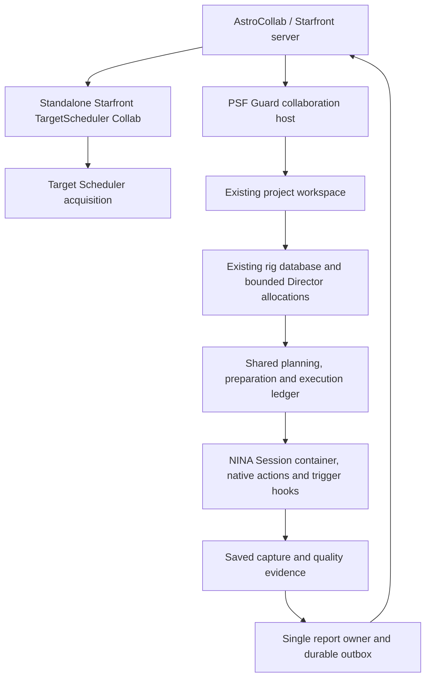

# AstroCollab and Starfront interoperability

Status: shared reader, authentication, reviewed import, managed-host hello/join,
nightly work retrieval, catalog-evidence review, durable contribution delivery
and fresh activity forwarding implemented. Reviewed assignments can use existing
Activation to write ordinary Target Scheduler rows, with GUID-based capture
association and actual-observing-night credit. Neither remote registration nor
import grants acquisition. Direct Starfront intake is not a requirement of
Director or PSF Guard Sync. An imported plan can leave its collaboration.
Reporting-owner handoff remains planned.
Last reviewed: 2026-10-22.

## Sources and scope

Reviewed AstroCollab **0.2.0-draft.1**, wire protocol **1**, at
[`35a6f06`](https://github.com/theatrus/astrocollab-api/tree/35a6f068c6015367b4dbb69c1c4de5b7a0747d90),
and Starfront at
[`60f87d0`](https://github.com/bray-sfro/starfront/tree/60f87d016c65798ec244b161f722587004af5d18)
(server version **0.2.43**, wire protocol **1**).
The public [protocol](https://github.com/theatrus/astrocollab-api/blob/35a6f068c6015367b4dbb69c1c4de5b7a0747d90/spec/protocol.md),
[OpenAPI](https://github.com/theatrus/astrocollab-api/blob/35a6f068c6015367b4dbb69c1c4de5b7a0747d90/openapi/astrocollab.yaml),
and [conformance scenarios](https://github.com/theatrus/astrocollab-api/blob/35a6f068c6015367b4dbb69c1c4de5b7a0747d90/spec/conformance.md)
own the wire contract. Do not maintain a second API specification here.

This draft adopts Starfront's hello, tonight and report routes. It is not the
earlier draft's capacity, revision-sync and calibrated-upload API. Core credit
comes from per-night reports. The draft's optional `files` extension has no
standard upload routes; current Starfront defines its own opt-in file API.
Monthly commitments and coordinator project administration are not part of
this client contract. File delivery uses the Starfront-specific extension below.

Starfront's useful reference points are `astrocontrol/collabclient.py` for
polling/reporting, `astrocontrol/main.py` for adopting work into a local plan,
`astrocontrol/collab.py` for requirements, tiling and allocation, and
`server/app.py` / `server/store.py` for routes and report persistence. Its
capture software and collaboration server are in the same repository.
Current upstream also supplies a NINA acquisition plugin under `nina/`;
the standalone Target Scheduler adapter remains a separate integration.
AstroCollab publishes an MIT license. Starfront now publishes its source under
[MPL-2.0](https://github.com/bray-sfro/starfront/blob/60f87d016c65798ec244b161f722587004af5d18/LICENSE).
PSF Guard's client implements the wire contract independently; no Starfront
implementation is copied into this Apache-2.0 core.

### Current Starfront compatibility

The standalone plugin and PSF Guard are checked independently. A passing
standalone check is not evidence that PSF Guard's host, durable outbox or
saved-image review passed. Both checks use a throwaway loopback server; no
synthetic contribution is sent to a shared collaboration service.

| Operation | Current routes and behavior |
| --- | --- |
| Authentication | `/api/v1/auth`, `/auth/login`, `/auth/poll`, and `/agents`; person and telescope credentials remain separate. Current Starfront does not expose the draft's pairing-code route. |
| Hello and presence | `/api/v1/agent/hello` still replaces the full equipment profile. Presence RA remains hours; task/footprint RA remains degrees. |
| Browse and join | `/api/v1/agent/projects` and `/agent/projects/{id}/join`; joining an existing share is idempotent and returns that share. |
| Tonight | `/api/v1/agent/task?night=...&moon=...&moonUp=...`; multiple tasks, per-project requirements, fixed nightly panel order and visit frame counts remain supported. |
| Reports | `/api/v1/agent/report`; metadata/integration reports, positional receipts, cumulative totals and duplicate replies remain supported. This is not an image upload. |
| Files | Starfront-specific `GET /api/v1/files/projects`, `GET /api/v1/projects/{id}/files`, and `PUT /api/v1/projects/{id}/files/{name}`. Opt-in `collectFiles` does not authorize PSF Guard to transfer image files. Not implemented in either client. |

Starfront now distinguishes mono channels from data bands such as `OSC-RGB`,
`OSC-Ha+OIII` and `Ha+OIII`. Task `filters[].filter` and `visit.frames` still
name physical filters; `filters[].channels` names the data bands they deliver.
Readers retain that mapping and normalize known band spellings without
turning them into mono credit. They retain `acceptOscRgb`,
`acceptOscNarrowband` and `maxBortle`; PSF Guard includes these rules in its
canonical reviewed snapshot and digest. Explicitly disabled OSC bands are held
even when still listed under `filters`. The guards follow Starfront's current
classification: OSC names with `+` use its narrowband switch, other OSC names
use its broadband switch. An unreadable sky limit requires review.

The server can infer familiar physical filters such as `Clear` and
`L-eXtreme` from the hello profile. Acquisition retains the physical name and
its sub length; report credit carries the assigned channels explicitly.
PSF Guard preserves channels in reviewed snapshots and requires saved-frame
camera evidence to agree with the OSC/mono band. The standalone host saves
channels beside each nightly TS plan so delayed reports do not depend on a
later server reply; conflicting same-night mappings are held, not relabeled.
Neither host invents a selectable NINA wheel filter from a band name.

**Remaining commissioning gaps:** neither host offers custom channel mapping
for physical filters Starfront cannot infer, or sends a commissioned Bortle
rating. These values remain unknown; do not manufacture them from a project's
requirements. Explicit file delivery remains unimplemented. Existing saved
reports without channels retain their payload rather than being silently
rewritten or credited differently on upgrade. Reviewed legacy snapshots keep
their digest when the new extension fields are absent or at default values.

Run PSF Guard's real-server host check with a fresh Starfront server bound to
`127.0.0.1`, isolated `STARFRONT_DATA`, and its generated owner-token file:

```powershell
$env:STARFRONT_TEST_URL = 'http://127.0.0.1:18880/'
$env:STARFRONT_TEST_OWNER_FILE = '<isolated-data>/admin-token.txt'
cargo test --lib starfront_server_hello_join_import_report_and_replay -- --ignored --exact server::director::collaboration_auth::tests::starfront::starfront_server_hello_join_import_report_and_replay
```

The test enrolls through the owner's API, then uses PSF Guard's private config
credential store and normal browse/join/import/check-in routes. It verifies
reviewed import grants no acquisition, delivers synthetic test evidence once,
and checks duplicate replay. It does not exercise a real Discord browser
approval or drive NINA hardware. The standalone host's independent check is
`tools/InteropCheck` in its repository.

## Integration ownership

There are two independent collaboration hosts. Use one for each remote agent:

- **PSF Guard** owns collaboration authentication, nightly intake, local adoption,
  measured contribution review and its durable report outbox. Director consumes
  ordinary rig allocations and reports execution telemetry. PSF Guard Sync
  transports catalog rows and images. Neither plugin needs a Starfront client.
- **[Starfront TargetScheduler Collab](https://github.com/theatrus/starfront-targetscheduler-collab)**
  owns the outer loop when PSF Guard is absent. It pairs directly, publishes
  presence, adopts assignments into Target Scheduler and reports their frames.
  Target Scheduler remains its acquisition scheduler. This is a separate plugin,
  not a Director adapter or a Sync mode.



The standalone host was reviewed at
[`163c5cd`](https://github.com/theatrus/starfront-targetscheduler-collab/tree/163c5cddaecaab830d6183dd101d9bc4608b4dfd).
Its useful references are `Activation.cs` for stable TS rows and nightly goals,
`Reports.cs` for capture-night cohorts and durable verdicts, and
`tools/InteropCheck` for isolated server validation. Reuse the public protocol
and identity rules, not its planned-cell footprint as pixel evidence. Its
reporting contract permits TS-derived estimates; PSF Guard retains its stricter
saved-file, measured-exposure and fresh-solve checks. Importing its TS data must
preserve original GUIDs and source provenance; it does not grant report ownership.

**Import into PSF Guard:** PSF Guard browses and imports a remote project into
the existing Library/project workspace, with downstream work in the selected
rig databases. Director receives the normal local allocations. PSF Guard adds
catalog review, grading, calibration evidence, coverage and report submission.
Import must preview changes before Apply; later automatic refresh must stay
within the explicitly reviewed policy.

One collaboration agent represents one commissioned rig/equipment setup. In
PSF Guard mode it binds to the existing project database's rig identity; it
does not create a second catalog hierarchy. Sites remain location, horizon,
time and weather inputs. A shared remote project can map to one combined
project with different downstream framing and recipes on each rig.

Choose **one report owner** per server/agent/share: standalone host or PSF Guard.
Switching mode requires explicit identity, provenance and outbox handoff, not
two independent reporters using the same telescope token. Do not automatically
claim or rewrite the standalone plugin's `starfront_collab_*` tables. A future
handoff must reconcile assignments, already submitted totals, verdicts and
pending reports before enabling the new owner. This supersedes the earlier plan
to add direct Starfront work admission to Director's sidecar.

## Authentication and credential ownership

Status: PSF Guard setup, config-file credentials and recovery states implemented.
The standalone plugin owns its separate NINA authentication. Reporting-owner
credential handoff remains planned. Keep three authorities separate:

- Local PSF Guard login and Director pairing control access to this installation.
- A temporary collaboration person token enrolls or lists remote rigs. Keep it
  only for setup, then discard it locally. Do not automatically call remote
  logout: the server may share that person session with another client.
- A collaboration agent token belongs to one commissioned rig and authorizes
  hello, participation, work retrieval and reports. It grants no local database
  or hardware permission.

In PSF Guard mode, the backend owns the agent credential and reporting queue.
NINA uses its existing Director pairing and never receives that credential.
In the standalone plugin, the managed NINA host owns collaboration HTTP and stores
the credential in a separate Windows Credential Manager entry. Director and Sync
never receive Starfront tokens or pairing codes.
Do not reuse Director's token format or either plugin's existing credential.

### PSF Guard config file

Use the existing config space for desktop and headless/Docker PSF Guard, not a
new encrypted vault, external secret service or deployment unlock key. Store
agent credentials as plaintext JSON in `collaboration-credentials.json` beside
the normal `config.json`. For a custom registry, use
`<registry-stem>.collaboration-credentials.json` in that registry's directory,
following the existing `auth.json` naming pattern. An isolated test registry
must never read or write the user's normal credential file.

On Unix, create the file and all temporary replacements with mode `0600` from
the start, owned by the service user. Use `0700` for an application config
directory created for this purpose. On Windows, restrict the file to the
running user's access with the appropriate ACL. Check the file type, ownership,
permissions and parent-directory write access; refuse symlinks and storage
whose protection cannot be enforced. Do not silently proceed with a world- or
group-readable credential file, or repair an unsafe path by following it.
Use a restricted temporary file in the same directory, sync it and replace
atomically. Serialize concurrent updates so connecting one rig cannot lose
another rig's credential. Verify durable storage before reporting connected.

Docker persists this file in its existing writable config volume with matching
service UID and permissions. No extra secret mount is required. File and backup
readers can use the stored tokens: filesystem permissions are access control,
not encryption. Exclude this file from config exports, diagnostic bundles and
version control; protect any deliberate backup like a password file. The draft
protocol describes a system credential store; this config file is PSF Guard's
explicit headless storage choice, not a change to the wire protocol.

Bind each credential to the canonical server origin/base path, local rig and
remote agent. Keep non-secret identity and queue metadata in the meta store;
never include the token in settings responses, browser storage, logs, generated
runtime configs, process arguments, environment or IPC. Changing a server or
rig requires a reviewed binding, not reusing another binding's token.

### Connect and recover

Offer browser sign-in and single-use pairing only as advertised by the server.
Keep polling and the person token in the host; the UI receives status and the
validated browser URL, never person or agent tokens. The browser URL can contain
a sign-in code, so treat it as temporary sensitive data too. Bind pending setup
to its local caller, rig and server, with expiry and a single claim. Local setup
writes must pass the existing ReadWrite and database-management checks. Pairing
or joining never starts acquisition. Check storage availability before enrollment
where possible; a lost enrollment or pairing reply must not cause a blind retry.

Treat readable credentials, missing credentials, denied file/vault access,
pending setup, rejected credentials and an unknown enrollment outcome as
different states. Re-read the credential before requests. Manual deletion must
enable reconnect, not leave a stale configured flag disabling the Pair button.
A storage failure must not erase identity or automatically register another rig.

The current draft has no standard way to replace a lost token for the same
agent. Listing agents does not recover their tokens, and enrollment or pairing
can create a new agent. Until a capability-discovered same-agent recovery
contract exists, retain the old binding and queued reports for explicit
recovery. Registering a new agent creates a separate binding; never relabel old
reports or send them under that new identity. Switching report owner likewise
needs an explicit handoff, not copying a token to a second active reporter.

Validate the browser sign-in URL against the reviewed server origin. Never
forward bearer credentials across an origin change or HTTP redirect. Production
uses HTTPS; isolated loopback tests have explicit test-only transport consent.
A `401` stops remote communication and asks for repair, without erasing already
issued bounded work or overriding hardware safety. Other permanent errors
require review; transient failures use bounded backoff outside the exposure
path. Do not invent refresh tokens or renewal routes absent from the protocol.

PSF Guard exposes these setup routes under `/api/director/v1`:

| Route | Behavior |
| --- | --- |
| `GET /rigs/{rig}/collaboration` | Non-secret bindings and current credential availability, including pending browser setup. |
| `POST /rigs/{rig}/collaboration` | Register local setup intent with a caller-minted UUID, server URL, name and explicit loopback test consent; no remote enrollment yet. |
| `POST /collaboration/{id}/discover` | Read health/features, with `/auth` fallback for sign-in only. |
| `POST /collaboration/{id}/pair` | Consume one user-supplied code once, persist remote identity and credential, never start acquisition. |
| `POST /collaboration/{id}/signin` | Begin browser approval; return only its validated URL and expiry. |
| `POST /collaboration/{id}/poll` | Check approval in the original local session, at most every two seconds, then enroll once and store the agent token. |
| `POST /collaboration/{id}/cancel` | Cancel this session's pending browser setup locally. |
| `POST /collaboration/{id}/validate` | Explicitly check the saved token with a bounded project-list read. No work is adopted. |
| `POST /collaboration/{id}/disconnect` | Disable the binding and remove its credential, preserving identity, work and reports. No unsupported remote revocation is invented. |

Setup is serialized separately from planning and acquisition. Token-producing
operations finish local persistence even if their browser request disconnects.
The meta store records uncertain enrollment before sending it and records a
returned agent ID before saving the token. A failed token write therefore keeps
the known agent for recovery. Pending browser codes live only in memory and
expire; after restart, start browser sign-in again. An existing registered or
uncertain binding cannot enroll again automatically. Local callers see a remote
credential rejection as a connection conflict, not a local-login `401`.
An explicit enrollment rejection permits a corrected code or new browser sign-in;
a lost or malformed token-producing reply remains uncertain, with no blind retry.

### Managed Work API

`POST /api/director/v1/collaboration/{id}/work` uses a tagged `operation` body.
It requires the same interactive editor and database-management gate as setup;
it does not accept remote bearer tokens or caller-provided scientific evidence.

| Operation | Input and result |
| --- | --- |
| `configure` | Save non-secret `settings`: binning, colour, hours per night, filter exposure/bandpass map and opt-in activity sharing. Optics come from the commissioned rig profile. |
| `browse` | Send hello, then return the authenticated project list and compatibility. |
| `join` | Join one remote project, then retrieve work for the rig's current observing night. Optional `observing_date` selects another date. |
| `tonight` | No extra input is required. Derive the named night and lunar context from the rig's site through the shared core. Accept optional `observing_date`, or legacy `night: {night, moon, moon_up}` (not both). Return the resolved `night` with shares. |
| `preview`, `apply` | Refetch the selected `task` for that night. Apply requires the current `review_digest`; changed work conflicts. Imports stay inactive. |
| `report_inputs` | List this binding's imported visits and databases bound to its rig. |
| `report_candidates` | List accepted saved-image GUIDs for an `import_id`, `catalog` and optional actual `observing_night` (defaults to the original night). Activated work is scoped by target GUID and assignment lifetime. No grades or files are changed. |
| `preview_report`, `queue_report` | Review `selection: {import_id, catalog, panel, image_guids, source_digest?, observing_night?}` using catalog and fresh pixel evidence. Queue requires its unchanged `review_digest`. |
| `checkin` | Send fresh opted-in presence and replay pending immutable reports. Persist receipts only after validating the complete positional reply. |
| `background_status` | Return the saved non-secret policy, rig-bound catalog identities, imported projects and current process's run status. It remains readable during a network operation. |
| `background_configure` | Compare-and-set `expected` and `policy`. A policy binds the rig's sole stable `catalog_id`, explicit `project_ids`, nightly `enabled`, `activate`, and separate `automatic_reports` consent. The legacy `interval_minutes` (5-1440) is retained only for retry backoff, not successful nightly scheduling. Only already joined or imported projects are allowed for intake. |
| `background_run` | Explicitly rerun enabled nightly intake and/or automatic reports now, retaining the same evidence, import and activation checks as the automatic loop. Return updated status. |

### Tonight and automatic adoption

Rig setup uses the existing workspace tab pattern rather than one long form.
Collaboration pairing is a resumable Server, Sign in, Capture wizard. Each
server has Tonight, Automation, Capture, Reports and Connection sections;
switching sections or servers preserves unsaved capture edits. Hidden report
and automation sections do not poll. Pairing and finishing capture setup never
enable background work, activation or activity sharing by themselves.

The manual and background paths use the same `interop::workflow::Night`
calculation: local mean-solar noon to noon, astronomical darkness below -18
degrees, and planning-grade Moon illumination and fraction of dark hours above
the horizon. Without astronomical darkness, the request is held rather than
assigned a guessed observing night.
Manual review and Apply keep the full returned night fixed even if midnight
passes. A date-only override uses the same lunar calculation.

Background refresh is off by default. One server loop checks due policies every
30 seconds; an interactive collaboration operation takes precedence. Requests
are bounded and serialized, with exponential retry up to one day. Credentials
are reread from the existing config file. A rejected credential pauses that
binding; missing credentials, unavailable storage and network failures preserve
existing work. A successful fetch runs once per rig-local noon-to-noon observing
night. Schema 28 atomically persists its checkpoint and pending response before
local application. Database locks and temporary storage failures retry that
saved response, including after restart, without fetching the deal again.
Configuration ambiguity remains held for operator review. Explicit Refresh now
or a changed policy can rerun intake. Policy survives restart; detailed run
status and retry backoff are process-local.

Only accepted, representable shares for the explicit project allowlist enter the
normal compare-and-set import path. Optional activation previews a planning copy
and applies its digest to exactly the selected rig/catalog. A pristine draft can
take unique local template recipes matching filter/binning, preferring the
assigned exposure. Saved exposure defaults must agree with the assignment;
template camera and Moon settings are retained. Ambiguity needs manual Planning;
saved recipes are never reconstructed, and shared multi-rig changes require
a manual activation. The
existing assignment provenance prevents duplicate activation or quota refills.
Automatic activation writes only the selected local database: it does not use
the full-catalog remote-peer push, which could publish unrelated projects.

Separate `automatic_reports` consent runs a five-minute evidence/queue/delivery
pass independently of nightly intake and activity sharing. It selects accepted,
saved frames only through activated target GUID/cutover provenance in the rig's
sole database. It groups actual rig-local capture nights, source revisions,
panels and filters, then uses the same fresh-pixel review twice before queueing.
Unchanged image cohorts skip re-queueing. Missing files can arrive later;
missing evidence, mixed cohorts and incompatible extensions remain held.
Each import pass is bounded to 65,536 attributable catalog rows, 256 cohorts
and 4,096 images per cohort. Pre-activation history does not consume that bound;
oversized sets are held rather than truncated into partial scientific reports.
GUID evidence lookup reads the catalog once per review, not once per image.
One background batch reviews at most eight cohorts and scans at most 32 imports;
it yields between units after 15 seconds and resumes on a later 30-second sweep.
One evidence unit may exceed that soft time budget. A restart safely restarts
the scan because queueing is idempotent. Queued immutable reports survive
outages and replay without a browser. Delivery, acceptance and rejection are
separate counts. Current rejected aggregates and their reasons remain visible
from the durable receipts even after an idle pass or restart; a newer accepted
aggregate clears the superseded warning. Equal
or lower-total corrections and withdrawals still require manual review.

The loop never enrolls or joins projects or starts hardware. It never treats a
missing remote assignment as cancellation. Manual browse, join, review/import, activation and
check-in remain available independently of this policy.

Accepted live rig telemetry also schedules background check-in at most once a
minute when activity sharing is enabled. Network failure never blocks the local
telemetry acknowledgement. Historical batches do not become fresh presence.
An explicit check-in works when activity sharing is off. A rejected remote
contribution is a delivered receipt, not a local grade change or endless retry.

## Contract mapping

| External input | Director / PSF Guard mapping | Required change or boundary |
| --- | --- | --- |
| Health and optional features | Connector discovery and compatibility state | Negotiate wire protocol 1. If features are omitted, discover sign-in through `/auth`; never guess that pairing/files exists. |
| Sign-in, enrollment or pairing | Separate collaboration credential and agent binding | Person tokens enroll/list telescopes; agent tokens fetch/report work. Neither is a Director pairing or local database permission. |
| Hello profile | NINA equipment snapshot plus reviewed rig setup | Add sensor/optics, fixed-angle or rotator capability, filter bandpass, calibrated exposure defaults and measured arcsecond quality. Send unknown as unknown. |
| Open projects and join | Browse, compatibility review, explicit participation | Join returns an accepted share; a manually offered share still needs acceptance. Joining does not start a sequence. |
| Project region, kind and depth goals | Existing project/objective intent, with remote provenance | `single` centers one object; `mosaic` covers a region. Remote depth is hours at a sky position, not a local frame quota or proof of cross-rig equivalence. |
| Task cells, ordered share, visit and version | Immutable demand translated to targets, recipes and frame goals | Keep server panel indices and geometry. Translate assigned visit frames, not season-long task hours. The assigned night is provenance, not an acquisition deadline. |
| Requirements | Contribution criteria and shared Director capability checks | TS uses reviewed local scheduling and recipes; remote criteria still govern credit. Director admission can narrow, never weaken, local safety/equipment constraints. Preserve project ranking and overrides. |
| Presence | Optional projection of Director live status | Opt-in position/name sharing; no commands and no replay of stale presence after reconnect. |
| Night report and verdict | Durable contribution outbox and remote assessment history | Report actual attributable data; remote accepted/rejected/unverified is separate from local per-frame grades. |
| Depth map | Advisory combined coverage in the existing project workspace | Never subtract another telescope's remote integration from local authorized attempts or overwrite local capture progress. |
| Optional files | Durable Starfront transfer queue | Raw or stack files travel independently of credit, using content-addressed names. Per-light calibration associations stay local until an upstream manifest API exists. |

## Shared Rust boundary

### Implemented reader

[`psf-guard-director-interop`](../../crates/director-interop/src/lib.rs) supplies
the same AstroCollab decoder to PSF Guard (`director_interop`) and the Director
runtime library (`interop`). Its `astrocollab` module reads health, hello
profiles, project lists and nightly shares. It performs no HTTP, credential,
database or equipment operations. The runtime IPC protocol remains unchanged;
the C# plugin cannot call this reader over IPC yet.

The reader retains source base URL and agent, project/task IDs, named night,
task version, server panel indices, milliarcsecond geometry and its digest.
Nightly demand uses visit frames and the task's exposure, not the season's depth
goal. Project goals and collected depth remain hours, separate from local frame
credit. Profile rotation distinguishes missing/unknown, fixed angle and explicit
null (adjustable); OSC and dual-band names do not become mono filters.

Only accepted shares for the requested named night with complete requirements,
nonempty panels and valid visits produce proposed demand. Other states retain
review reasons and no demand. A proposed demand is **not** a local approval:
capability matching, local policy, horizon/Moon windows, budgets and fresh
dispatch checks still belong to the admission and execution paths.

Input is bounded to 256 KiB, 32 levels and 4,096 JSON values, with at most 64
projects, 32 tasks, 256 cells per task and 256 resulting demands per response.
Oversized input is refused, never truncated. Unknown fields are tolerated;
duplicate JSON keys, conflicting legacy aliases, ambiguous folded filters,
foreign agent IDs and invalid coordinates are refused. Unreadable optional
measurements remain unknown; unreadable requirement limits hold the work for
review. Errors do not echo the source body or URL. Source URLs reject embedded
credentials, query strings and fragments, and require HTTPS except explicitly
consented loopback HTTP.

Regression fixtures include AstroCollab's captured Starfront examples and a
nightly reply generated by its independent reference server. They verify the
same six OIII visits of eleven 300-second frames, plus held states, units,
identity, geometry changes, alias ambiguity and resource bounds. This is reader
validation, not connector or acquisition conformance. Chunking, a depth-map
decoder and transport are not implemented yet.

### Implemented import and reporting primitives

`interop::collaboration::prepare_import` prepares one accepted nightly share.
It creates stable IDs from the server URL and remote identities, keeps exact
server panel indices and geometry, and strips unknown fields from its stored
public-wire snapshot. Project identity rolls up agents on the same server;
assignment identity also includes agent, task and the original named night.
Names do not establish identity.

The meta store provides preview/Apply with a review digest. Preview writes
nothing. Apply creates an ordinary project and initial filter objectives, with
no rig contributions, activation or new catalog hierarchy. The initial framing
draft shows the imported parent region; activation still uses exact remote cells.
Exact remote geometry stays in the import, not a regenerated rectangular grid.
Existing local drafts, priorities and grades are not overwritten on refresh.
Changed local draft revisions invalidate a pending review. A lost Apply reply
requires a fresh preview; unchanged reimport is a no-op.

Schema 23 retains immutable source revisions, so grading after a compatible
source update can still use the original assignment. One server/agent binds
to one rig. Older remote versions and changed content at the same version are
refused. Attaching or detaching an imported project is blocked until provenance
handoff is supported, or until the plan leaves the collaboration. Activation requires a current reviewed assignment for
each participating rig and one enabled recipe per assigned filter at its assigned
exposure. Import alone never grants acquisition.

### Target Scheduler execution

Publication is the existing project workspace's Activation, not another import
screen or plugin mode. `GET /projects/{id}/activation/collaboration` lists imported
assignments. Preview and Apply accept `collaboration: [{import_id, source_digest}]`.
The activation digest binds that choice and refuses changed source content.
Exact remote panel centers, rotations and frame demands become ordinary TS rows.
Local observing preferences and native TS safety/scheduling stay in control.
Remote quality/Moon requirements remain credit criteria, not fabricated evidence
or a second scheduler.

There is no offline nightly guard, hard attempt cap or date-based expiry in this
TS path. The protocol calls tonight's list advice and defines no deadline mode;
TS itself does not enforce stored project dates. Work remains eligible across
nights until completed, disabled locally or superseded by reviewed new activation.
Network loss and a missing nightly response do not revoke existing work.

The rig-side `psf_guard_collaboration_plan` table records non-secret provenance:
exposure-plan/target GUIDs, import ID, source digest, remote panel/filter/exposure,
activation start, optional supersession cutover and cumulative desired frames.
It stays on PSF Guard's catalog copy; ordinary TS rows travel through existing
Sync, and returning image target GUIDs identify their source. Same-source Apply
does not replenish the goal. Reviewed replacement closes the old association,
adds requested frames above accepted/acquired progress, and reuses unchanged sky
targets. Old source revisions remain available for delayed grading and reporting.
Cutovers use TS capture timestamp precision (seconds). Scoped automatic remote-peer
delivery, explicit remote revocation and report-owner handoff remain follow-ups.

`finalize_contribution` builds a report from host-verified, saved, accepted and
finalized frames. It binds capture/image GUID pairs to an import revision,
panel and filter, requires matching image/solve fingerprints, uses the actual
exposure sum and pixel-derived footprint. `finalize_contribution_for_night`
retains original task/source identity but reports the actual observing night;
the legacy helper defaults to the assignment night. Reports on different nights
have separate queue/replay keys. A frame cannot move between nights for credit.
Unknown measurements remain null. Calibration is asserted only when all frames
have verified calibration evidence. The managed host verifies saved-file and
fresh solve fingerprints from its catalog; supplying Rust structures alone
is not proof that an image exists. There is no public evidence-ingress API.

Director preserves `PGCAPID` independently of the catalog image GUID. Managed
report review requires one contiguous, acknowledged saved receipt for that
capture on the bound rig, matching the activated exposure-plan goal, saved
identity, exposure duration and a capture timestamp not before reservation.
Native trigger time is not inferred from capture/save duration: autofocus or a
meridian flip may run between reservation and exposure. File intake and batch check-in can arrive in
either order; neither receipt alone nor a copied header grants contribution
credit. Target Scheduler frames without this header keep stable image-GUID
identity. The lookup reads a bounded receipt batch rather than querying per
frame. Duplicate capture identity across ledgers is held, not guessed.

Saved `PGGRMS` supplies guider RMS in arcseconds. The NINA adapter converts
recorded guider-pixel RMS with its recorded guider scale and omits unmeasured
values. Saved `PGHFR` supplies explicitly pixel-valued HFR for conversion with
the fresh image solve. Explicit saved `PGBAND` or a single-band nm filter label
can establish bandpass. Moon context uses the saved exposure midpoint and site
with shared-core ephemerides and topocentric parallax. Missing site coordinates
leave separation unknown. Current rig settings and remote limits never stand
in for capture evidence; required calibration without processing evidence is
still held.

The report builder accepts only one source revision, exposure recipe and
colour/bandpass cohort with a verified common footprint. The managed host
computes conservative shared coverage from the fresh pixel solutions before
aggregation. Mixed revisions still need a lossless provenance merge before
combining captures. Disjoint coverage and mixed revisions are never averaged
or replaced with planned pointing. Automatic reporting holds these cohorts for
review.
Exposure matching allows only measured shutter jitter around the assigned
recipe: 0.1%, with a 10 ms floor and one-second cap. Integration sums the saved
durations; the reported sub length is their mean, not the assigned duration.

The meta store queues immutable report payloads and their capture/image pairs.
Exact requeue is idempotent; an extension must increase integration and retain
every previously credited pair. A capture or image cannot move to another
panel, filter or share. Same-total quality corrections, lowered totals and
retiling after a report exists require review rather than a pretend overwrite.
The queue returns one oldest unacknowledged snapshot per report key. It survives
restart and database backup/restore. A complete, validated positional reply
acknowledges only the submitted IDs, atomically; concurrent new frames remain
pending. Retrying an acknowledgement preserves its first receipt and verdict.
Remote rejection/unverified evidence never rewrites local grades or progress.

Live presence has a separate fresh-only projection: at most a 60-second lease,
actual RA in hours, optional names/position for privacy, and no offline replay.
Fresh opted-in Director activity is forwarded by the managed host. Offline
activity is not replayed as current presence; scientific reports are replayed.

Still missing: reporting-owner handoff and
lossless mixed-revision aggregates. Managed-host hello/join, import, catalog
evidence, common footprint, report transport and durable replay are implemented.

### Leaving a collaboration

**Leave collaboration**, under **Collaboration assignments** in a plan's
Activation, makes an imported plan an ordinary local plan.
`GET /projects/{id}/collaboration/leave` previews it; `POST` applies it and
needs database management and an interactive editor, as joining does. The
plan, its framing, objectives, recipes, links, activation record, rig
projects, frames and grades stay. The POST runs in its own task, so a
browser that goes away cannot stop it between steps or before the
coordinator is told. In order, the server:

1. in one meta-store transaction (`MetaStore::leave_collaboration`):
   cancels unfinished `collaboration_transfer` jobs whose selection names
   one of the plan's imports; deletes the imports' `collaboration_capture`,
   `collaboration_outbox` (queued and acknowledged), `collaboration_revision`
   and `collaboration_import` rows, then the `collaboration_project` row;
   and removes the remote project from the `project_ids` of every
   connection's background policy on the same server. A policy left with no
   project turns nightly intake off. Each changed policy is a
   compare-and-set update of the connection's payload and clears the
   connection's nightly checkpoint and saved response, as saving a policy
   does, so the next run fetches again. When this transaction fails,
   nothing has changed and the plan is still in its collaboration;
2. ends the imports' open `psf_guard_collaboration_plan` rows in each
   database the plan links (`end_at_ms` at the current second, as a
   cutover is). The rows stay as the record of what was assigned; no frame
   after the cutover matches them. A person can always leave: a linked
   database that is not registered, or cannot be read or written, keeps its
   open rows, and the preview and the result carry a warning for it. Nothing
   reads those rows as assignments once the imports are gone
   (`collaboration_activation::current` skips a row whose import is
   missing), and the plan's next ordinary activation on that rig ends every
   open row of the project's targets (`collaboration_activation::end_left`).
   The warning says to register the database again and activate the plan.
   The store goes first because rows left open are harmless and reported,
   while rows ended for a plan still in its collaboration would make its
   next activation read them as superseded;
3. forgets the background loop's process-local runs for every connection to
   that server, so no report scan resumes inside an import that is gone;
4. declines each task the imports came from with
   `POST /api/v1/agent/task/{task}` and `{"state":"declined"}`, using the
   saved sign-in of the registered connection for the import's agent. A
   declined task leaves the agent's list and gets no more panels. A
   rejected sign-in marks the connection for repair. The local leave stands
   whatever the coordinator answers. The preview names the rigs that are
   signed in and those that are not; the result says whether all, some or
   none of the tasks were declined and why, and the server logs each task
   still to decline. The dialog asks the person to leave or decline the
   project on the coordinator's site for the rest.

Nothing is kept that would make the plan collaboration work again. Import
rows drive activation's assignment list, report candidates, automatic
reports, report delivery and file transfers, so they go, and with them
every report record. Reports not yet sent are deleted and never reach the
coordinator; the dialog says to deliver them first with **Check in** to
have them counted. The coordinator keeps the reports it received.
`collaboration_file_delivery` rows stay: they record files the remote
project already holds, keyed by server and remote project, and only let a
later upload skip them. Without capture rows, frames the plan reported are
no longer protected from reject removal or from the Library's project
deletion, as no correction will be sent; the dialog says so.

`MetaStore::create_transfer` refuses a request whose selection names an
import that is not stored, so the transfer worker cannot queue files for an
import left between its scan and its request. A transfer ID derives from
the request, so the same request after a rejoin has the same ID: it
replaces a transfer that leaving cancelled (its error is
`LEFT_COLLABORATION`), while a transfer a person cancelled stays cancelled.

Nightly intake imports only shares whose project is in the policy's
`project_ids`, so the pruned policy cannot import the plan again. When the
coordinator declined the tasks, the share leaves the rig's nightly list:
the person joins the project again, which creates a new task, to take part.
When a task was not declined, manual **Tonight** and **Apply** can still
import it, as an explicit choice, and so can intake once the person lists
the project again. A plan's ID comes from the server and remote project, so
a reviewed import of a project the plan left **rejoins** that plan: the
import preview's `rejoins` names it, and Apply recreates the
`collaboration_project` link and imports into the plan, which keeps its
name, framing, objectives and recipes. The review digest covers the rejoin.
The two refusals in `rejoins` (another plan holds the link, or the plan
with that ID is linked to another remote project) cannot happen while plan
IDs derive from the server and remote project; they guard a store written
some other way.

Rejoining re-inserts the import's revisions with a new import time. When a
rejoined revision is activated, `Admitted::prepare` reopens its rows that
ended before that time, which only leaving can do, from the activation's
cutover: frames captured while the plan was its own do not count. A
revision replaced by a newer one keeps its old import time, so its rows stay
ended and activating it is refused as superseded.

After leaving, the plan's next activation is an ordinary one: it uses the
plan's own framing (an imported plan's framing is the remote project's
parent region), not the coordinator's cell geometry. The targets the
collaboration assigned stay in Target Scheduler until that activation or
the person changes them.

Declining a task is the closest the Starfront API comes to leaving: it has
no endpoint to leave a joined project. The coordinator may still list the
project as joined, and joining again creates a new task.

Deleting an imported plan with nothing captured leaves its collaboration
inside the transaction that deletes the plan, then declines its tasks. Frames
queued for or sent in a report refuse the deletion until the person leaves
on purpose. Unlike leaving, deletion refuses an unregistered or unreadable
linked database, since it deletes the rig projects. When a rig project
changes part way, the deletion answers `changed` as for any plan: the plan
stays in its collaboration and forgets the links of the projects already
deleted (`MetaStore::forget_deleted_plan_project`). See
[Project removal](project-removal.md#deleting-a-plan).

Leaving, and deleting a plan from a collaboration, take the collaboration
gate before the rig-database turn (`discovery_admission`) and the sync lock.
Nightly intake, automatic reports, report delivery and every interactive
collaboration operation hold the gate, and intake activates work under it,
which takes the other two; taking the gate first excludes them without a
lock-order inversion. Deleting a plan of its own does not take the gate, so
it does not wait for a nightly sweep. Under the other two locks it checks
again: a plan an import linked meanwhile answers `changed`, and
`MetaStore::delete_plan` refuses a collaboration the caller did not
preview. The transfer worker does not take the gate: a cancelled job
changes revision, so the worker's next compare-and-set save fails and an
in-flight upload is not acknowledged.

### Host and admission work

Keep the pure planning core free of HTTP, credentials, catalog SQL and NINA
types. The small shared Rust adapter owns tolerant public-wire decoding and
normalization for PSF Guard. Keep transport and persistence in the collaboration
host. Director's C# adapter executes ordinary NINA operations; its Rust sidecar
does not need Starfront tokens or a second AstroCollab-to-plan mapper. The
independent standalone plugin uses its own TS mapper and credential store.

The proposed shared inputs are **work provenance**, **observation demand**,
**reviewed local policy**, and **contribution evidence**. They translate into
the existing `project::Project`, `program::Program`, geometry, Moon, priority,
preparation and ledger contracts where those contracts express the intent.
Do not deserialize a remote Task directly as an internal Program or Allocation.
External JSON permits unknown fields; internal IPC stays strict and versioned.
Bound public payload sizes, nesting and collection lengths before normalization.
Large mosaics must enter deterministic bounded chunks under one reviewed nightly
budget, not expand the core's 256-goal/256-KiB limits or create fresh authority
for every chunk.

Current gaps are explicit:

- `project::Contribution` requires rig-specific accepted-frame counts. It does
  not express a collaborative depth map or prove that integration from unlike
  rigs is interchangeable. Retain remote depth separately and derive only a
  bounded per-rig nightly visit; do not claim the global goal is locally complete.
- Director acquisition requires PSF Guard pairing and a coordinator
  allocation/start acknowledgement. Collaboration intake does not bypass this
  contract. The standalone plugin leaves hardware execution to Target Scheduler.
- Shared report aggregation needs per-frame provenance, evidence completeness
  and immutable outbox snapshots; the capture ledger alone is not a calibration
  or grading catalog. Hosts supply that evidence without moving image algorithms
  into the planner. PSF Guard continues to use published Seiza processing.

Adoption can be manual or automatic within a reviewed allowlist and budget.
The remote server supplies demand; local Director selects when and what to
image using the same priorities, altitude/horizon, darkness, Moon, meridian,
overhead and recovery rules used for local projects. Remote panel order is a
preference within the adopted work, not permission to violate local constraints.
NINA native actions, seven hook slots, built-in meridian trigger flow, safety
interrupts and configurable park/hold behavior remain the execution path.
Admit a visit only when its minimum frames can fit the remaining budget/window,
including preparation estimates. A safety interrupt always wins; report an
incomplete visit truthfully rather than run past a shutdown to meet the quota.

## Identity, quantities and evidence

Persist `(server origin/base path, agent, project, task, named night, task
version, geometry digest, server panel index, filter, local recipe)` alongside
every adopted goal and saved capture. Map external 12-hex IDs explicitly to
local IDs; do not find projects by name or nearest coordinates. Task version
is not a PSF Guard revision, and server receipt identity is not a capture GUID.

Always send the rig's actual named observing night, not its assignment date.
Preserve it through delayed replay,
even after midnight or a site/time-zone change. AstroCollab timestamps and
exposures use seconds, Director uses milliseconds, and core coordinates use
integer milliarcseconds. Convert with finite/range/overflow checks. Regions and
footprints use RA **degrees**; presence and TS use RA **hours**. Sky width is not
RA-coordinate width, especially near the poles or RA wrap.

Convert HFR pixels to arcseconds with the matching image's binned pixel scale;
guide RMS is already arcseconds only when the source declares it so. Do not
reuse a new rig configuration's scale for old frames. Record bandpass in nm,
Moon fraction in 0..1, and separate unknown measurements from measured zero.

Protocol filter folding differs from the core's broader alias list: the core
currently recognizes `rgb`/`osc` as luminance aliases. The adapter must preserve
wire identity and explicit sensor colour semantics, not advertise OSC as mono
L or synthesize R/G/B, H/O contributions from a colour or dual-band exposure.
Unknown filters require an explicit native filter mapping. Different exposure
lengths/purposes remain separate local recipes; do not report a misleading
average exposure for incompatible cohorts under one panel/filter record.
For the first adapter, select one approved exposure cohort per share/panel/filter;
defer heterogeneous cohorts until a lossless report convention is established.

Report verified final saves and eligible measured frames, not attempted or
planned frames. A cloud rejection, canceled exposure or uncertain save cannot
earn credit. A planned center or FITS header is not a solved footprint. Keep
fresh pixel-derived footprint/scale evidence and calibration provenance with
the report. If required evidence is unavailable, defer the report or preserve
the explicit unknown; do not fill in the planned value.

Raw NINA frames are not calibrated merely because compatible masters exist.
The standalone host can serve projects accepting uncalibrated data; projects
requiring calibration need verified feedback from an external processor or
later PSF Guard import/processing. That feedback must bind the original frames,
recipe and masters. No calibration engine is added to the NINA adapter.
Do not submit raw totals early and expect adding `calibrated: true` later at the
same integration to update them; the duplicate behavior below prevents that.

## Offline behavior and known protocol gaps

Cache an adopted assignment's immutable list. TS can finish its frame goal on
later nights; offline operation does not create new work or replenish that goal.
Director allocations retain their own local limits and normal shutdown hooks,
but must not infer expiry from AstroCollab's assigned night. Refresh at safe boundaries
and stage changed work, never mutate an in-flight target or recipe. Unknown,
declined, complete, superseded, invalid or empty work does not mean "image all
panels". Only already admitted work can continue during an outage.

Keep these distinctions visible in the implementation and tests:

1. **A nightly list is held.** The same named night keeps its deal despite new
   Moon, availability or remote progress. Do not promise continual server
   reprioritization; local conditions can still pause or select another goal.
2. **Retiling can reuse identity.** Starfront changes cells and increments the
   same task's version when a fixed camera turns. Its report key has no geometry
   version. If a panel index changes sky position after frames exist for that
   night/filter, retain both local geometries and stop automatic submission of
   the conflicting aggregate. Require a verified server convention or protocol
   extension before combining them. Never silently rewrite old footprints.
3. **Reports are monotonic by integration, not revisions.** Starfront only
   replaces an existing payload/verdict when `seconds` increases, preserving a
   coordinator override. Equal-total quality corrections, lowered totals after
   regrading and withdrawals cannot be reconciled by retrying. Initially publish
   finalized evidence, then surface later corrections for review rather than
   claim remote convergence. An amendment/withdrawal contract is future work.
4. **A batch reply acknowledges records in order.** Require a complete, validated
   positional reply before acknowledging the immutable submitted snapshot. Keep
   short/malformed replies and HTTP failures queued; a server may have committed
   a prefix before failing. Replaying the same snapshots must not double-count.
   Captures added while a batch is in flight remain pending. Recorded does not
   mean scientifically accepted, and a duplicate does not prove corrected
   evidence replaced the earlier payload.
5. **Starfront and the draft differ.** The draft allows joining with some wanted
   filters; its conformance suite records Starfront's refusal as a known gap.
   Show the server's actual compatibility/refusal, do not promise partial-filter
   enrollment works everywhere or silently ignore remote requirements.

Do not mark a continuing multi-night share complete after one nightly visit.
Local visit exhaustion and remote project/share completion are distinct states.
Known fixed camera rotation, unknown rotation and a functioning rotator are
also distinct: protocol null means angle-adjustable, not "we do not know".

Credential ownership, config-file permissions, repair and transport rules are
defined in [Authentication and credential ownership](#authentication-and-credential-ownership).

## File delivery

Status: Starfront file delivery, durable queue, exception review and opt-in
automatic delivery implemented. The draft still has no standard file routes.
Remote calibration manifests and server-computed checksums remain upstream work.
Director and Sync do not gain collaboration clients or upload credentials.

**Selection.** A package names one existing rig/catalog binding, imported
assignment revision, observing night, panel and filter, and accepted image GUIDs.
Activation provenance must associate every image with that assignment. Source
paths come from the catalog, never the request. The raw mode loads one
`LibrarySnapshot`, uses its per-light selection and the shared
`delivery_selection` coherent input reduction that exports call. It retains the
selected bias, dark, dark-flat and flat UUIDs, measured flat basis, matching-rule
digest, source stamps and SHA-256 file hashes. Dark flats match the selected
flats' exposure, not the lights'. Kept-out and unrelated candidates do not travel.
Shared calibration sets are stored once and referenced by each light. Unrelated
quality-cache metadata and image previews are not copied into the manifest.
The configured exclusion of uncalibratable lights applies. Missing image or
calibration files wait for retry. Sources and selections are revalidated before
delivery and after it; a changed cohort is held, not silently relabeled.

**Stacks.** If flats require an across-change correction, raw delivery is held
and the operator can choose an existing PSF Guard or WBPP stack. Resolve only
recorded ready artifacts for the selected catalog, target and filter, and pin
the artifact revision. PSF Guard stacks require exactly the selected integrated
input IDs. WBPP's imported artifacts do not record those IDs, so their membership
requires explicit operator confirmation and is labeled unverified. A stack is
an integrated artifact, never an extra exposure or additional contribution
credit. Automatic stack delivery selects PSF Guard artifacts only; WBPP remains
manual until input provenance is available.

**Transport.** Probe `/api/v1/files/projects` and the project's file listing
using the existing agent credential. Require an open, collecting project and a
Discord-associated owner. Remember the remote owner with the package and hold a
change in owner for review. Stream each file through
`PUT /api/v1/projects/{id}/files/{name}?kind=...`, sending Content-Length and the
explicit light/flat/dark/bias/darkflat kind. Names contain the full SHA-256 and
artifact role, so same-size files from different rigs cannot collide. Check
the reply's name, kind, size and owner. This verifies receipt identity, not a
server-computed checksum: current Starfront only deduplicates name and size.
Stage one immutable file in the catalog cache during sending, hash-check it,
and discard the temporary copy afterwards. Never rewrite an original or put an
entire night's data in memory. The transfer worker is separate from control
check-ins and never holds a database writer across file or network work.

**Durability and controls.** Meta schema 32 adds a shared delivery ledger to
transfer jobs, policies, package definitions, indexed artifacts, job receipts
and activity summaries. The ledger key is canonical server URL, project, remote
owner, kind and SHA-256 content hash; bytes must also match. Record it atomically
with the job acknowledgment. Reuse it across jobs and calibration sets, never
across different destinations or file revisions. Job-local receipts remain for
progress and restart. Legacy receipts are preserved during migration; current
remote listings can populate the ledger without sending those bytes again.
Requests and prepared packages are durable;
each file acknowledgment is committed before the next file. Compare-and-swap
revisions keep an in-flight worker from undoing Pause or Cancel. Startup recovers
Uploading to Queued and retains acknowledged files, while Paused/Review/Cancelled
stay unchanged. Network errors, rate limits and full storage back off; credential,
collection-policy, source or provenance conflicts need attention. Retry after an
ambiguous receipt uses the same content name. Current Starfront does not resume
byte ranges: an interrupted file restarts, not the entire package.
Normal manual requests use **Upload pending** and authorize background preparation
followed by upload. Automatic requests behave the same. Only exceptional
calibration/provenance/destination conditions require review. WBPP retains its
explicit input-membership confirmation. The legacy `prepare_transfer` operation
still requires approval; opening an old prepared job never grants consent.
Retrying an exception returns to review, including jobs first created by
an automatic policy. A fresh manual request on the same held images also requires
review. Disabling automatic uploads stops admitting new work;
pause or cancel already queued work separately.
Re-preparation clears local receipts and checks the current owner's remote file
listing and destination-scoped ledger; acknowledgments from another owner cannot
skip delivery. Automatic raw admission uses catalog GUIDs and cheap source stamps
(path, size and modification time); only new or changed sources are hashed.
Actual delivery identity is still the SHA-256 of the bytes, not a stamp. Completed
sources whose stamps change become eligible again. New jobs are capped at 4,096
images. Unfinished work stays reserved while running or paused. Held and
cancelled requests need an operator retry, rather than being silently replaced
by each new exposure. Stack selection keeps its full input cohort.

Use the existing shutdown guard, stop claiming work when shutdown begins, and
cancel a stalled HTTP stream while retaining the queue. Preparation observes
shutdown between sources and hashing chunks. A forced exit is also recoverable
because state does not depend on the last in-memory progress update.

**UI and policy.** Contribution files sits beside the existing report review,
not in a new catalog hierarchy. Automatic uploads default off and bind to the
rig's current catalog identity; a replaced or ambiguous database cannot become
the upload source. The same candidate grouping supplies manual and automatic
work. The header adds a Transfers activity kind with file/byte progress and the
same controls. Review, Paused, Retry and Needs attention are not running work and
do not spin. Activity polling returns summaries, not every package's potentially
large manifest; explicit inspection fetches one manifest. File delivery and
scientific report delivery remain independent, with separate receipts.

**Known upstream gap.** The current file API collects bytes by project/person/
kind; it cannot associate a light with its flat/dark set or represent a corrected
master dependency. Keep the versioned manifest locally and show that limitation
with the transfer status. Do not claim the remote coordinator will reproduce PSF Guard's
calibration merely because the selected files were delivered. A future upstream
manifest extension can publish these relationships without changing acquisition
or credit ownership. Do not automatically delete remote files after regrading;
report corrections and withdrawals still need their own protocol.

`POST /collaboration/{id}/work` adds `transfer_outputs`, `upload_pending`, `prepare_transfer`,
`transfer_manifest`, `transfer_control` and `transfer_policy`. Mutations retain
the operator and database-management gates. Preparation is queued rather than
hashing within the request. `GET /transfers` returns durable activity summaries
and non-secret policies for the header and rig setup.

## Delivery and validation

This is an additive backlog, not a replacement for unfinished local Director
commissioning or unattended-night validation. Shared import/report primitives
and managed PSF Guard browse/import/report workflows are implemented. Standalone
collaboration is a separate plugin; Director and Sync do not acquire a direct
Starfront dependency.

1. **Shared read-only adapter (reader implemented).** The pinned reader and
   checked-in examples cover health, profiles, projects, requirements and nightly
   demand/provenance. Rust adapter and runtime-consumer tests cover unknown
   fields, units, filter/colour identity, rotation, empty shares and bounds.
   Managed-host transport is implemented. Remaining: versioned non-secret IPC and tests against
   both live implementations through our hosts. No hardware launch.
2. **Browse and import (storage implemented).** Origin maps, source history,
   reviewed draft Apply and local-edit preservation have regression tests.
   PSF Guard credentials, pairing and browser sign-in are implemented in rig
   setup. Hello/join, UI preview/Apply, and standalone plugin credentials are
   implemented. Commissioned optics and explicit filters describe the remote
   rig; the server's compatibility decision is displayed. Reviewed downstream
   TS activation and GUID-based capture association are implemented. Managed
   Tonight pulls and opt-in background refresh/activation are implemented with
   a stable rig/catalog binding and explicit project allowlist. Remaining:
   scoped automatic remote-peer delivery and safe
   automatic recipe expansion when a later assignment introduces a new filter.
3. **Standalone interoperability.** Keep the independent TS plugin usable without
   PSF Guard. Define explicit provenance and report-owner handoff before importing
   its collaboration records for reporting. Do not add direct Starfront intake
   to Director or Sync. Test owner conflicts, delayed captures and night rollover.
4. **Reports and handoff (outbox implemented).** Finalized evidence contracts,
   calibration gating, separate remote verdicts and immutable queue/replay have
   tests for partial replies, new frames in flight, retile collisions and
   correction refusal. Catalog evidence extraction, conservative common solved
   coverage, reviewed queueing, bounded transport/replay and live activity
   forwarding are implemented. Reporting uses stable image GUIDs, only accepted
   saved frames and unchanged-source pixel solutions. Header processing evidence
   can establish calibration; filenames and available masters cannot. The host
   never fills missing measurements from planned settings. The operator maps
   the cohort to its actual observing night and original task/panel. Director
   capture receipts and saved guiding/HFR, bandpass and Moon context are linked
   during managed-host review. Remaining:
   mixed-revision aggregates, precise polygon credit,
   and plugin-to-PSF Guard ownership handoff. Unattended report creation stays off
   for unresolved geometry or evidence-correction cases.
5. **Starfront files (implemented).** Durable packages and file receipts,
   exact export calibration selection, user-selected stack delivery, opt-in
   background delivery and shutdown recovery. Remaining upstream: remote
   calibration manifests, cryptographic receipts and byte-range resume. WBPP
   automatic delivery awaits exact input provenance. Raw image intake and
   collaborative contribution transport remain separate.

Use AstroCollab's reference server, client proxy and conformance suite, plus an
isolated Starfront server with copied fixtures. Then run the actual plugin and
bundled sidecar on supported NINA 3.2 and 3.3 simulator copies, with an isolated
PSF Guard server for the import mode. Record versions, request assertions,
ledger evidence and UI captures. Passing a reference suite alone does not prove
host interoperability or safe unattended acquisition.

See [Director design](director.md#federation-and-collaboration) for the local
execution boundary and [data transfer](data-transfer.md) for existing catalog
sync contracts. PSF Guard Sync and Chatstronomy's TS integration remain separate
and unchanged.
