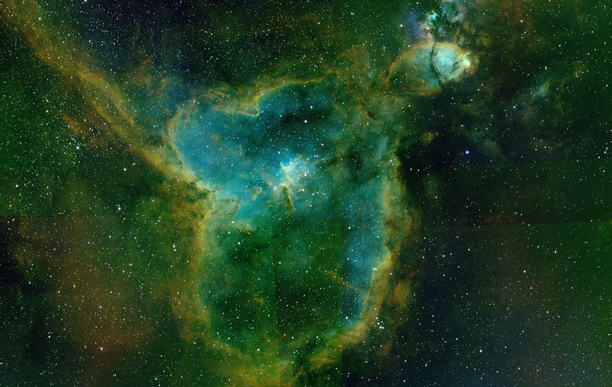
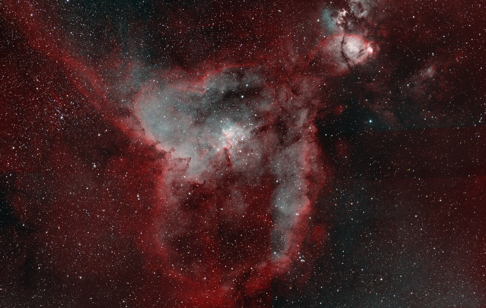

# Heart and Soul mosaic examples

Open `index.html` to compare two examples. The page works offline. The images
below are 1600-pixel JPEG previews; the Dropbox copy also includes the full-size
PNG files under `full-size/` and the requests/job reports under `reports/`.

| Example | Processing |
| --- | --- |
| [H-alpha mosaic](images/ha.jpg) | All four panels on one canvas; automatic display stretch. |
| [RGB](images/rgb.jpg) | Default color processing from the R, G and B mosaics. |
| [SHO · shared Ha stretch](images/sho-shared.jpg) | One H-alpha stretch, original narrowband stars, balance off. |
| [SHO · balanced](images/sho-balanced.jpg) | Shared H-alpha stretch and OIII/SII balance; original narrowband stars. |
| [HOO · balanced](images/hoo-balanced.jpg) | Shared H-alpha stretch and OIII balance; original narrowband stars. |
| [SHO · RGB stars](images/sho-rgb-stars.jpg) | Balanced SHO nebula with RGB stars through StarXTerminator. |
| [HOO · RGB stars](images/hoo-rgb-stars.jpg) | Balanced HOO nebula with RGB stars through StarXTerminator. |
| [SHO · Automatic stars](images/sho-automatic-stars.jpg) | Automatic selected RGB stars for the available mosaic channels. |
| [SHO · starless](images/sho-starless.jpg) | Balanced SHO with the stars removed through StarXTerminator. |

## Source data

Four saved PSF Guard panel stacks per filter were mean-binned **4× per axis**
with matching FITS/WCS changes, then integrated through the expanded-canvas
path. This gallery uses those existing panel integrations; the raw-frame build
path has separate calibration, mapping and publication regressions.

| Filter | Accepted exposures in source panel stacks | Total source integration | Source calibration status |
| --- | ---: | ---: | --- |
| R | 240 | 40 min | none |
| G | 240 | 40 min | none |
| B | 240 | 40 min | none |
| HA | 163 | 13 h 35 min | applied |
| OIII | 180 | 15 h 0 min | applied |
| SII | 180 | 15 h 0 min | applied |

The sources contain **1,243 accepted exposures, 45 h 35 min** across all six
filters. Each channel mosaic accepted all four panel inputs. Source job IDs,
calibration states, image dimensions and checksums are in `examples.json`.
There is no separate L channel in this data set.

## Color processing

Eight color jobs ran through PSF Guard's tracked-job API on an isolated fixture.
They used the default display setup and an inscribed common-coverage crop.
Narrowband balance used shadow protection 1 and OIII/SII boosts 1; the reports
confirm that balance applied to OIII and, for SHO, SII. Each example
keeps its own crop, so compare features visually rather than subtracting PNGs.

The RGB-star and starless cases used licensed StarXTerminator on the CPU.
**Automatic** selected RGB and reused the explicit SHO case's two star-removal
artifacts. Gaia color calibration was unavailable because the fixture has no
fresh reference solve. Visible panel background seams remain in this data.

These examples cover the mosaic, display-balance and star-processing modes.
PSF Guard's continuum stage and combined LRGB+SHO blending remain pending in
[PSF Guard #993](https://github.com/theatrus/psf-guard/pull/993) and
[Seiza #368](https://github.com/theatrus/seiza/pull/368). Keep mosaic
[PR #994](https://github.com/theatrus/psf-guard/pull/994) in draft until those
prerequisites are ready. No Seiza release is part of this example work.

## Code and validation

The application was built from `162e1482` with a local Seiza validation merge
(`567e05d`) combining the pending continuum work with main's GPU interfaces.
The local Cargo overrides and development lockfile are excluded from the PR.
Both Seiza output-version suites passed unchanged, and binding parity passed.

The isolated fixture and generated outputs are separate from the live catalog
and original panel stacks. The offline Dropbox reports record each request,
completed job, resolved star mode, balance result and crop.
